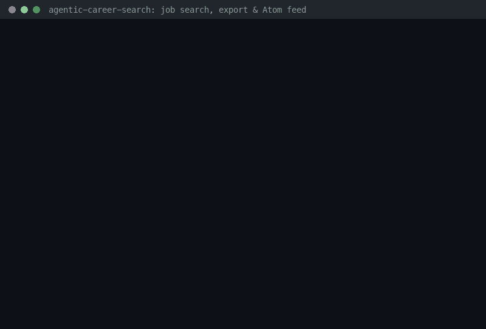
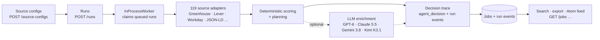

# agentic-career-search

   

**An agentic job-discovery backend that explains every decision.** Point it at public
career boards (119 ATS and job-board adapters: Greenhouse, Lever, Workday, Ashby,
SmartRecruiters, schema.org JSON-LD and more). A worker runs cancellable discovery runs
that score every posting and record why, then you search, export and subscribe to the
results.



## Why this exists

Job-search automation usually fails in practice because it:

- **can't explain its ranking** → every job stores a deterministic score, priority tier,
  matched terms, rationale and plan steps (`raw.agent_decision`);
- **breaks silently** → one adapter contract with timeouts, bounded scope and per-source
  `source.failed` events instead of a crashed script;
- **can't be steered** → runs follow a `queued → running → completed / cancelled / failed`
  state machine with cooperative cancellation and an ordered event log;
- **leaves results in a terminal** → JobSpy-style search, CSV/JSONL export and an Atom
  feed for Slack, Teams or any feed reader;
- **depends on one LLM** → enrichment is optional and works with the current OpenAI,
  Anthropic, Google and Kimi models, while the deterministic core runs offline.

## How it works



Every step is observable through `GET /runs/{run_id}/events`, and every stored job carries
its decision trace. See [ARCHITECTURE.md](ARCHITECTURE.md) for the state machine and
event types.

## 60-second quickstart

```bash
git clone https://github.com/Francis1998/agentic-career-search.git && cd agentic-career-search
uv sync --extra dev --frozen
export DATABASE_URL=sqlite+aiosqlite:///./demo.db

# Offline: seed demo jobs and serve them (no network, no keys)
uv run python scripts/seed_demo_jobs.py
ENABLE_WORKER=false uv run uvicorn autoapply_agent.main:app --port 8000 &

curl -s 'localhost:8000/jobs?q=python&remote=true&sort=score&dedupe=true' \
  | jq -c '.[] | [.title, .company, .score]'
curl -s -OJ 'localhost:8000/jobs/export?format=csv&min_score=0.7'    # spreadsheet-safe CSV
curl -s 'localhost:8000/jobs/feed.atom?remote=true' | head -20       # Atom feed
```

For live data, start the API with the worker enabled (omit `ENABLE_WORKER=false`), then
register a public board and start a run:

```bash
curl -s -X POST localhost:8000/source-configs -H 'content-type: application/json' \
  -d '{"name":"gitlab","source_type":"greenhouse","base_url":"https://boards.greenhouse.io/gitlab"}'
curl -s -X POST localhost:8000/runs -H 'content-type: application/json' \
  -d '{"query":"backend engineer python remote"}'
```

[PORTFOLIO_WALKTHROUGH.md](docs/guides/PORTFOLIO_WALKTHROUGH.md) follows one real search
end to end, and [QUICKSTART.md](QUICKSTART.md) covers setup details.

## Feature map

| Area | What you get | Docs |
|---|---|---|
| Sources | 119 adapters (ATS, job boards, vendor-neutral JSON-LD) behind one `CareerSourceAdapter` contract | [Supported sources](docs/SUPPORTED_SOURCES.md) |
| Runs | Queue, worker, cooperative cancel, ordered run events | [ARCHITECTURE.md](ARCHITECTURE.md) |
| Decisions | Deterministic score, priority tier, matched terms, rationale, plan steps per job | [ARCHITECTURE.md](ARCHITECTURE.md) |
| Search & export | Filters, `X-Total-Count` paging, cross-board dedupe, OWASP-safe CSV, JSON Lines, Atom 1.0 | [Search & export guide](docs/guides/JOB_SEARCH_EXPORT_GUIDE.md) |
| LLM enrichment | Optional summaries from GPT-6, Claude 5.5, Gemini 3.8 or Kimi K3.1 | [CONFIGURATION.md](CONFIGURATION.md) |
| Alerts | Fail-soft webhook for high-priority jobs (Slack, Discord, custom) | [CONFIGURATION.md](CONFIGURATION.md) |
| Career toolkit | 175+ offline, human-in-the-loop helpers (fit, salary bands, interview prep, offer and benefit gap advisors) | [Use-case catalog](docs/USE_CASE_CATALOG.md) |
| Operations | Health probes, Alembic migrations, CI (ruff, mypy, pytest), weekly security scan | [DEPLOYMENT.md](docs/DEPLOYMENT.md) |

## LLM enrichment (current model stack)

Provider integration is built into the code path and is optional: deterministic scoring
and decision traces work without any key. Defaults track the current model line-ups
(verified 2026-11-06):

| Provider | `LLM_PROVIDER` | Default model | Request shape |
|---|---|---|---|
| [OpenAI](https://developers.openai.com/api/docs/guides/latest-model) | `gpt` | `gpt-6-luna` | Chat Completions; `reasoning_effort` from `OPENAI_REASONING_EFFORT` (`none`, so `temperature` is allowed); `gpt-6.1-sol` / `gpt-6-astra` need `low` or higher |
| [Anthropic](https://platform.claude.com/docs/en/models/overview) | `claude` | `claude-haiku-5-5` | Messages API; `output_config.effort` from `CLAUDE_EFFORT` (`low`); no sampling parameters (Claude 5.5 returns 400 for them) |
| [Google](https://aistudio.google.com/docs/models) | `gemini` | `gemini-3.8-flash` | `generateContent`; `thinkingLevel: LOW` on Gemini 3+; no sampling parameters |
| [Moonshot Kimi](https://platform.kimi.ai/docs/api/models-overview.md) | `kimi` | `kimi-k3.1-pro` | OpenAI-compatible; `reasoning_effort: low`; `temperature` is fixed at 1.0 by K3 and never sent |

Larger options: `gpt-6.1-sol` / `gpt-6-astra`, `claude-sonnet-5-5` / `claude-opus-5-5`,
`gemini-4-argon`, `kimi-k3.1-pro-highspeed`. Kimi K2 models are being retired. See each
provider's page for pricing.

Enable provider enrichment:

```env
LLM_ENABLE_ENRICHMENT=true
LLM_PROVIDER=gemini   # or kimi / claude / gpt
```

Then set matching API keys in `.env` (see `CONFIGURATION.md`).

## API at a glance

- `POST /source-configs` create source adapter configs
- `GET /source-configs` list enabled sources
- `POST /runs` enqueue autonomous run
- `GET /runs/{run_id}` inspect run state
- `GET /runs/{run_id}/events` inspect event timeline
- `POST /runs/{run_id}/cancel` request cancellation
- `GET /jobs` search normalized, scored, and enriched outputs (`q`, `company`, `location`, `remote`, `min_score`, `source_config_id`, `run_id`, `created_after`, `hours_old`, `sort`, `dedupe`, `limit`/`offset`)
- `GET /jobs/{job_id}` inspect one job
- `GET /jobs/export?format=csv|jsonl` stream filtered results as a download
- `GET /jobs/feed.atom` subscribe to new matches (Atom 1.0)
- `GET /health/live` and `GET /health/ready`

## Documentation

| Document | What it covers |
|---|---|
| [QUICKSTART.md](QUICKSTART.md) | Local setup and a first run |
| [docs/guides/PORTFOLIO_WALKTHROUGH.md](docs/guides/PORTFOLIO_WALKTHROUGH.md) | One real job search, end to end |
| [docs/guides/JOB_SEARCH_EXPORT_GUIDE.md](docs/guides/JOB_SEARCH_EXPORT_GUIDE.md) | Filters, CSV/JSONL export, Atom feed |
| [ARCHITECTURE.md](ARCHITECTURE.md) | Components, run lifecycle, events |
| [docs/API.md](docs/API.md) | HTTP API reference |
| [CONFIGURATION.md](CONFIGURATION.md) | Environment variables and provider profiles |
| [docs/SUPPORTED_SOURCES.md](docs/SUPPORTED_SOURCES.md) | Every source adapter |
| [docs/USE_CASE_CATALOG.md](docs/USE_CASE_CATALOG.md) | Advisor and use-case catalog, demo gallery |
| [SAFETY.md](SAFETY.md) | Scope boundaries and guardrails |
| [docs/DEPLOYMENT.md](docs/DEPLOYMENT.md) | Deployment and migrations |
| [docs/TROUBLESHOOTING.md](docs/TROUBLESHOOTING.md) | Common failures |
| [CONTRIBUTING.md](CONTRIBUTING.md) | Development workflow |
| [CHANGELOG.md](CHANGELOG.md) | Release history |

## License

MIT © [Francis1998](https://github.com/Francis1998)
