# Use-case & advisor catalog

> Moved verbatim from the README on 2026-11-07 to keep the README focused; only
> relative link targets were rebased from the repository root to `docs/`.

New advisor, use-case and demo entries belong in this file, not in the README (see [CONTRIBUTING.md](../CONTRIBUTING.md)).

## Demo Gallery

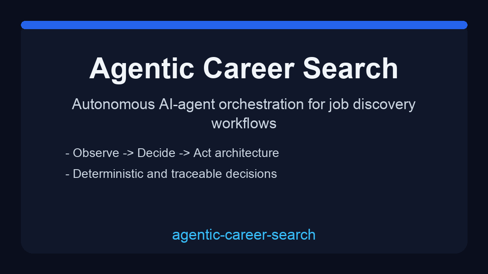


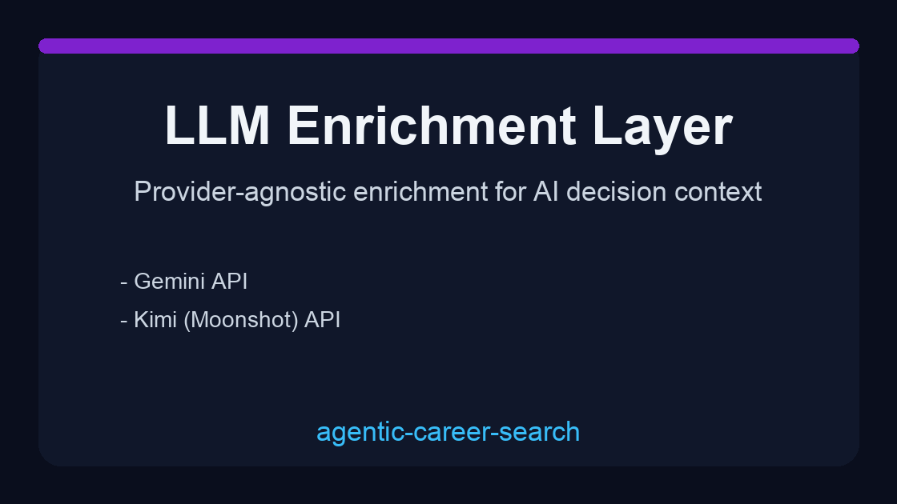

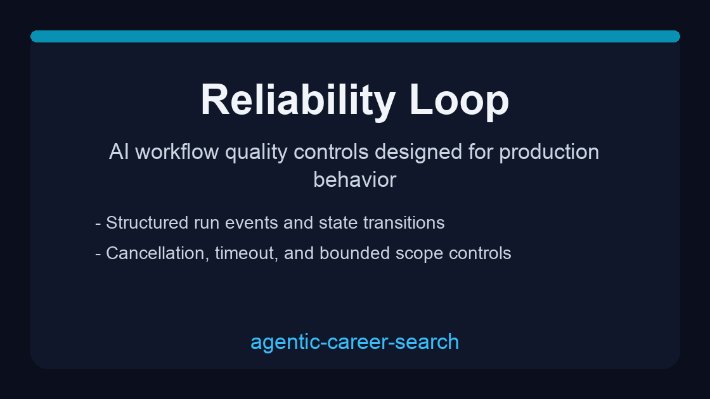

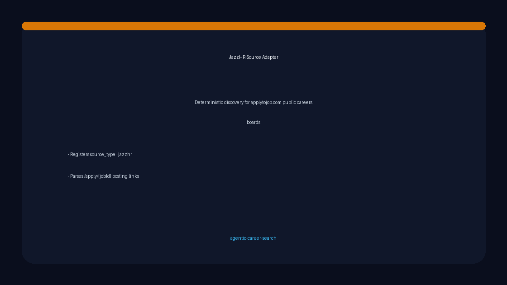

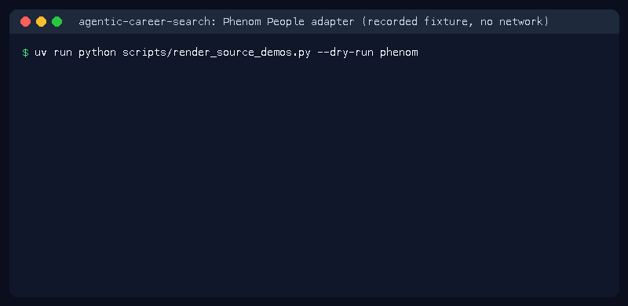


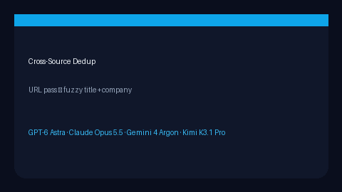

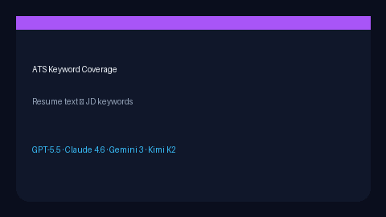

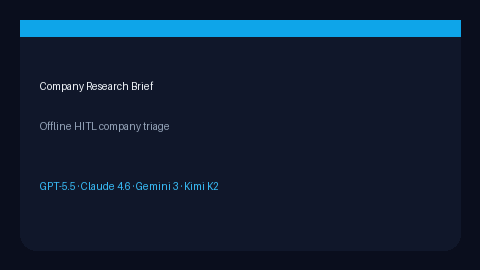

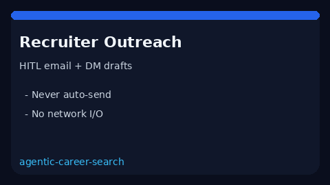


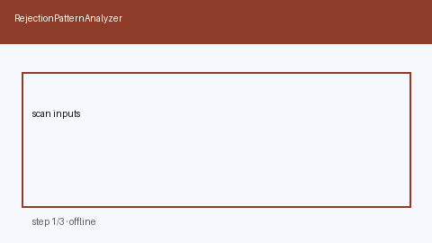
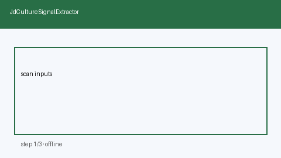

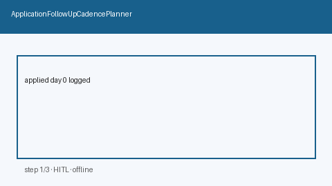

## Why this exists

Most job-search automation demos fail in real usage because they:
- cannot explain why a role is ranked highly,
- cannot recover cleanly when providers fail,
- have no durable event trace for debugging,
- become hard to maintain once features grow.

This project solves those issues with explicit agent engineering primitives:
- deterministic decision engine with rationale traces,
- state-machine run lifecycle and durable event log,
- tool/adapters abstraction for external integrations,
- safety controls (timeouts, bounded scope, cancellation),
- optional LLM enrichment via multiple providers,
- JobSpy-style job search API (text/company/location/remote/score/time filters, paging with `X-Total-Count`, cross-board dedupe), OWASP-safe CSV + JSON Lines export, and an Atom feed for Slack/Teams/feed readers — see `docs/guides/JOB_SEARCH_EXPORT_GUIDE.md`,
- skills-profile fit scoring (`fit_score` 0–1 + matched/missing) — see `docs/guides/SKILLS_PROFILE_FIT_GUIDE.md`,
- assistive USD salary-band estimates from title/location heuristics — see `docs/guides/SALARY_BAND_ESTIMATOR_GUIDE.md`,
- HITL application drafts (resume bullets + cover notes) with no auto-submit — see `docs/guides/APPLICATION_DRAFT_SERVICE_GUIDE.md`,
- CRM-lite application stage tracker (`saved→applied→interview→offer`) — see `docs/guides/APPLICATION_STAGE_TRACKER_GUIDE.md`,
- interview-prep briefs (likely questions + STAR prompts + focus gaps) — see `docs/guides/INTERVIEW_PREP_BRIEF_GUIDE.md`,
- cross-source fuzzy dedup (title+company beyond URL) — see `docs/guides/CROSS_SOURCE_JOB_DEDUP_GUIDE.md`,
- ATS keyword coverage (resume text ↔ JD keywords) — see `docs/guides/ATS_KEYWORD_COVERAGE_GUIDE.md`,
- company research briefs (talking points + JD signals, HITL) — see `docs/guides/COMPANY_RESEARCH_BRIEF_GUIDE.md`,
- HITL recruiter outreach drafts (email + LinkedIn DM, never auto-send) — see `docs/guides/RECRUITER_OUTREACH_DRAFT_GUIDE.md`,
- HITL referral intro drafts (warm email + LinkedIn, never auto-send) — see `docs/guides/REFERRAL_INTRO_DRAFT_GUIDE.md`,
- negotiation talking points (total-comp counters, HITL) — see `docs/guides/NEGOTIATION_TALKING_POINTS_GUIDE.md`,
- post-interview debrief briefs (strengths + gaps + follow-ups, HITL) — see `docs/guides/INTERVIEW_FEEDBACK_SYNTH_GUIDE.md`,
- offer deadline countdowns + HITL reminders (never auto-decline) — see `docs/guides/OFFER_DEADLINE_TRACKER_GUIDE.md`,
- portfolio bullet ↔ JD theme matching (HITL token overlap) — see `docs/guides/PORTFOLIO_PROJECT_MATCHER_GUIDE.md`,
- interview schedule conflict advisory (local overlap detection; never writes calendars) — see `docs/guides/INTERVIEW_SCHEDULE_CONFLICT_GUARD_GUIDE.md`,
- HITL rejection-pattern themes from offline notes (never auto-rewrites resumes) — see `docs/guides/REJECTION_PATTERN_ANALYZER_GUIDE.md`,
- HITL post-apply follow-up cadence (day offsets + channels; never auto-nudge) — see `docs/guides/APPLICATION_FOLLOWUP_CADENCE_GUIDE.md`,

## Real use cases (problem -> solution)

| Problem | Why it hurts | How this repo solves it |
|---|---|---|
| Teams can scrape jobs but cannot justify recommendations | Low trust from users and reviewers | `AgentDecisionEngine` stores score, matched terms, priority tier, and rationale |
| Background runs are hard to debug | Silent failures block iteration speed | Durable run events (`run.*`, `source.*`, `agent.*`) support replay-style troubleshooting |
| Vendor lock-in around one model provider | High migration cost and brittle integrations | Configurable LLM enrichment supports GPT-5.5, Claude Sonnet 4.6, Gemini 3.x, and Kimi K2-style APIs |
| Model/API outages break the entire flow | System appears unreliable | Graceful fallback preserves deterministic baseline output when LLM enrichment is unavailable |
| Scraped jobs pile up without a pipeline CRM | Candidates lose track of where each role stands | `ApplicationStageTracker` enforces an auditable saved→offer stage machine |
| Postings omit pay and scrapers leave empty salary fields | Candidates cannot triage roles by compensation | `SalaryBandEstimator` produces an auditable USD band from title/location heuristics |
| Candidates discover roles but arrive unprepared for interviews | Weak signal conversion after outreach | `InterviewPrepBriefService` builds likely questions, STAR prompts, and focus gaps for human review |
| Same role appears on Indeed + LinkedIn with different URLs | Duplicate noise in triage and CRM | `CrossSourceJobDeduper` clusters fuzzy title+company near-duplicates after URL pass |
| Resume free text is not scored against JD keywords | ATS rejection risk is opaque | `AtsKeywordCoverageScorer` reports coverage + present/missing JD keywords |
| Candidates research companies ad hoc before outreach | Inconsistent talking points and invented facts | `CompanyResearchBriefService` builds offline HITL briefs from JD signals |
| Multiple offers lack a side-by-side total-comp view | Hard to triage cash vs equity trade-offs offline | `OfferCompareMatrix` ranks offers by cash+equity heuristic without auto-accept |
| RemoteOK-style location prefs are board-UI-only | Hard to reuse geo/remote filters in agent triage | `LocationRemoteFitScorer` scores candidate prefs vs posting location/policy |

| Outreach templates and Easy Apply auto-send without review | Accidental spam and irreversible messages | `RecruiterOutreachDraftService` builds email/LinkedIn drafts that always require human review |
| Warm intros are ad-hoc or auto-sent via InMail templates | Burned connectors and irreversible messages | `ReferralIntroDraftService` builds email/LinkedIn intro drafts that always require human review |
| Counter-offers are improvised from Levels.fyi / Blind threads | Inconsistent anchors and accidental over-ask | `NegotiationTalkingPointsService` builds HITL talking points from current vs target total-comp |
| Interview notes stay unstructured after loops | Weak conversion and lost signal | `InterviewFeedbackSynthesizer` builds HITL debriefs with strengths/gaps/follow-ups |
| Offer deadlines are tracked only in Teal/Huntr without local countdown | Missed responses or accidental auto-decline risk | `OfferDeadlineTracker` computes offline urgency + HITL reminders and never auto-declines |
| Portfolio bullets are hand-aligned to JD themes in Teal/Jobscan UIs | Hard to reuse theme mapping in agentic triage | `PortfolioProjectMatcher` scores offline bullet↔theme token overlap for HITL review |
| Teal/Huntr calendar sync auto-writes interview events | Accidental double-booking without local HITL review | `InterviewScheduleConflictGuard` detects offline overlaps and never mutates calendars |
| Teal/Careerflow thank-you templates encourage one-click sends | Accidental recruiter spam after interviews | `ThankYouNoteOutlinePlanner` builds offline email/LinkedIn outlines and never auto-sends |
| Teal/Huntr show quiet apps only inside proprietary CRM UIs | Follow-ups are ad-hoc or accidentally auto-sent | `ApplicationGhostingDetector` computes offline stall urgency + HITL suggestions and never auto-nudges |
| Teal Insights / Huntr analytics keep apply-volume coaching in closed UIs | Burnout from spray-and-pray without local pace bands | `WeeklyApplicationPaceAdvisor` compares planned vs target apps offline and never auto-submits |
| Teal Insights / Huntr keep rejection analytics in closed dashboards | Candidates repeat the same miss without a local theme map | `RejectionPatternAnalyzer` clusters offline rejection reasons into HITL themes and never auto-rewrites resumes |
| Teal/LinkedIn bury JD culture cues inside proprietary insight panels | Candidates miss pace/on-call/collab signals before applying | `JdCultureSignalExtractor` extracts offline culture cues for HITL review and never auto-applies |
| Simplify/Teal/LinkedIn bury visa sponsorship filters behind login walls | Candidates waste cycles on citizenship-only or no-sponsor roles | `VisaSponsorshipSignalExtractor` extracts offline work-auth cues for HITL review and never auto-applies |
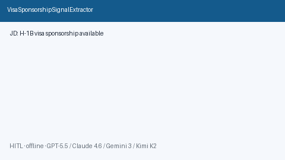
| Teal Insights / Jobscan / Resume Worded lock bullet-impact scoring in closed UIs | Candidates keep weak adjective-only bullets without a local metric map | `ResumeBulletImpactScorer` scores offline %/$/scale cues for HITL edits and never auto-rewrites |
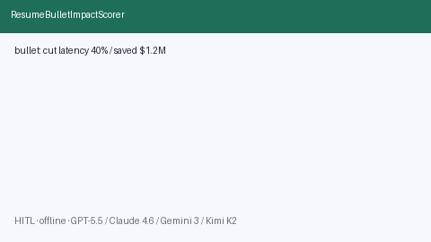
| Teal/Huntr/Superhuman keep recruiter-reply intent labels in proprietary inboxes | Candidates misread scheduling vs rejection tone without a local classifier | `RecruiterReplyIntentClassifier` classifies offline reply intents for HITL responses and never auto-sends |
| Teal/Rezi/Kickresume lock cover-letter tone matchers in closed UIs | Candidates send mismatched tone vs JD pace/culture | `CoverLetterToneAligner` scores offline tone bands for HITL edits and never auto-sends |

| Careerflow/Taplio/LinkedIn Premium lock headline graders in closed UIs | Candidates publish keyword-weak headlines without a local coverage map | `LinkedInHeadlineKeywordScorer` scores offline headline↔role keywords for HITL edits and never auto-posts |

| Interviewing.io/Exponent/Teal lock phone-screen agendas in closed UIs | Candidates improvise screens without a local minute map | `PhoneScreenAgendaPlanner` builds offline JD-driven agendas for HITL rehearsal and never auto-books |

| Interviewing.io/Exponent/Teal lock behavioral STAR banks in closed UIs | Candidates improvise stories without a local competency map | `StarBehavioralStoryMatcher` matches offline STAR banks to JD cues for HITL rehearsal and never auto-sends |
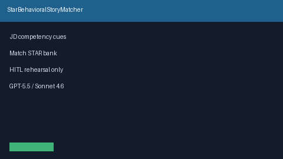
| Teal/Huntr/Simplify lock packet checklists in closed CRMs | Candidates submit incomplete packets without a local gate | `ApplicationPacketCompletenessGate` checks offline resume/cover/portfolio readiness for HITL submit and never auto-submits |

| RemoteOK/FlexJobs/WWR bury timezone filters behind proprietary boards | Candidates misjudge remote sync fit across offsets | `RemoteTimezoneOverlapAdvisor` bands offline weekday overlap hours for HITL review and never auto-applies |

| Huntr/Teal/Jobtracker lock multi-round interview boards in closed CRMs | Candidates lose track of phone→HM→onsite→offer without a local state machine | `InterviewRoundProgressTracker` tracks offline allowed round transitions for HITL review and never auto-advances |

| Levels.fyi/Candor/Carta lock vesting calculators in closed UIs | Candidates misread cliff/unvested risk without a local schedule | `EquityVestingCliffAdvisor` bands offline cliff + linear vest progress for HITL review and never auto-accepts |

| Levels.fyi/Blind/Candor bury on-call pay math in closed UIs | Engineers accept thin rotations without a local value band | `OnCallStipendGapAdvisor` bands offline stipend vs on-call load for HITL review and never auto-accepts |
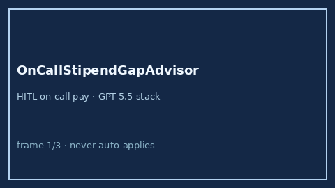
| Levels.fyi/Candor/Blind bury target-bonus math in closed UIs | Candidates under-negotiate bonus without a local gap band | `PerformanceBonusTargetGapAdvisor` bands offline offered vs market target % for HITL review and never auto-accepts |
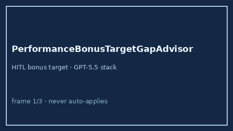
| Rippling/Levels.fyi/Candor bury home-office stipend math in closed UIs | Candidates underfund desks without a local coverage band | `HomeOfficeStipendGapAdvisor` bands offline stipend vs setup cost for HITL review and never auto-accepts |
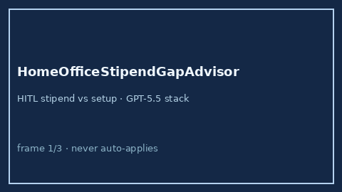
| Fidelity/HealthEquity/Levels.fyi bury HSA contribution room in closed UIs | Employees leave IRS room unused without a local gap band | `HsaContributionGapAdvisor` bands offline YTD vs IRS limit for HITL review and never auto-enrolls |
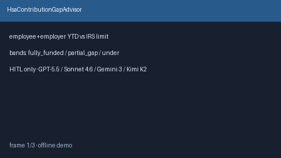
| Carta/Pulley/Levels.fyi bury ISO AMT bargain-element math in closed UIs | Employees trigger surprise AMT without a local exposure band | `IsoAmtExposureAdvisor` bands offline bargain element vs exemption for HITL review and never auto-exercises |
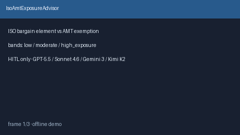
| Fidelity/HealthEquity/Levels.fyi bury COBRA premium runway math in closed UIs | Workers underfund continuation months without a local bridge band | `CobraContinuationGapAdvisor` bands offline premium×months vs bridge for HITL review and never auto-enrolls |

| Fidelity/Carta/Levels.fyi bury NQDC deferral cliff math in closed UIs | Employees surprise-distributions without a local cliff band | `NqdcDeferralCliffAdvisor` bands offline years-to-cliff vs deferral for HITL review and never auto-elects |
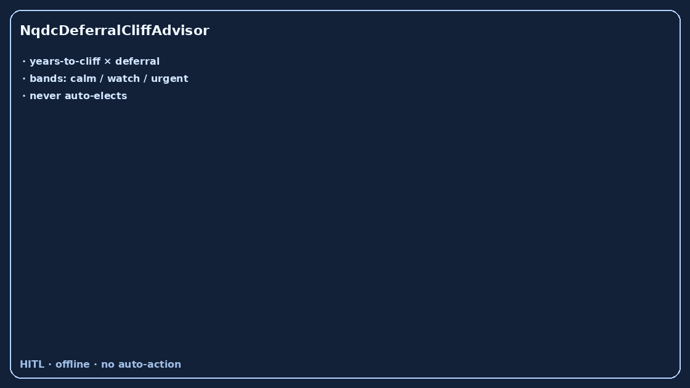
| Lattice/Workday/Levels.fyi bury bereavement leave math in closed UIs | Workers under-provision grief days without a local coverage band | `BereavementLeaveGapAdvisor` bands offline offered vs needed days for HITL review and never auto-approves |
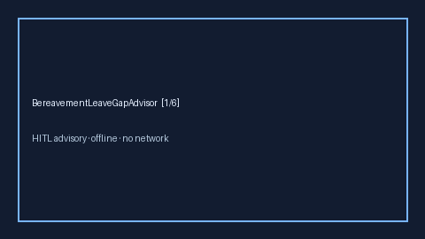
| Student Loan Hero/Rippling/Levels.fyi bury employer SLPRP math in closed UIs | Workers underfund loan payments without a local contribution band | `StudentLoanRepaymentGapAdvisor` bands offline payment vs employer contribution for HITL review and never auto-enrolls |

| Clerky/Blind/Levels.fyi bury non-compete geographic-scope math in closed UIs | Candidates over-accept geo restrictions without a local radius band | `NonCompeteGeoScopeAdvisor` bands offline restricted vs acceptable radius for HITL review and never auto-signs |
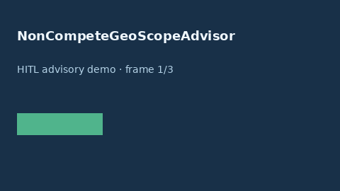
| Fidelity/Vanguard/Schwab bury 401k match vesting-cliff math in closed UIs | Workers forfeit match without a local vested-pct coverage band | `Four01kMatchVestingCliffAdvisor` bands offline vested match vs target for HITL review and never auto-enrolls |
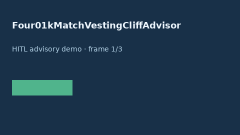
| Lattice/Rippling/Justworks bury eldercare leave math in closed UIs | Caregivers under-provision leave without a local days band | `EldercareLeaveDaysGapAdvisor` bands offline offered vs needed eldercare days for HITL review and never auto-approves |
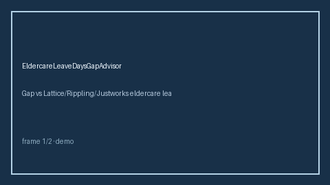
| Levels.fyi/Blind/Rippling bury meal stipend math in closed UIs | Workers underfund meals without a local stipend band | `MealStipendGapAdvisor` bands offline stipend vs food cost for HITL review and never auto-claims |
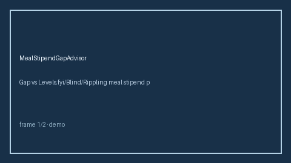
| Clerky/Blind/Levels.fyi bury garden-leave math in closed UIs | Candidates under-negotiate transition buffers without a local days band | `GardenLeaveGapAdvisor` bands offline garden-leave vs needed transition days for HITL review and never auto-accepts |

| Levels.fyi/Blind/Rippling bury retention-bonus cliff math in closed UIs | Workers forfeit retention bonuses without a local months-to-cliff band | `RetentionBonusCliffAdvisor` bands offline months-to-cliff vs buffer for HITL review and never auto-resigns |

| Carta/Pulley bury equity blackout-window math in closed UIs | Workers mistime liquidity without a local blackout-vs-plan days band | `EquityBlackoutWindowAdvisor` bands offline blackout days vs planned liquidity for HITL review and never auto-trades |

| Carta/Pulley/Levels.fyi bury RSU refresh-cliff math in closed UIs | Workers mistime resignations without a local months-to-cliff band | `RsuRefreshCliffAdvisor` bands offline months-to-refresh-cliff vs buffer for HITL review and never auto-resigns |

| Remotive/Levels.fyi/Blind bury commute time-value math in closed UIs | Candidates underweight opportunity cost of commute hours without a local $/week band | `CommuteTimeValueAdvisor` bands offline weekly commute hours × opportunity cost for HITL review and never auto-accepts |

| Levels.fyi/Blind/Rippling sign-on clawback planners bury related math in closed UIs | Workers lack a local clawback_months vs needed_months band | `SignOnClawbackGapAdvisor` bands offline clawback_months vs needed_months for HITL review and never auto-enrolls |

| Rippling/Gusto/Levels.fyi PTO carryover-cap planners bury related math in closed UIs | Workers lack a local carryover_hours vs needed_hours band | `PtoCarryoverCapGapAdvisor` bands offline carryover_hours vs needed_hours for HITL review and never auto-enrolls |
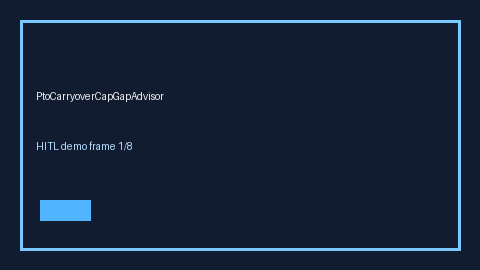
| Levels.fyi/Blind/Rippling year-end bonus pro-rata planners bury related math in closed UIs | Workers lack a local prorata_pct vs target_pct band | `YearEndBonusProrataGapAdvisor` bands offline prorata_pct vs target_pct for HITL review and never auto-enrolls |

| Carta/Pulley/Levels.fyi IPO lockup-release planners bury related math in closed UIs | Workers lack a local days_to_lockup_end vs needed_liquidity_days band | `IpoLockupReleaseGapAdvisor` bands offline days_to_lockup_end vs needed_liquidity_days for HITL review and never auto-enrolls |
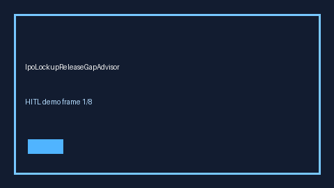
| Carta/Schwab/Fidelity RSU supplemental-withholding gap planners bury related math in closed UIs | Workers lack a local withheld_rate vs marginal_rate band | `RsuSupplementalWithholdingGapAdvisor` bands offline withheld_rate vs marginal_rate for HITL review and never auto-enrolls |
| Carta/Pulley/Levels.fyi equity forfeiture-on-PIP planners bury related math in closed UIs | Workers lack a local protected_equity_usd vs unvested_equity_usd band | `EquityForfeitureOnPipGapAdvisor` bands offline protected_equity_usd vs unvested_equity_usd for HITL review and never auto-enrolls |

| Fidelity/Vanguard/Rippling 401(k) match true-up planners bury related math in closed UIs | Workers lack a local true_up_credited_usd vs true_up_owed_usd band | `Four01kMatchTrueUpGapAdvisor` bands offline true_up_credited_usd vs true_up_owed_usd for HITL review and never auto-enrolls |

| Rippling/Gusto/Care.com childcare-subsidy planners bury related math in closed UIs | Workers lack a local offered_subsidy_usd vs needed_subsidy_usd band | `ChildcareSubsidyGapAdvisor` bands offline offered_subsidy_usd vs needed_subsidy_usd for HITL review and never auto-enrolls |

| Levels.fyi/Blind/Rippling unlimited-PTO utilization planners bury related math in closed UIs | Workers lack a local days_taken vs peer_median_days band | `UnlimitedPtoUtilizationGapAdvisor` bands offline days_taken vs peer_median_days for HITL review and never auto-enrolls |

| Rippling/Culture Amp/Lattice conference-budget planners bury related math in closed UIs | Workers lack a local offered_budget_usd vs needed_budget_usd band | `ConferenceBudgetGapAdvisor` bands offline offered_budget_usd vs needed_budget_usd for HITL review and never auto-enrolls |

| Levels.fyi/Blind/Rippling summer-Friday planners bury related math in closed UIs | Workers lack a local offered_fridays vs peer_median_fridays band | `SummerFridayGapAdvisor` bands offline offered_fridays vs peer_median_fridays for HITL review and never auto-enrolls |

| Rippling/Gusto/BambooHR floating-holiday planners bury related math in closed UIs | Workers lack a local offered_days vs needed_days band | `FloatingHolidayGapAdvisor` bands offline offered_days vs needed_days for HITL review and never auto-enrolls |

| Benevity/YourCause/CyberGrants charitable-match planners bury related math in closed UIs | Workers lack a local `match_usd` vs `donation_usd` band | `CharitableMatchGapAdvisor` bands offline `match_usd` vs `donation_usd` for HITL review and never auto-enrolls |

| Rippling/Culture Amp/Total Rewards LSA planners bury related math in closed UIs | Workers lack a local `offered_usd` vs `needed_usd` band | `LifestyleSpendingAllowanceGapAdvisor` bands offline `offered_usd` vs `needed_usd` for HITL review and never auto-enrolls |

| Progyny/Carrot/Maven fertility-travel stipend planners bury related math in closed UIs | Workers lack a local `offered_usd` vs `needed_usd` band | `FertilityTravelStipendGapAdvisor` bands offline `offered_usd` vs `needed_usd` for HITL review and never auto-enrolls |

| Maven/Carrot/Progyny menopause-benefit planners bury related math in closed UIs | Workers lack a local `offered_usd` vs `needed_usd` band | `MenopauseBenefitGapAdvisor` bands offline `offered_usd` vs `needed_usd` for HITL review and never auto-enrolls |

| Lattice/Rippling/BambooHR pet-bereavement leave planners bury related math in closed UIs | Workers lack a local offered_days vs needed_days band | `PetBereavementLeaveGapAdvisor` bands offline `offered_days` vs `needed_days` for HITL review and never auto-approves |

| Rippling/WellnessLiving/Levels.fyi gym-membership planners bury related math in closed UIs | Workers lack a local offered_usd vs needed_usd band | `GymMembershipGapAdvisor` bands offline `offered_usd` vs `needed_usd` for HITL review and never auto-enrolls |

| Rippling/Guild/Levels.fyi learning-stipend planners bury related math in closed UIs | Workers lack a local offered_usd vs needed_usd band | `LearningStipendGapAdvisor` bands offline `offered_usd` vs `needed_usd` for HITL review and never auto-enrolls |

| Rippling/Gusto/Levels.fyi parking-stipend planners bury related math in closed UIs | Workers lack a local offered_parking_usd vs needed_parking_usd band | `ParkingStipendGapAdvisor` bands offline offered_parking_usd vs needed_parking_usd for HITL review and never auto-enrolls |


| Carta/Pulley/Levels.fyi ISO early-exercise AMT ladder planners bury related math in closed UIs | Workers lack a local ladder_years vs needed_years band | `IsoEarlyExerciseAmtLadderAdvisor` bands offline ladder_years vs needed_years for HITL review and never auto-enrolls |

| Clerky/Blind/Levels.fyi notice-period buyout planners bury related math in closed UIs | Candidates underfund notice buyouts without a local weeks band | `NoticePeriodBuyoutGapAdvisor` bands offline buyout_weeks vs needed_weeks for HITL review and never auto-enrolls |

| NerdWallet/Levels.fyi/Blind severance COBRA top-up planners bury related math in closed UIs | Workers underfund COBRA top-ups without a local months band | `SeveranceCobraTopupGapAdvisor` bands offline topup_months vs needed_months for HITL review and never auto-enrolls |

| Rippling/Gusto/Levels.fyi bury PTO accrual-cliff math in closed UIs | Workers mistime leave without a local accrued-vs-cliff hours band | `PtoAccrualCliffAdvisor` bands offline accrued hours vs cliff for HITL review and never auto-enrolls |

| Fidelity/Schwab/Carta bury ESPP lookback-discount math in closed UIs | Workers underfund ESPP without a local lookback-discount coverage band | `EsppLookbackGapAdvisor` bands offline lookback discount vs target for HITL review and never auto-enrolls |

| NerdWallet/Levels.fyi/Blind bury housing allowance math in closed UIs | Candidates underfund rent without a local allowance band | `HousingAllowanceGapAdvisor` bands offline allowance vs housing cost for HITL review and never auto-claims |

| Levels.fyi/NerdWallet/Blind bury COL-adjusted offer math in closed UIs | Candidates mis-rank offers without a local COL-adjusted coverage band | `ColAdjustedOfferAdvisor` bands offline offer vs COL-adjusted target for HITL review and never auto-accepts |

| Clerky/Carta/Blind bury side-project IP assignment math in closed UIs | Candidates over-assign side-project IP without a local retain band | `SideProjectIpAssignmentAdvisor` bands offline retained vs target IP pct for HITL review and never auto-assigns |
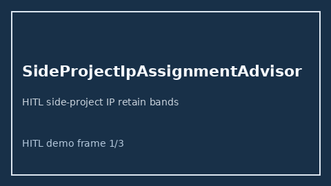
| Rippling/Gusto/Levels.fyi bury paid-family-leave state-mandate math in closed UIs | Workers under-provision leave without a local employer-vs-state week band | `PaidFamilyLeaveStateGapAdvisor` bands offline employer vs state-mandated weeks for HITL review and never auto-approves |
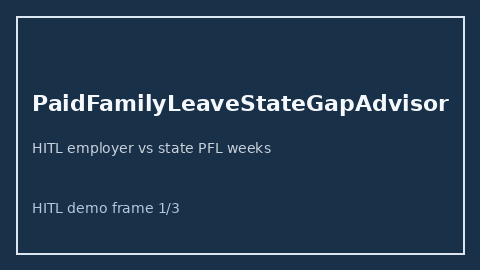
| Boundless/MyVisaJobs/Trackitt bury green-card sponsorship timeline math in closed UIs | Candidates mis-time GC filings without a local sponsorship-months band | `GreenCardSponsorshipTimelineAdvisor` bands offline sponsored vs wait months for HITL review and never auto-files |

| Figo/Trupanion/Levels.fyi/Blind bury pet insurance stipend math in closed UIs | Employees under-claim pet coverage without a local stipend band | `PetInsuranceGapAdvisor` bands offline vet cost vs employer pet stipend for HITL review and never auto-claims |

| Ladder/Wellhub/Levels.fyi/Blind bury wellness stipend math in closed UIs | Employees under-use wellness budgets without a local coverage band | `WellnessStipendGapAdvisor` bands offline wellness spend vs employer stipend for HITL review and never auto-claims |

| WageWorks/Fidelity/Levels.fyi bury Dependent Care FSA math in closed UIs | Caregivers underfund daycare without a local FSA room band | `DependentCareFsaGapAdvisor` bands offline daycare cost vs DCFSA limit for HITL review and never auto-enrolls |

| LegalShield/ARAG/Levels.fyi/Blind bury legal insurance plan math in closed UIs | Employees under-use legal plans without a local coverage band | `LegalInsuranceGapAdvisor` bands offline legal need vs employer plan value for HITL review and never auto-enrolls |

| Bright Horizons/Care.com/Levels.fyi bury backup-care day math in closed UIs | Caregivers under-provision school-closure coverage without a local day band | `BackupCareDaysGapAdvisor` bands offline needed vs employer backup-care days for HITL review and never auto-books |

| Rippling/Gusto/Levels.fyi bury remote-stipend tax math in closed UIs | Remote workers mis-budget net stipend without a local tax band | `RemoteWorkStipendTaxGapAdvisor` bands offline stipend vs tax withholding for HITL review and never auto-withholds |
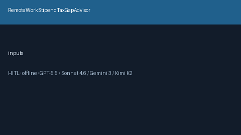
| YNAB/Mint/Levels.fyi bury emergency-fund runway math in closed UIs | Job seekers underfund runway without a local months band | `EmergencyFundRunwayAdvisor` bands offline liquid savings vs burn for HITL review and never auto-transfers |
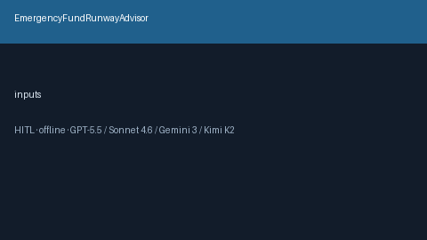
| Carta/Pulley/Levels.fyi bury post-termination option exercise-window math in closed UIs | Employees forfeit options without a local exercise-window band | `StockOptionExerciseWindowAdvisor` bands offline days-remaining vs min exercise window for HITL review and never auto-exercises |

| Carta/Levels.fyi/Blind bury change-of-control acceleration math in closed UIs | Employees under-negotiate double-trigger accel without a local coverage band | `ChangeOfControlAccelerationAdvisor` bands offline accelerated vs target pct for HITL review and never auto-accelerates |
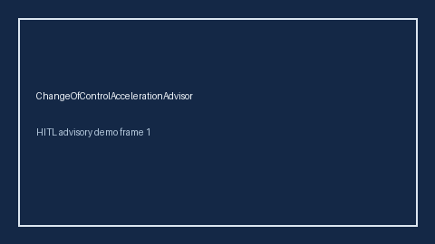
| Mercer/PwC/Levels.fyi bury tax-equalization / gross-up math in closed UIs | Relocating workers underfund cross-border tax without a local gross-up band | `TaxEqualizationGrossUpAdvisor` bands offline gross-up vs tax delta for HITL review and never auto-grosses-up |

| Levels.fyi/Blind/Rippling bury interview travel-stipend math in closed UIs | Candidates underfund onsite travel without a local stipend-coverage band | `InterviewTravelStipendGapAdvisor` bands offline stipend vs travel cost for HITL review and never auto-books |

| Levels.fyi/Blind/Candor bury offer-expiration urgency math in closed UIs | Candidates miss decision buffers without a local urgency band | `OfferExpirationUrgencyAdvisor` bands offline days-until-expire vs decision buffer for HITL review and never auto-declines |

| MyVisaJobs/H1BGrader/Boundless bury H-1B lottery odds math in closed UIs | Candidates misjudge selection odds without a local registration-coverage band | `H1bLotteryOddsAdvisor` bands offline selected vs target H-1B registrations for HITL review and never auto-registers |

| MyVisaJobs/Levels.fyi/Boundless bury visa timeline math in closed UIs | Candidates miss start dates without a local processing-band | `VisaTimelineGapAdvisor` bands offline days-to-start vs visa processing for HITL review and never auto-applies |
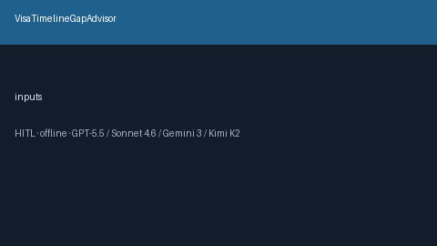
| MetLife/Guardian/Prudential/Levels.fyi bury life-insurance math in closed UIs | Employees under-insure dependents without a local coverage band | `LifeInsuranceCoverageGapAdvisor` bands offline income need vs employer life cover for HITL review and never auto-enrolls |

| Lyra/Spring Health/Modern Health/Levels.fyi bury EAP session-cap math in closed UIs | Employees under-use therapy sessions without a local coverage band | `MentalHealthEapSessionGapAdvisor` bands offline needed vs EAP session caps for HITL review and never auto-books |

| Benevity/VolunteerMatch/Levels.fyi/Blind bury volunteer-hours math in closed UIs | Employees miss volunteer-PTO without a local coverage band | `EmployeeVolunteerHoursGapAdvisor` bands offline needed vs employer volunteer hours for HITL review and never auto-logs |

| WageWorks/CommuterBenefits/TransitChek/Levels.fyi bury transit-benefit math in closed UIs | Commuters under-enroll transit benefits without a local coverage band | `TransitCommuteBenefitGapAdvisor` bands offline transit need vs employer benefit for HITL review and never auto-enrolls |

| Carrot/Progyny/Maven/Levels.fyi bury adoption-assistance math in closed UIs | Families underfund adoption costs without a local assistance band | `AdoptionAssistanceGapAdvisor` bands offline adoption cost vs employer assistance for HITL review and never auto-claims |
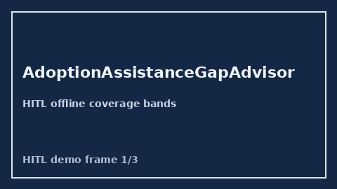
| Unum/MetLife/Guardian/Levels.fyi bury LTD disability math in closed UIs | Employees under-insure income replacement without a local LTD band | `LtdDisabilityGapAdvisor` bands offline income-replacement need vs employer LTD for HITL review and never auto-enrolls |
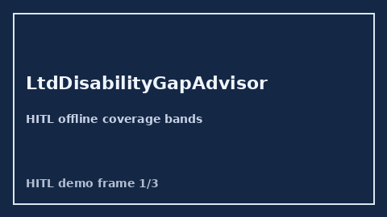
| Norton/LifeLock/Aura/Levels.fyi bury identity-theft benefit math in closed UIs | Employees under-enroll ID protection without a local coverage band | `IdentityTheftProtectionGapAdvisor` bands offline risk budget vs employer benefit for HITL review and never auto-enrolls |

| Levels.fyi/Blind/Carrot/Progyny bury fertility benefit math in closed UIs | Employees under-claim fertility coverage without a local cap band | `FertilityBenefitGapAdvisor` bands offline treatment cost vs employer cap for HITL review and never auto-claims |

| Levels.fyi/Blind/Candor bury tuition reimbursement math in closed UIs | Employees under-claim learning budgets without a local coverage band | `TuitionReimbursementGapAdvisor` bands offline tuition vs employer cap for HITL review and never auto-claims |

| Levels.fyi/Blind/Candor bury sabbatical tenure math in closed UIs | Employees miss leave windows without a local eligibility band | `SabbaticalEligibilityAdvisor` bands offline tenure vs policy for HITL review and never auto-approves |
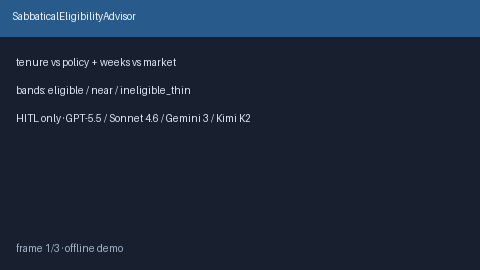
| Blind/Levels.fyi/RemoteOK bury commute vs stipend math in closed UIs | Candidates accept office terms without a local commute-cost band | `CommuteCostTradeoffAdvisor` bands offline commute vs stipend tradeoffs for HITL review and never auto-accepts |

| Rippling/Gusto/Candor bury PTO cash-out calculators in closed UIs | Employees misjudge payout vs use-it without a local cash-out band | `PtoCashOutValueAdvisor` bands offline unused-PTO cash-out value for HITL review and never auto-cashes |

| Levels.fyi/Fidelity/Candor bury 401(k) match calculators in closed UIs | Employees under-contribute without a local match-gap band | `FourOhOneKMatchGapAdvisor` bands offline employer vs market match dollars for HITL review and never auto-enrolls |
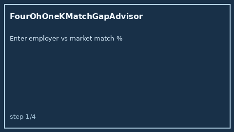
| Levels.fyi/Blind/Candor bury parental-leave week math in closed UIs | Candidates accept thin leave without a local coverage band | `ParentalLeaveGapAdvisor` bands offline offered vs market leave weeks for HITL review and never auto-accepts |

| Levels.fyi/Carta/Candor bury ESPP discount contribution math in closed UIs | Employees under-contribute without a local discount-value band | `EsppDiscountValueAdvisor` bands offline look-through discount value for HITL review and never auto-enrolls |

| Huntr/Teal/Levels.fyi bury counter-offer leverage scoring in closed UIs | Candidates under-negotiate without a local leverage band | `CounterOfferLeverageAdvisor` bands offline competing-offer leverage for HITL review and never auto-sends |

| Levels.fyi/Carta/Candor bury RSU refresh planners in closed UIs | Employees miss overdue refresh conversations without a local cadence band | `RsuRefreshCadenceAdvisor` bands offline years-since-refresh for HITL review and never auto-accepts |

| Huntr/Teal/Greenhouse bury notice vs start-date planners in closed UIs | Candidates accept starts that collide with contractual notice | `NoticePeriodConflictFlagger` bands offline notice vs preferred-start slack for HITL review and never auto-accepts |

| Levels.fyi/Blind/Candor bury severance week math in closed UIs | Candidates accept under-tenure packages without a local coverage band | `SeverancePackageGapAdvisor` bands offline offered vs expected weeks for HITL review and never auto-accepts |
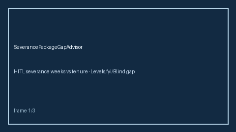
| Levels.fyi/Candor/Blind bury signing-bonus clawback math in closed UIs | Candidates misjudge repayment risk if they leave early | `SigningBonusClawbackAdvisor` bands offline remaining clawback liability for HITL review and never auto-accepts |

| Huntr/Teal/Levels.fyi bury relocation stipend math in closed UIs | Candidates accept underfunded moves without a local coverage band | `RelocationPackageGapAdvisor` bands offline stipend vs move-cost coverage for HITL review and never auto-accepts |

| Blind/Levels.fyi/Candor leave non-compete severity buried in closed UIs | Candidates accept long/broad covenants without a local severity band | `NonCompeteRestrictivenessFlagger` flags offline duration/geo/garden-leave cues for HITL review and never auto-accepts |

| Teal/Simplify/Huntr bury ghost-job detectors behind proprietary boards | Candidates waste cycles on evergreen/vague listings | `GhostJobSignalFlagger` flags offline evergreen/repost/vague-comp cues for HITL review and never auto-applies |

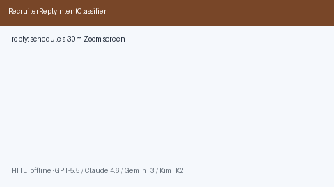
| Teal/Huntr bury post-apply follow-up calendars in closed CRMs | Candidates either spam or go silent without a local cadence | `ApplicationFollowUpCadencePlanner` emits offline day+channel HITL steps and never auto-nudges |
| Teal/Huntr bury post-interview reflection checklists in closed UIs | Lost signal and ad-hoc follow-ups after loops | `InterviewDebriefChecklist` builds offline what-went-well/gaps/follow-up checklists and never auto-sends |
| Teal/Simplify keep skill learning plans inside closed dashboards | Fit scores alone do not produce a practice path | `SkillGapLearningPathPlanner` emits ordered HITL milestones from have vs required skills and never enrolls |
| Teal/Huntr/Simplify hide posting age inside proprietary boards | Candidates waste time on stale evergreen listings | `JobPostingFreshnessScorer` bands age_days offline (fresh/aging/stale/expired) and never auto-applies |
| Repo quality degrades over time | Contributors lose confidence | CI checks + daily automation loop maintain quality and push incremental improvements |

## Engineering standards covered

This repository follows the requested standards:
1. standalone repo architecture (not coupled to source repo internals),
2. AI-agent-first design with deterministic decision traces,
3. LLM output consumption from Claude/Gemini/Kimi and GPT-style integrations,
4. production-minded layout (`src`, `tests`, `scripts`, CI, env config, migrations),
5. high-quality docs (`README`, `QUICKSTART`, `CONFIGURATION`, `SAFETY`, `ARCHITECTURE`),
6. branch-based merge workflow for controlled integration (no direct unsafe merges),
7. lint/type/test validation before finalization,
8. no Docker requirement for standard local verification,
9. phase branches for development roadmap (`phase/01` to `phase/10`),
10. commit-forward workflow with frequent incremental pushes.

## Regenerate demos

```bash
./scripts/generate_demo_gif.sh
```

| Rippling/Gusto/BambooHR jury-duty pay planners bury related math in closed UIs | Workers lack a local `offered_days` vs `needed_days` band | `JuryDutyPayGapAdvisor` bands offline `offered_days` vs `needed_days` for HITL review and never auto-approves |


| Fidelity/Vanguard/Schwab employer 529 match planners bury related math in closed UIs | Workers lack a local `offered_days` vs `needed_days` band | `College529MatchGapAdvisor` bands offline `offered_days` vs `needed_days` for HITL review and never auto-approves |

| Rippling/BambooHR/Workday organ-donor leave planners bury related math in closed UIs | Workers lack a local `offered_days` vs `needed_days` band | `OrganDonorLeaveGapAdvisor` bands offline `offered_days` vs `needed_days` for HITL review and never auto-approves |

| Folx/Plume/Progyny gender-affirming care benefit planners bury related math in closed UIs | Workers lack a local `offered_days` vs `needed_days` band | `GenderAffirmingCareGapAdvisor` bands offline `offered_days` vs `needed_days` for HITL review and never auto-approves |

| Benevity/YourCause/Rippling disaster-relief leave planners bury related math in closed UIs | Workers lack a local `offered_days` vs `needed_days` band | `DisasterReliefLeaveGapAdvisor` bands offline `offered_days` vs `needed_days` for HITL review and never auto-approves |
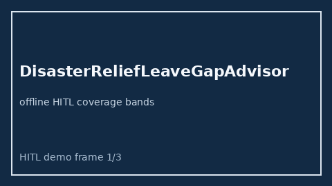

| BrightHorizons/Care.com/Workplace Options caregiver backup-care planners bury related math in closed UIs | Workers lack a local `offered_days` vs `needed_days` band | `CaregiverBackupCareGapAdvisor` bands offline `offered_days` vs `needed_days` for HITL review and never auto-approves |


| BambooHR/Workday/Rippling election-day civic-leave planners bury related math in closed UIs | Workers lack a local `offered_days` vs `needed_days` band | `ElectionDayPtoGapAdvisor` bands offline `offered_days` vs `needed_days` for HITL review and never auto-approves |


| Carrot/Progyny/Kindbody surrogacy benefit planners bury related math in closed UIs | Workers lack a local `offered_days` vs `needed_days` band | `SurrogacyBenefitGapAdvisor` bands offline `offered_days` vs `needed_days` for HITL review and never auto-approves |
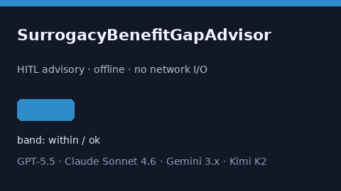

| Rippling/Workday/BambooHR military-leave differential planners bury related math in closed UIs | Workers lack a local `offered_days` vs `needed_days` band | `MilitaryLeaveDifferentialGapAdvisor` bands offline `offered_days` vs `needed_days` for HITL review and never auto-approves |
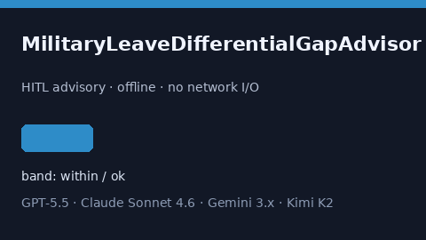

| Lattice/Workday/BambooHR sabbatical accrual planners bury related math in closed UIs | Workers lack a local `offered_months` vs `needed_months` band | `SabbaticalAccrualGapAdvisor` bands offline `offered_months` vs `needed_months` for HITL review and never auto-approves |

| Rippling/Workday/BambooHR parental bonding-leave planners bury related math in closed UIs | Workers lack a local `offered_days` vs `needed_days` band | `ParentalBondingLeaveGapAdvisor` bands offline `offered_days` vs `needed_days` for HITL review and never auto-approves |

| Progyny/Carrot/Maven fertility medication coverage planners bury related math in closed UIs | Workers lack a local `offered_usd` vs `needed_usd` band | `FertilityMedicationCoverageGapAdvisor` bands offline `offered_usd` vs `needed_usd` for HITL review and never auto-approves |
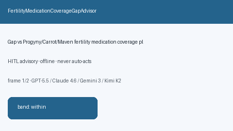
| Rippling/Deel/Remote.com remote-work equipment stipend planners bury related math in closed UIs | Workers lack a local `offered_usd` vs `needed_usd` band | `RemoteWorkEquipmentGapAdvisor` bands offline `offered_usd` vs `needed_usd` for HITL review and never auto-approves |
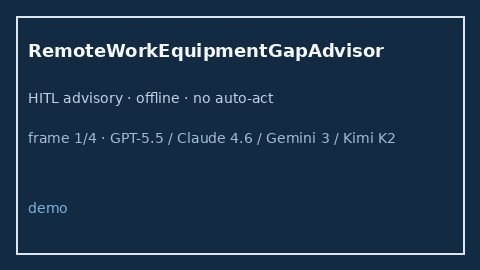

| Benevity/YourCause/DoubletheDonation volunteer PTO planners bury related math in closed UIs | Workers lack a local `offered_days` vs `needed_days` band | `VolunteerPtoGapAdvisor` bands offline `offered_days` vs `needed_days` for HITL review and never auto-approves |
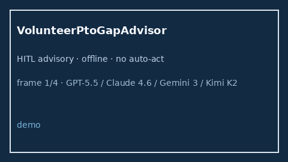

| Rippling/Deel/Remote.com internet stipend planners bury related math in closed UIs | Workers lack a local `offered_usd` vs `needed_usd` band | `InternetStipendGapAdvisor` bands offline `offered_usd` vs `needed_usd` for HITL review and never auto-approves |
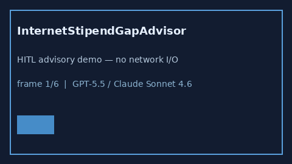
| WeWork/Industrious/Deskpass coworking stipend planners bury related math in closed UIs | Workers lack a local `offered_usd` vs `needed_usd` band | `CoworkingStipendGapAdvisor` bands offline `offered_usd` vs `needed_usd` for HITL review and never auto-approves |
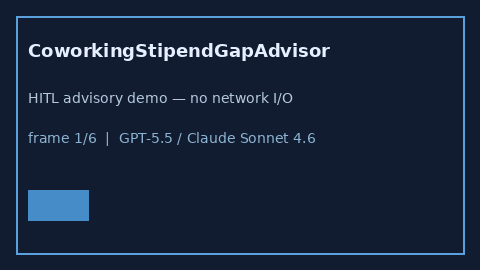
| Rippling/Gusto/BambooHR cell-phone stipend planners bury related math in closed UIs | Workers lack a local `offered_usd` vs `needed_usd` band | `CellPhoneStipendGapAdvisor` bands offline `offered_usd` vs `needed_usd` for HITL review and never auto-approves |
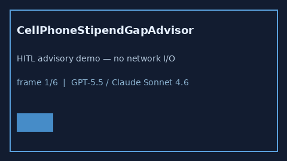
| WageWorks/BenefitWallet/Optum eldercare FSA planners bury related math in closed UIs | Workers lack a local `offered_usd` vs `needed_usd` band | `EldercareFsaGapAdvisor` bands offline `offered_usd` vs `needed_usd` for HITL review and never auto-approves |
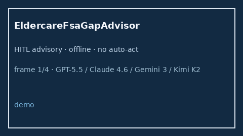

| Edenred/WageWorks/CommuterBenefits commute stipend planners bury related math in closed UIs | Workers lack a local `offered_usd` vs `needed_usd` band | `CommuteStipendGapAdvisor` bands offline `offered_usd` vs `needed_usd` for HITL review and never auto-approves |


| Wellthy/Cariloop/Torchlight caregiver respite planners bury related math in closed UIs | Workers lack a local `offered_days` vs `needed_days` band | `CaregiverRespiteGapAdvisor` bands offline `offered_days` vs `needed_days` for HITL review and never auto-approves |


| SoFi/CommonBond/Gradifi student-loan refinance stipend planners bury related math in closed UIs | Workers lack a local `offered_usd` vs `needed_usd` band | `StudentLoanRefinanceStipendGapAdvisor` bands offline `offered_usd` vs `needed_usd` for HITL review and never auto-approves |


| Right Management/RiseSmart/CareerBuilder outplacement planners bury related math in closed UIs | Workers lack a local `offered_days` vs `needed_days` band | `OutplacementServiceGapAdvisor` bands offline `offered_days` vs `needed_days` for HITL review and never auto-approves |


| Progyny/Carrot/Maven egg-freezing benefit planners bury related math in closed UIs | Workers lack a local `offered_days` vs `needed_days` band | `EggFreezingBenefitGapAdvisor` bands offline `offered_days` vs `needed_days` for HITL review and never auto-approves |


| Rippling/Workday/BambooHR adoption leave top-up planners bury related math in closed UIs | Workers lack a local `offered_days` vs `needed_days` band | `AdoptionLeaveTopUpGapAdvisor` bands offline `offered_days` vs `needed_days` for HITL review and never auto-approves |


| Carrot/Progyny/Maven family-building leave planners bury related math in closed UIs | Workers lack a local `offered_days` vs `needed_days` band | `FamilyBuildingLeaveGapAdvisor` bands offline `offered_days` vs `needed_days` for HITL review and never auto-approves |


| Guild/EdAssist/Workday tuition reimbursement annual-cap planners bury related math in closed UIs | Workers lack a local `offered_usd` vs `needed_usd` band | `TuitionReimbursementCapGapAdvisor` bands offline `offered_usd` vs `needed_usd` for HITL review and never auto-approves |


| Rippling/Workday/BambooHR climate-resilience leave planners bury related math in closed UIs | Workers lack a local `offered_days` vs `needed_days` band | `ClimateResilienceLeaveGapAdvisor` bands offline `offered_days` vs `needed_days` for HITL review and never auto-approves |


| Wellthy/Cariloop/Torchlight caregiving leave top-up planners bury related math in closed UIs | Workers lack a local `offered_days` vs `needed_days` band | `CaregivingLeaveTopUpGapAdvisor` bands offline `offered_days` vs `needed_days` for HITL review and never auto-approves |


| Guild/LinkedIn Learning/Workday professional-development stipend planners bury related math in closed UIs | Workers lack a local `offered_usd` vs `needed_usd` band | `ProfessionalDevelopmentStipendGapAdvisor` bands offline `offered_usd` vs `needed_usd` for HITL review and never auto-approves |


| Remote.com/Deel/Rippling relocation lump-sum tax gross-up planners bury related math in closed UIs | Workers lack a local `offered_usd` vs `needed_usd` band | `RelocationLumpSumTaxGrossUpGapAdvisor` bands offline `offered_usd` vs `needed_usd` for HITL review and never auto-approves |

| Carta/Pulley/Shareworks phantom-equity liquidity planners bury related math in closed UIs | Workers lack a local `offered_usd` vs `needed_usd` band | `PhantomEquityLiquidityGapAdvisor` bands offline `offered_usd` vs `needed_usd` for HITL review and never auto-approves |

| Unum/Lincoln Financial/MetLife disability insurance buy-up planners bury related math in closed UIs | Workers lack a local `offered_pct` vs `needed_pct` band | `DisabilityInsuranceBuyupGapAdvisor` bands offline `offered_pct` vs `needed_pct` for HITL review and never auto-approves |

| Unum/Guardian/Colonial Life long-term-care insurance planners bury related math in closed UIs | Workers lack a local `offered_usd` vs `needed_usd` band | `LongTermCareInsuranceGapAdvisor` bands offline `offered_usd` vs `needed_usd` for HITL review and never auto-approves |


| Carta/Shareworks/E*TRADE ESPP contribution planners bury related math in closed UIs | Workers lack a local `offered_pct` vs `needed_pct` band | `EsppContributionGapAdvisor` bands offline `offered_pct` vs `needed_pct` for HITL review and never auto-approves |


| Peanut Butter/Goodly/Gradifi student-loan forgiveness match planners bury related math in closed UIs | Workers lack a local `offered_usd` vs `needed_usd` band | `StudentLoanForgivenessMatchGapAdvisor` bands offline `offered_usd` vs `needed_usd` for HITL review and never auto-approves |


| Carrot/Progyny/Maven adoption-travel stipend planners bury related math in closed UIs | Workers lack a local `offered_usd` vs `needed_usd` band | `AdoptionTravelGapAdvisor` bands offline `offered_usd` vs `needed_usd` for HITL review and never auto-approves |


| Lattice/Culture Amp/Workday sabbatical pay-rate planners bury related math in closed UIs | Workers lack a local `offered_pct` vs `needed_pct` band | `SabbaticalPayRateGapAdvisor` bands offline `offered_pct` vs `needed_pct` for HITL review and never auto-approves |


| Carta/Pulley/Shareworks equity-refresh grant planners bury related math in closed UIs | Workers lack a local `offered_usd` vs `needed_usd` band | `EquityRefreshGrantGapAdvisor` bands offline `offered_usd` vs `needed_usd` for HITL review and never auto-approves |


| Carta/Pulley/Shareworks stock-option reload planners bury related math in closed UIs | Workers lack a local `offered_usd` vs `needed_usd` band | `StockOptionReloadGapAdvisor` bands offline `offered_usd` vs `needed_usd` for HITL review and never auto-approves |


| Rippling/Deel/Remote.com housing stipend COLA planners bury related math in closed UIs | Workers lack a local `offered_usd` vs `needed_usd` band | `HousingStipendColaGapAdvisor` bands offline `offered_usd` vs `needed_usd` for HITL review and never auto-approves |


| Rippling/Workday/BambooHR bereavement-travel stipend planners bury related math in closed UIs | Workers lack a local `offered_usd` vs `needed_usd` band | `BereavementTravelGapAdvisor` bands offline `offered_usd` vs `needed_usd` for HITL review and never auto-approves |

| Carrot/Progyny/Maven IVF cycle-coverage planners bury related math in closed UIs | Workers lack a local `offered_usd` vs `needed_usd` band | `FertilityIvfCycleGapAdvisor` bands offline `offered_usd` vs `needed_usd` for HITL review and never auto-approves |

| Watershed/Normative/Sweep climate commute-carbon offset planners bury related math in closed UIs | Workers lack a local `offered_usd` vs `needed_usd` band | `ClimateCommuteOffsetGapAdvisor` bands offline `offered_usd` vs `needed_usd` for HITL review and never auto-approves |

| Rippling/Lattice/Wellhub wellness stipend year-end rollover planners bury related math in closed UIs | Workers lack a local `offered_usd` vs `needed_usd` band | `WellnessStipendRolloverGapAdvisor` bands offline `offered_usd` vs `needed_usd` for HITL review and never auto-approves |

| Lyra/Spring Health/Modern Health mental-health session-cap planners bury related math in closed UIs | Workers lack a local `offered_sessions` vs `needed_sessions` band | `MentalHealthSessionCapGapAdvisor` bands offline `offered_sessions` vs `needed_sessions` for HITL review and never auto-approves |

| WageWorks/Optum/Fidelity HSA employer-seed planners bury related math in closed UIs | Workers lack a local `offered_usd` vs `needed_usd` band | `HsaEmployerSeedGapAdvisor` bands offline `offered_usd` vs `needed_usd` for HITL review and never auto-approves |

| Carrot/Progyny/Maven egg-freezing annual storage-fee planners bury related math in closed UIs | Workers lack a local `offered_usd` vs `needed_usd` band | `FertilityEggFreezingStorageGapAdvisor` bands offline `offered_usd` vs `needed_usd` for HITL review and never auto-approves |

| WageWorks/Edenred/CommuterBenefits.com year-end rollover planners bury related math in closed UIs | Workers lack a local `offered_usd` vs `needed_usd` band | `CommuterStipendRolloverGapAdvisor` bands offline `offered_usd` vs `needed_usd` for HITL review and never auto-approves |

| Take Command/PeopleKeep/WiserAdvise QSEHRA allowance planners bury related math in closed UIs | Workers lack a local `offered_usd` vs `needed_usd` band | `QsehraAllowanceGapAdvisor` bands offline `offered_usd` vs `needed_usd` for HITL review and never auto-approves |

| VSP/EyeMed/Davis Vision buy-up allowance planners bury related math in closed UIs | Workers lack a local `offered_usd` vs `needed_usd` band | `VisionInsuranceBuyupGapAdvisor` bands offline `offered_usd` vs `needed_usd` for HITL review and never auto-approves |

| Unum/Aflac/MetLife critical-illness insurance planners bury related math in closed UIs | Workers lack a local `offered_usd` vs `needed_usd` band | `CriticalIllnessInsuranceGapAdvisor` bands offline `offered_usd` vs `needed_usd` for HITL review and never auto-approves |

| Deel/Remote.com/Rippling remote stipend clawback planners bury related math in closed UIs | Workers lack a local `offered_usd` vs `needed_usd` band | `RemoteStipendClawbackGapAdvisor` bands offline `offered_usd` vs `needed_usd` for HITL review and never auto-approves |

| Bright Horizons/Care.com/Rippling emergency backup-childcare planners bury related math in closed UIs | Workers lack a local `offered_usd` vs `needed_usd` band | `EmergencyBackupChildcareGapAdvisor` bands offline `offered_usd` vs `needed_usd` for HITL review and never auto-approves |


| Notion/Rippling/Deel sabbatical-travel stipend planners bury related math in closed UIs | Workers lack a local `offered_usd` vs `needed_usd` band | `SabbaticalTravelStipendGapAdvisor` bands offline `offered_usd` vs `needed_usd` for HITL review and never auto-approves |


| Rippling/Lattice/BambooHR Q4 bonus-cliff planners bury related math in closed UIs | Workers lack a local `offered_usd` vs `needed_usd` band | `Q4BonusCliffGapAdvisor` bands offline `offered_usd` vs `needed_usd` for HITL review and never auto-approves |


| Notion/Rippling/Deel cybersecurity / hardware-security stipend planners bury related math in closed UIs | Workers lack a local `offered_usd` vs `needed_usd` band | `CybersecurityStipendGapAdvisor` bands offline `offered_usd` vs `needed_usd` for HITL review and never auto-approves |


| Rippling/Lattice/BambooHR pet-adoption stipend planners bury related math in closed UIs | Workers lack a local `offered_usd` vs `needed_usd` band | `PetAdoptionStipendGapAdvisor` bands offline `offered_usd` vs `needed_usd` for HITL review and never auto-approves |

