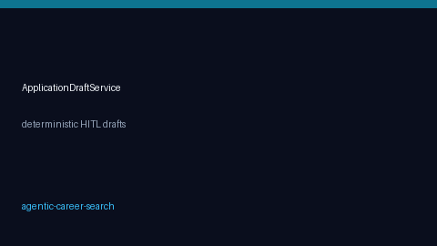

# Application Stage Tracker Guide



Track applications through a **CRM-lite pipeline**:
`saved → applied → interview → offer → accepted|rejected`.

This module is the in-process state machine with explicit allowed transitions; it keeps
agent loops able to reason about pipeline stage without auto-submitting applications.
For durable tracking (database, timeline, follow-ups, board, exports, MCP) use the
[Application Tracker](APPLICATION_TRACKER_GUIDE.md), which enforces the same transitions.

Optional LLM notes polish can later use GPT-6 Astra / Claude Opus 5.5 /
Gemini 4 Argon / Kimi K3.1 Pro. Stage transitions themselves stay deterministic.

## Why this exists

Teal’s pipeline is the core UX for serious job seekers. JobSpy scrapes boards
without a stage CRM. OpenHands can act on the web, which is the wrong default
for application state. This tracker fills the gap with an auditable stage
machine that agents and humans can share.

## Track a job

```python
from autoapply_agent.services.application_stages import (
    ApplicationStage,
    ApplicationStageTracker,
)

tracker = ApplicationStageTracker()
tracker.upsert("https://example.com/jobs/1", ApplicationStage.SAVED)
tracker.advance("https://example.com/jobs/1")  # → applied
tracker.upsert(
    "https://example.com/jobs/1",
    ApplicationStage.REJECTED,
    note="no reply after 14d",
)
print(tracker.list_by_stage(ApplicationStage.REJECTED))
```

## Stages and transitions

| From | Allowed next |
|---|---|
| saved | applied, rejected |
| applied | interview, rejected |
| interview | offer, rejected |
| offer | accepted, rejected |
| accepted / rejected | (terminal) |

## Safety notes

- Tracker never submits applications or contacts employers.
- Notes may contain personal data — keep them local / redacted in logs.
- v1 is in-memory; do not treat it as durable storage yet.

See `SAFETY.md` for project-wide boundaries.
