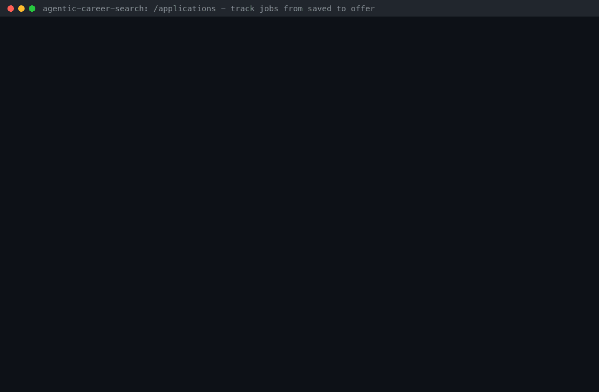

# Application Tracker Guide



*Recorded from a real session against the seeded demo jobs
([transcript](APPLICATION_TRACKER_DEMO_TRANSCRIPT.txt)), rendered by
`scripts/generate_demo_gif.py`.*

The application tracker turns a captured job into a **persistent pipeline card** and
moves it through `saved → applied → interview → offer → accepted / rejected`. Every
change lands in an **append-only timeline**, follow-up dates show up as
**overdue / due** and in an **iCalendar feed**, and the whole pipeline is available as a
**board**, a **CSV / JSON Lines export** and two **read-only MCP tools** for your AI
assistant.

It is local bookkeeping. Nothing here submits an application, sends a message or
contacts an employer: you apply yourself, then record what happened.

## Contents

- [Why it exists](#why-it-exists)
- [Prerequisites](#prerequisites)
- [Quickstart (copy-paste)](#quickstart-copy-paste)
- [The pipeline (state machine)](#the-pipeline-state-machine)
- [HTTP API reference](#http-api-reference)
- [MCP tools](#mcp-tools)
- [Worked example with real output](#worked-example-with-real-output)
- [Configuration and storage](#configuration-and-storage)
- [How it fits with the rest of the project](#how-it-fits-with-the-rest-of-the-project)
- [Safety and privacy](#safety-and-privacy)
- [Troubleshooting](#troubleshooting)
- [FAQ](#faq)
- [Limitations and roadmap](#limitations-and-roadmap)

## Why it exists

Discovery runs fill the job feed (`GET /jobs`), but finding a role is only half of a job
search: you also need to remember what you applied to, who to follow up with and what
happened next. Self-hosted and hosted job trackers all centre on that loop:

| Project | How it tracks applications | What this project lacked |
|---|---|---|
| [JobSync](https://github.com/Gsync/jobsync) (self-hosted, open source) | Jobs move through statuses (draft, applied, interview, offer, rejected...); activities and tasks record what happened and what to do next | No applications table at all: `services/application_stages.py` was an in-memory tracker, so nothing survived a restart |
| [Huntr](https://huntr.co/) job tracker | Board with one column per stage; follow-up reminders | No board, no per-application history, no follow-ups |
| [Teal](https://www.tealhq.com/) job tracker | Status columns per job; follow-up reminders | No API, no MCP access, no export of pipeline state |

What the tracker adds, on top of the existing feed:

- an `applications` table (one card per captured job) and an append-only
  `application_events` timeline, created by Alembic migration `d3a9f1c4b7e2`;
- the existing transition rules of `services/application_stages.py` as the **single**
  state machine (an illegal move is a `409` and changes nothing);
- follow-ups (`next_action_at`, `next_action`) classified as `overdue`, `due` (within 7
  days), `scheduled` or `none`;
- list filters, a board grouped by stage, a CSV-injection-safe CSV export, JSON Lines and
  a read-only iCalendar feed of follow-ups;
- read-only MCP tools `list_applications` and `get_application`.

## Prerequisites

- The API running locally (see [QUICKSTART.md](../../QUICKSTART.md)); Python 3.11 with
  `uv sync --extra dev`.
- At least one captured job: run a discovery run, or seed the offline demo jobs with
  `python scripts/seed_demo_jobs.py`.
- `curl` and `jq` for the examples below.
- A new database gets the tables at startup. An existing database: run
  `alembic upgrade head` (see [Configuration and storage](#configuration-and-storage)).

## Quickstart (copy-paste)

```bash
export DATABASE_URL=sqlite+aiosqlite:///./tracker-demo.db
python scripts/seed_demo_jobs.py                     # 8 demo jobs, no network
ENABLE_WORKER=false uvicorn autoapply_agent.main:app --port 8000 --log-level warning &
export CT='content-type: application/json'

# 1. Track job 1 (starts in "saved")
curl -s localhost:8000/applications -H "$CT" -d '{"job_id": 1, "note": "Referred by Sam"}' | jq .

# 2. You applied: move it and schedule a follow-up
curl -s -X PATCH localhost:8000/applications/1 -H "$CT" \
  -d '{"stage": "applied", "next_action_at": "2026-11-24T17:00:00Z", "next_action": "Email the recruiter"}' | jq .

# 3. See the board, the follow-ups due this week and the timeline
curl -s localhost:8000/applications/board | jq '.columns[] | {stage, count}'
curl -s 'localhost:8000/applications?follow_up=due' | jq '.[] | {id, next_action, next_action_at}'
curl -s localhost:8000/applications/1/events | jq .

# 4. Export to a spreadsheet, or subscribe to the follow-ups from a calendar app
curl -s 'localhost:8000/applications/export?format=csv' -o applications.csv
curl -s localhost:8000/applications/calendar.ics -o follow-ups.ics
```

Interactive docs for every endpoint are at `http://localhost:8000/docs` (tag
`applications`).

## The pipeline (state machine)

```
saved ──► applied ──► interview ──► offer ──► accepted
  │          │            │           │
  └──────────┴────────────┴───────────┴─────► rejected
```

| From | Legal next stages |
|---|---|
| `saved` | `applied`, `rejected` |
| `applied` | `interview`, `rejected` |
| `interview` | `offer`, `rejected` |
| `offer` | `accepted`, `rejected` |
| `accepted`, `rejected` | none (final stages) |

- The rules live in `services/application_stages.py` (`check_transition`,
  `allowed_next_stages`) and are shared by the in-memory `ApplicationStageTracker` and the
  persistent tracker, so there is one state machine.
- Every application response lists its `allowed_stages`, so a client never has to
  hard-code the rules.
- `POST /applications` may **start** at any stage (for a job you already applied to
  elsewhere); every later move follows the table.
- Moving to the current stage is not a move (no event, `200`).
- An illegal move is `409` with the legal options in `detail`, and nothing in the request
  is applied (not even notes or follow-ups sent with it).
- `rejected` covers every closed outcome (rejected by them, withdrawn by you, role
  filled); write the reason in the move's `note`.

## HTTP API reference

Errors use FastAPI's standard shape: `{"detail": "..."}` for `404` / `409`, and
`{"detail": [ ... ]}` (one entry per invalid field) for `422`. Ids in paths and bodies
must be between 1 and 2^63-1 (SQLite's `INTEGER` range); anything else is `422`.
Timestamps are ISO-8601; a value without an offset is read as **UTC**, and every
response returns UTC (`...Z`).

### Application object

| Field | Type | Notes |
|---|---|---|
| `id`, `job_id` | integer | One application per job |
| `stage` | string | `saved`, `applied`, `interview`, `offer`, `accepted`, `rejected` |
| `archived` | boolean | Archived cards are hidden by default |
| `notes` | string or null | Your editable scratchpad (≤ 10,000 characters) |
| `applied_at` | timestamp or null | Set to now on the first move to `applied` unless you send it |
| `next_action_at`, `next_action` | timestamp / string or null | Follow-up time and label (label ≤ 200 characters, one line) |
| `follow_up_status` | string | `overdue` (time passed), `due` (within 7 days), `scheduled` (later), `none` |
| `days_in_stage` | integer | Whole days since `stage_changed_at` |
| `stage_changed_at`, `created_at`, `updated_at` | timestamp | |
| `allowed_stages` | array | Legal next stages (empty when final) |
| `job` | object | `id`, `title`, `company`, `location`, `remote`, `url` (http(s) only, else null), `score`, `priority_tier`, `run_id`, `captured_at` |

### `POST /applications` — start tracking a job

Body (unknown fields are `422`):

| Field | Default | Limits |
|---|---|---|
| `job_id` | required | A captured job id |
| `stage` | `saved` | Any stage |
| `notes` | null | ≤ 10,000 characters; control characters other than tab / line breaks rejected |
| `note` | null | Note on the first timeline event, ≤ 2,000 characters |
| `applied_at` | null | Not in the future |
| `next_action_at` | null | Any valid instant |
| `next_action` | null | ≤ 200 characters, no line breaks |

Responses: `201` with the application and a `Location` header; `404 {"detail": "job not
found"}`; `409` when the job is already tracked — or when another capture of the **same
posting URL** (a later run re-captured it; compared case-insensitively after trimming) is
tracked. The `409` carries a `Location` header pointing at the existing application.

### `GET /applications` — list

| Parameter | Default | Meaning |
|---|---|---|
| `stage` | all | Repeat for several: `?stage=applied&stage=interview` |
| `company` | — | Case-insensitive substring of the job's company (≤ 256) |
| `q` | — | Space-separated terms (≤ 200 characters); each must match the job title, company or location, or the notes or next action |
| `follow_up` | — | `overdue`; `due` (before now + `due_within_days`, overdue included); `scheduled` (any follow-up); `none` |
| `due_within_days` | 7 | 0–366, horizon of `follow_up=due` |
| `include_archived` | false | Include archived applications |
| `job_id` | — | The application of one job |
| `sort` | `updated` | `updated` / `created` (newest first), `next_action` (soonest first), `applied` (latest first), `score` (job score, highest first); missing dates sort last, `id` breaks ties |
| `limit`, `offset` | 50, 0 | `limit` 1–500 |

The number of matches before paging is in the `X-Total-Count` header.

### `GET /applications/board` — grouped by stage

Takes the list filters plus `per_stage` (1–100, default 20 cards per column). Returns
`total`, `include_archived`, `follow_ups` (`{"overdue", "due", "scheduled", "none"}`
counts) and `columns`: always six, in pipeline order, each with `stage`, `count` and
its first `per_stage` `applications`. A `stage` filter empties the other columns.

### `GET /applications/{id}` — one application

`404 {"detail": "application not found"}` when missing.

### `PATCH /applications/{id}` — move, annotate, reschedule

Send at least one field; omitted fields are untouched, `null` clears `notes`,
`applied_at`, `next_action_at` or `next_action`. Clearing `next_action_at` also clears
`next_action` unless the same request sets one.

| Field | Effect | Timeline |
|---|---|---|
| `stage` | Move along the state machine | `stage_changed` (with `from_stage` / `to_stage`) |
| `applied_at`, `next_action_at`, `next_action` | Set or clear | `updated`, with `changes: {field: {from, to}}` (folded into `stage_changed` when sent with a move) |
| `note` | Timeline note (≤ 2,000) | Stored on this request's event, or `note_added` on its own |
| `notes` | Replace the scratchpad | No event (it is an editable field, not history) |

Each request appends **at most one** event. Errors: `404`; `409 {"detail": "cannot move
from saved to offer (allowed: applied, rejected)"}` or `"... (rejected is a final
stage)"`; `409 {"detail": "application was changed by another request; retry"}` when two
writers race for the same timeline slot; `422` for invalid fields or an empty body.

### `GET /applications/{id}/events` — timeline

Oldest first. Each event: `id`, `application_id`, `sequence` (1, 2, 3... per
application, unique), `event_type` (`tracked`, `stage_changed`, `updated`, `note_added`,
`archived`, `unarchived`), `from_stage`, `to_stage`, `note`, `changes`, `created_at`.
Events are never edited or deleted by the API.

### `POST /applications/{id}/archive` and `/unarchive`

Optional body `{"note": "..."}`. Archiving hides a card from lists, the board, exports
and the calendar (unless `include_archived=true`) and keeps its stage and history.
Both are idempotent: repeating the current state records nothing (a note sent with it is
recorded as `note_added`).

### `GET /applications/export?format=csv|jsonl`

Takes the list filters and sort, plus an optional `limit` (1–100,000; every match by
default). Returns an attachment (`applications-<UTC time>.csv` or `.jsonl`) with
`X-Total-Count`. CSV columns: `application_id, job_id, stage, archived, title, company,
location, remote, url, score, applied_at, next_action_at, next_action, follow_up_status,
days_in_stage, stage_changed_at, created_at, updated_at, notes`. Every cell is quoted,
text cells starting with `=`, `+`, `-`, `@`, tab or carriage return get a leading `'`
(the OWASP CSV-injection rule shared with `GET /jobs/export`), and only http(s) posting
links are written. JSON Lines rows are the API's application objects.

### `GET /applications/calendar.ics` — follow-up feed

A read-only iCalendar (RFC 5545) feed with one 30-minute, free (`TRANSP:TRANSPARENT`)
event per application with a follow-up, soonest first. It takes the list filters
(`follow_up` narrows within scheduled follow-ups) and `limit` (1–10,000, default 1,000).
The title is `<next action or "Follow up"> - <title> at <company>`; the description holds
the stage, applied date, posting link and application link, **never your notes**. Text
values are escaped (`\`, `;`, `,`, line breaks), other control characters are dropped,
and lines are folded at 75 octets without splitting UTF-8 characters. Each event's UID is
stable per application and `SEQUENCE` is its latest timeline sequence, so calendar apps
update events in place when you reschedule. The feed has no authentication of its own:
keep the API on localhost or behind your proxy.

## MCP tools

The [MCP server](MCP_SERVER_GUIDE.md) exposes the pipeline to AI assistants, read-only
(SQLite connections run `PRAGMA query_only`; there is no tool that tracks, moves or
archives an application):

| Tool | Arguments | Returns |
|---|---|---|
| `list_applications` | The `GET /applications` filters: `stage` (array), `company`, `q`, `follow_up`, `due_within_days`, `include_archived`, `job_id`, `sort`; `limit` (default 10, max 50), `offset` | `total`, paging (`next_offset`), `stage_counts` (the board counts), `follow_ups` counts and the applications (notes cut to a 280-character preview, `notes_truncated`) |
| `get_application` | `application_id`; `event_limit` (1–200, default 20) | The application with its full notes, `event_count`, `events_truncated` and its most recent timeline events |

Example prompts: "Which of my applications have overdue follow-ups?", "Show my pipeline
board", "What happened with application 3?". To move a card, use the HTTP API yourself.

## Worked example with real output

From the recorded session above (demo jobs from `scripts/seed_demo_jobs.py`):

```text
$ for job in 1 3 4 5 8; do curl -s localhost:8000/applications -H "$CT" -d "{\"job_id\": $job}" | jq -r '"#\(.id) \(.stage)  \(.job.title) | \(.job.company)"'; done
#1 saved  Senior Python Engineer | Acme Robotics
#2 saved  Staff Platform Engineer (Python, Kubernetes) | Globex
#3 saved  Backend Engineer, Payments | Initech
#4 saved  Site Reliability Engineer | Vandelay Industries
#5 saved  =HYPERLINK("https://evil.example","Apply here") | Injected Co
$ curl -s localhost:8000/applications -H "$CT" -d '{"job_id": 1}' -w '  HTTP %{http_code}\n'
{"detail":"job 1 is already tracked as application 1"}  HTTP 409
$ curl -s -X PATCH localhost:8000/applications/1 -H "$CT" -d '{"stage": "offer"}' -w '  HTTP %{http_code}\n'
{"detail":"cannot move from applied to offer (allowed: interview, rejected)"}  HTTP 409
$ curl -s localhost:8000/applications/1/events | jq -r '.[] | "\(.sequence) \(.event_type) \(.from_stage // "-") -> \(.to_stage // "-") \(.note // "")"'
1 tracked - -> saved
2 stage_changed saved -> applied
3 stage_changed applied -> interview Phone screen booked with Sam
$ curl -s localhost:8000/applications/board | jq -r '(.columns[] | "\(.stage): \(.count) \([.applications[].job.company] | join(", "))"), (.follow_ups | tojson)'
saved: 2 Injected Co, Initech
applied: 1 Globex
interview: 1 Acme Robotics
offer: 0
accepted: 0
rejected: 1 Vandelay Industries
{"overdue":1,"due":1,"scheduled":0,"none":3}
$ curl -s 'localhost:8000/applications/export?format=csv&sort=created' | python3 -c 'import csv, sys; [print(*(r[i] for i in (0, 2, 4, 5)), sep=" | ") for r in csv.reader(sys.stdin)]'
application_id | stage | title | company
5 | saved | '=HYPERLINK("https://evil.example","Apply here") | Injected Co
4 | rejected | Site Reliability Engineer | Vandelay Industries
...
$ curl -s localhost:8000/applications/calendar.ics | grep -E '^(DTSTART|SUMMARY)'
DTSTART:20261118T170000Z
SUMMARY:Check in - Staff Platform Engineer (Python\, Kubernetes) at Globex
DTSTART:20261124T170000Z
SUMMARY:Email the recruiter - Senior Python Engineer at Acme Robotics
```

Note the hostile demo title: it is stored as captured, shown as data, and neutralized
with a leading `'` in the CSV so a spreadsheet never evaluates it.

## Configuration and storage

- No new settings. The calendar is named `<APP_NAME> follow-ups`.
- Tables: `applications` (unique `job_id`, foreign key to `jobs`, index on
  `next_action_at`) and `application_events` (unique `(application_id, sequence)`).
- New databases: created at app startup like every other table.
- Existing databases: `alembic upgrade head` applies `d3a9f1c4b7e2`;
  `alembic downgrade c41f2a7d9e60` drops both tables (and their data). The migration is
  idempotent, so a database created by app startup and stamped at the baseline upgrades
  cleanly.
- Back up the database file before deleting old runs: an application keeps a foreign key
  to its job.

## How it fits with the rest of the project

- **Job feed**: find jobs with `GET /jobs` (or `POST /jobs/match`), then track the ones
  you want with their `id`. `job_id` filters connect the two.
- **Decision trace**: each card shows the job's `score` and `priority_tier` from the
  agent's decision trace; `sort=score` orders the pipeline by them.
- **In-memory tracker**: `ApplicationStageTracker` (see
  [APPLICATION_STAGE_TRACKER_GUIDE.md](APPLICATION_STAGE_TRACKER_GUIDE.md)) keeps working
  for in-process agent loops and enforces the same transitions.
- **Assistants**: the MCP tools read the same queries as `GET /applications`.

## Safety and privacy

- Local pipeline state only: no endpoint submits an application, sends email or direct
  messages, or contacts an employer. The tracker records decisions you made.
- MCP access is read-only by design (human-in-the-loop): assistants can read the
  pipeline but not change it.
- Your notes stay in your database: they are never logged and never written to the
  calendar feed. Logs carry ids, event types and sequences only.
- Captured job text comes from public career pages and is treated as data (CSV
  neutralization, http(s)-only links, escaped iCalendar text).
- Input is validated at the boundary: stage enum, date ranges (no future `applied_at`),
  text sizes, control characters and integer ranges.

## Troubleshooting

| Symptom | Cause and fix |
|---|---|
| `409 job N is already tracked` | One application per job. Follow the `Location` header to the existing card. |
| `409 this posting is already tracked ...` | A later run captured the same posting URL again. Use the existing card. |
| `409 cannot move from X to Y` | Not a legal move; the `allowed` list in `detail` (and `allowed_stages`) shows the options. Go through intermediate stages, or `rejected` to close it. |
| `409 application was changed by another request` | Two writes raced; repeat the request. |
| `422` on a date | Use ISO-8601 (`2026-11-24T17:00:00Z`); `applied_at` cannot be in the future. |
| A card disappeared | It is archived: add `include_archived=true`, or `POST /applications/{id}/unarchive`. |
| `no such table: applications` | An old database: run `alembic upgrade head`. |
| Calendar app shows nothing | Only applications with `next_action_at` appear; check `GET /applications?follow_up=scheduled`. |

## FAQ

**Does tracking a job apply to it?** No. The project never submits applications.

**Can I undo a stage move?** Not through a move: the pipeline only goes forward (or to
`rejected`), and the timeline is append-only so the history stays auditable. Add a
`note` explaining the correction, or archive the card.

**Can I track a job that is not in the feed?** Not yet: the card references a captured
job. Capture it with a run first.

**Why is `due` seven days?** A week is a common follow-up interval after applying; use
`due_within_days` (0–366) for another horizon.

**Does the assistant see my notes?** `get_application` returns them; `list_applications`
returns a preview. Do not connect the MCP server to an assistant you would not show them
to.

## Limitations and roadmap

- Single user, no authentication of its own (like the rest of the API).
- Tracks captured jobs only; manual cards for jobs found elsewhere are a possible follow-up.
- No reminders are pushed (email or notifications); use the calendar feed or
  `follow_up=due`.
- No contacts, documents or interview rounds per card yet (JobSync and Huntr offer them).
- Optional LLM summaries of a timeline (for example with GPT-6.2 Sol, Claude Opus 5.5 or
  Gemini 4 Neon) are not part of this feature; stage moves stay deterministic.
