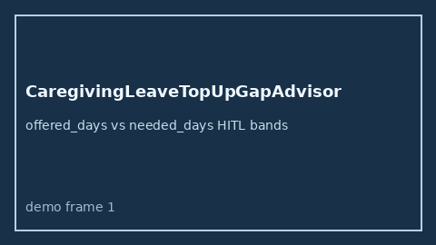

# CaregivingLeaveTopUpGapAdvisor Guide



Offline HITL helper for `offered_days` bands.
Gap vs Wellthy/Cariloop/Torchlight caregiving leave top-up planners. Distinct from `CaregiverBackupCareGapAdvisor` / `CaregiverRespiteGapAdvisor`.

Optional polish via **GPT-6 Astra / Claude Opus 5.5 / Gemini 4 Argon / Kimi K3.1 Pro**.

## Usage

```python
from autoapply_agent.services.caregiving_leave_top_up_gap import CaregivingLeaveTopUpGapAdvisor

report = CaregivingLeaveTopUpGapAdvisor().advise(
    offered_days=50.0,
    needed_days=100.0,
)
assert report.requires_human_review is True
assert report.auto_approve is False
print(report.coverage_band)
```

## Safety

Advisory only. No network I/O. Never auto-acts. Humans decide.
