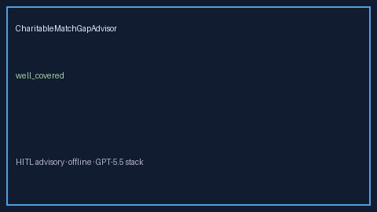

# CharitableMatchGapAdvisor Guide



Offline HITL advisor for `match_usd` vs `donation_usd` coverage bands.
Gap vs Benevity/YourCause/CyberGrants charitable-match planners. Distinct from `EmployeeVolunteerHoursGapAdvisor` / `WellnessStipendGapAdvisor`.

Optional polish via **GPT-5.5 / Claude Sonnet 4.6 / Gemini 3.x / Kimi K2**.

## Usage

```python
from autoapply_agent.services.charitable_match_gap import CharitableMatchGapAdvisor

report = CharitableMatchGapAdvisor().advise(
    match_usd=50.0,
    donation_usd=100.0,
)
assert report.requires_human_review is True
assert report.auto_enroll is False
print(report.coverage_band)
```

## Safety

Advisory only. No network I/O. Never auto-enrolls. Humans decide.
