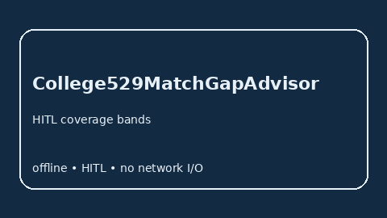

# College529MatchGapAdvisor Guide



Offline HITL advisor for `offered_days` vs `needed_days` coverage bands.
Gap vs Fidelity/Vanguard/Schwab employer 529 match planners. Distinct from `StudentLoanRepaymentGapAdvisor` / `TuitionReimbursementGapAdvisor`.

Optional polish via **GPT-5.5 / Claude Sonnet 4.6 / Gemini 3.x / Kimi K2**.

## Usage

```python
from autoapply_agent.services.college_529_match_gap import College529MatchGapAdvisor

report = College529MatchGapAdvisor().advise(
    offered_days=50.0,
    needed_days=100.0,
)
assert report.requires_human_review is True
assert report.auto_approve is False
print(report.coverage_band)
```

## Safety

Advisory only. No network I/O. Never auto-approves. Humans decide.
