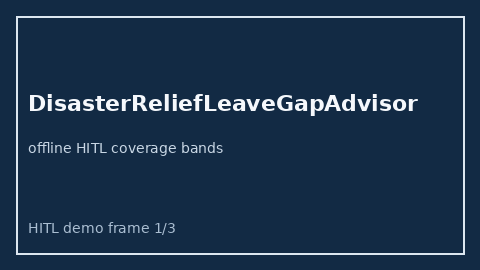

# DisasterReliefLeaveGapAdvisor Guide



Offline HITL advisor for `offered_days` vs `needed_days` coverage bands.
Gap vs Benevity/YourCause/Rippling disaster-relief leave planners. Distinct from `EldercareLeaveDaysGapAdvisor` / `BackupCareDaysGapAdvisor`.

Optional polish via **GPT-6 Astra / Claude Opus 5.5 / Gemini 4 Argon / Kimi K3.1 Pro**.

## Usage

```python
from autoapply_agent.services.disaster_relief_leave_gap import DisasterReliefLeaveGapAdvisor

report = DisasterReliefLeaveGapAdvisor().advise(
    offered_days=50.0,
    needed_days=100.0,
)
assert report.requires_human_review is True
assert report.auto_approve is False
print(report.coverage_band)
```

## Safety

Advisory only. No network I/O. Never auto-approves. Humans decide.
