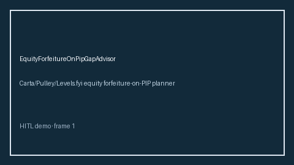

# EquityForfeitureOnPipGapAdvisor Guide



Offline HITL advisor. Never auto-acts. Closes closed-UI gaps vs Carta/Pulley/Levels.fyi equity forfeiture-on-PIP planners (distinct from related advisors).

Optional later polish via **GPT-5.5 / Claude Sonnet 4.6 / Gemini 3.x / Kimi K2**.

Distinct from `EquityVestingCliffAdvisor` / `EquityBlackoutWindowAdvisor`.

## Usage

```python
from autoapply_agent.services.equity_forfeiture_on_pip_gap import EquityForfeitureOnPipGapAdvisor

report = EquityForfeitureOnPipGapAdvisor().advise(
    protected_equity_usd=100.0,
    unvested_equity_usd=100.0,
)
assert report.auto_enroll is False
print(report.coverage_band)
```

## Safety

Always `requires_human_review=True`. No HTTP. Humans decide. See `SAFETY.md`.
