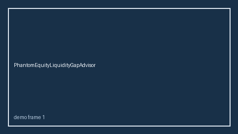

# EquityRefreshGrantGapAdvisor Guide



Offline HITL helper for `offered_usd` bands.
Gap vs Carta/Pulley/Shareworks equity-refresh grant planners. Distinct from `PhantomEquityLiquidityGapAdvisor` / `RsuSupplementalWithholdingGapAdvisor`.

Optional polish via **GPT-6 Astra / Claude Opus 5.5 / Gemini 4 Argon / Kimi K3.1 Pro**.

## Usage

```python
from autoapply_agent.services.equity_refresh_grant_gap import (
    EquityRefreshGrantGapAdvisor,
)

report = EquityRefreshGrantGapAdvisor().advise(
    offered_usd=50.0,
    needed_usd=100.0,
)
assert report.requires_human_review is True
assert report.auto_approve is False
print(report.coverage_band)
```

## Safety

Advisory only. No network I/O. Never auto-acts. Humans decide.
