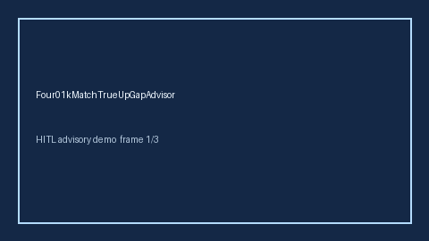

# Four01kMatchTrueUpGapAdvisor Guide



Offline HITL advisor. Never auto-acts. Closes closed-UI gaps vs Fidelity/Vanguard/Rippling 401(k) match true-up planners (distinct from related advisors).

Optional later polish via **GPT-5.5 / Claude Sonnet 4.6 / Gemini 3.x / Kimi K2**.

Distinct from `FourOhOneKMatchGapAdvisor` / `Four01kMatchVestingCliffAdvisor`.

## Usage

```python
from autoapply_agent.services.four01k_match_true_up import Four01kMatchTrueUpGapAdvisor

report = Four01kMatchTrueUpGapAdvisor().advise(
    true_up_credited_usd=100.0,
    true_up_owed_usd=100.0,
)
assert report.auto_enroll is False
print(report.coverage_band)
```

## Safety

Always `requires_human_review=True`. No HTTP. Humans decide. See `SAFETY.md`.
