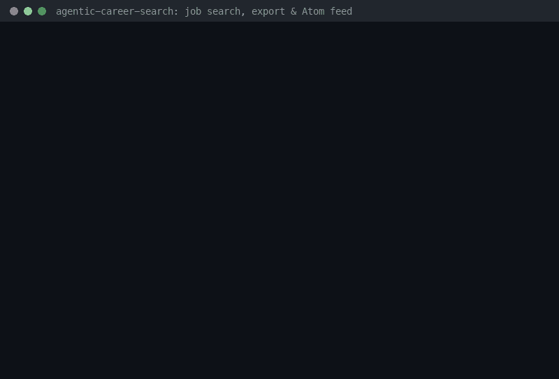

# Job Search, Export & Atom Feed Guide



Search every job your runs have captured with JobSpy-style filters, page through
the results with a total count, download them as a spreadsheet-safe CSV or as JSON
Lines, and subscribe to new matches with an Atom feed in Slack, Teams or any feed
reader.

| Method | Path | What it does |
|---|---|---|
| `GET` | `/jobs` | Filtered, sorted, paginated search; total matches in `X-Total-Count` |
| `GET` | `/jobs/{job_id}` | One job (JSON `404 {"detail": "job not found"}` when missing) |
| `GET` | `/jobs/export?format=csv\|jsonl` | Streamed download of every match |
| `GET` | `/jobs/feed.atom` | Atom 1.0 (RFC 4287) feed of the newest distinct matches |

## Why this exists

[JobSpy](https://github.com/speedyapply/JobSpy) (`speedyapply/JobSpy`), the most
popular open-source job scraper, made two things the norm for job-search tooling:
**one set of filters** (`search_term`, `location`, `is_remote`, `hours_old`,
`results_wanted`, `offset`) and **one-call export** (`jobs.to_csv(...)`, or
`jobspy ... -o jobs.jsonl`). Job seekers also routinely pipe new postings into Slack,
Teams or a feed reader instead of re-running searches by hand.

agentic-career-search already does the hard part — it captures jobs from 100+ ATS and
board adapters, normalizes them and scores them with an explainable decision trace —
but its API could only list the newest *N* jobs (`GET /jobs?run_id=&limit=`): no text
search, no filters, no paging, no detail view, no export and no way to be notified.
This feature closes that gap on top of the data you already have:

- **Search**: free text, company, location, remote, score, source, run and
  capture-time filters, `newest`/`score` ordering, `limit`/`offset` paging.
- **Dedupe**: one row per posting even when every hourly run re-captures it or it is
  mirrored on several boards.
- **Export**: streamed CSV hardened against spreadsheet formula injection, and JSON
  Lines that round-trip into the API schema.
- **Subscribe**: a standards-compliant Atom feed with stable entry ids, so readers
  notify once per posting.

## Quickstart (seeded local database)

```bash
uv sync --extra dev --frozen
export DATABASE_URL=sqlite+aiosqlite:///./demo.db
uv run python scripts/seed_demo_jobs.py      # one demo run with 8 captured jobs
ENABLE_WORKER=false uv run uvicorn autoapply_agent.main:app --port 8000
```

`scripts/seed_demo_jobs.py` writes realistic jobs from a Greenhouse and a Lever demo
source, including a cross-board mirror (to try `dedupe=true`) and one deliberately
hostile row (to see the CSV/Atom hardening). Run it twice to simulate a second run
re-capturing the same postings. With real data, configure sources and start runs as
in [QUICKSTART.md](../../QUICKSTART.md) instead; the endpoints below work the same.

In a second terminal:

```bash
# Remote Python roles, best score first, 2 per page; the header holds the total
curl -s -D - -o /dev/null 'localhost:8000/jobs?q=python&remote=true&sort=score&limit=2' \
  | grep -i x-total-count
curl -s 'localhost:8000/jobs?q=python&remote=true&sort=score&limit=2' \
  | jq -c '.[] | [.id, .title, .company, .score]'

# Same search with cross-board mirrors and re-captures collapsed
curl -s 'localhost:8000/jobs?q=python&remote=true&sort=score&dedupe=true' \
  | jq -c '.[] | [.id, .title, .company, .score]'

# One job, and a missing one
curl -s localhost:8000/jobs/3 | jq -c '{id, title, location, url}'
curl -s -w ' %{http_code}\n' localhost:8000/jobs/999

# Downloads and the feed
curl -s -OJ 'localhost:8000/jobs/export?format=csv&sort=score'   # saves jobs-<UTC>.csv
curl -s 'localhost:8000/jobs/export?format=jsonl&min_score=0.85' | jq -c '{id, title, score}'
curl -s 'localhost:8000/jobs/feed.atom?remote=true&limit=2' | xmllint --format -
```

Interactive OpenAPI docs for every parameter: `http://127.0.0.1:8000/docs`.

## Filter reference

All filters combine with AND and apply identically to `/jobs`, `/jobs/export` and
`/jobs/feed.atom`. Text matching is a case-insensitive substring match (`%` and `_`
are literal characters; SQLite only case-folds ASCII).

| Parameter | Type / range | Meaning | JobSpy analogue |
|---|---|---|---|
| `q` | string, ≤ 200 chars | Space-separated terms; **each** term must appear in the title, company or location | `search_term` |
| `company` | string | Company contains this text | — |
| `location` | string | Location contains this text | `location` |
| `remote` | `true` / `false` | Remote rule below; `false` also keeps jobs without a location | `is_remote` |
| `min_score` | float `0`–`1` | Deterministic score ≥ value | — |
| `source_config_id` | int `1`–`2^63-1` | Captured from this source config | `site_name` |
| `run_id` | string | Captured by this run (the original filter) | — |
| `created_after` | ISO-8601 instant | Captured at or after this time; naive values are UTC | — |
| `hours_old` | int `1`–`8760` | Captured within the last N hours (with `created_after`, the later bound wins) | `hours_old` |
| `sort` | `newest` (default) / `score` | `newest`: capture time, then id, descending (with `dedupe`: when the posting was first seen). `score`: highest score first, ties newest first | — |
| `dedupe` | `true` / `false` (default) | Collapse duplicates, see below (feed: always on) | — |
| `limit` | `/jobs`: 1–500 (50) · export: 1–100000 (all) · feed: 1–200 (50) | Page size / row cap / entry count | `results_wanted` |
| `offset` | int `0`–`2^63-1` (0), `/jobs` only | Matches to skip | `offset` |

Out-of-range values (including a `created_after` whose UTC equivalent falls outside
the supported date range) return `422` with the standard FastAPI validation body.
Repeated parameters follow FastAPI: the last value wins. Encode a
`+` UTC offset as `%2B` in URLs, or use `Z`:
`created_after=2026-11-06T09:00:00-08:00` and `created_after=2026-11-06T17:00:00Z`
are the same instant.

**Remote rule.** A job is remote when its location contains (case-insensitively) any
of `remote`, `anywhere`, `work from home`, `wfh`, `telecommute` or `distributed`.
Adapters normalize remote signals into the location (for example JSON-LD postings
that declare `jobLocationType: TELECOMMUTE` become
`Remote - <office> / <applicant regions>`, or `Remote` without either, BambooHR
`isRemote` postings without a location become `Remote`, and Lever postings labelled
with the `Remote` workplace type become `Remote - <location>`), so the same rule
drives the `remote` filter, the CSV `remote` column and the feed summary. Hybrid
roles are not remote: Lever's `Hybrid` and `On-site` labels leave the location
unchanged, and JSON-LD postings without `TELECOMMUTE` keep their office location.

**Dedupe rule.** With `dedupe=true` results are *postings*, not captures. Every
stored job is visited in capture order and joins the posting of an earlier job with
the same URL (case-insensitive) **or** the same normalized title + company + location;
if those two point to different postings, the one first seen earlier wins, so a
capture's posting depends only on earlier captures and never changes later. Normalization reuses `services/cross_source_dedup.py` and
works for every script (NFKC, case-folding; punctuation, spacing and legal suffixes
such as `Inc`/`LLC`/`GmbH` are ignored, while letters such as `東京` vs `大阪` are
kept), so `Senior Python Engineer · Acme Robotics, Inc. · Remote - US` on Lever and
`Senior Python Engineer · Acme Robotics · Remote - US` on Greenhouse count once, but
the same title in two cities stays two jobs. Identity is resolved over the whole
capture history, independent of the filters; the filters only decide which postings
match, and each posting is shown through its first matching capture. That keeps a
posting's identity stable when, for example, `hours_old` drops its oldest captures.
(`CrossSourceJobDeduper`'s fuzzy difflib clustering remains available offline; it is
O(n²) and therefore not run per request.)

**Paging.** Read `X-Total-Count` once, then step `offset` by `limit`:

```bash
total=$(curl -s -D - -o /dev/null 'localhost:8000/jobs?remote=true&limit=100' \
  | awk 'tolower($1)=="x-total-count:" {print $2+0}')
for offset in $(seq 0 100 $((total - 1))); do
  curl -s "localhost:8000/jobs?remote=true&limit=100&offset=$offset" | jq -c '.[]'
done
```

Ordering ends with the job id, so pages never overlap or skip rows while the data is
unchanged. Without parameters, `GET /jobs` still returns the 50 newest jobs as a JSON
array, so existing clients keep working.

## Export recipes

Exports stream every match (or `limit` rows) in the requested order with
`Content-Disposition: attachment; filename="jobs-<UTC timestamp>.<csv|jsonl>"`.

| Format | Content-Type | Shape |
|---|---|---|
| `csv` (default) | `text/csv; charset=utf-8` | Header + one fully quoted row per job: `id, title, company, location, remote, score, priority_tier, source, url, source_config_id, run_id, external_id, created_at` |
| `jsonl` | `application/x-ndjson` | One `JobRead` object (the `/jobs` item shape, including `raw` and `plan_steps`) per line |

**Spreadsheet.** `curl -s -OJ 'localhost:8000/jobs/export?format=csv&min_score=0.7'`
saves the file under the server-provided name. Open it in Excel (*Data → From
Text/CSV*, UTF-8), Numbers, LibreOffice or Google Sheets (*File → Import*).
`created_at` is RFC 3339 UTC (`2026-11-07T06:58:05Z`).

**pandas.**

```python
import pandas as pd

jobs = pd.read_csv("http://localhost:8000/jobs/export?format=csv&remote=true")
top = jobs.sort_values("score", ascending=False).head(10)[["title", "company", "url"]]

detail = pd.read_json("http://localhost:8000/jobs/export?format=jsonl&dedupe=true", lines=True)
```

**jq / shell.**

```bash
curl -s 'localhost:8000/jobs/export?format=jsonl&dedupe=true' \
  | jq -r 'select(.score >= 0.8) | [.title, .company, .url] | @tsv'
```

**Python stdlib.** `csv.DictReader` and `JobRead.model_validate_json(line)` read the
two formats without extra dependencies.

## Subscribe to the Atom feed

`GET /jobs/feed.atom` accepts every filter above plus `limit` and returns
`application/atom+xml; charset=utf-8`:

- one entry per **distinct posting** (dedupe is always on), most recently
  discovered first;
- entry `id` = `urn:uuid:` + UUIDv5 of the URL of the posting's first capture, so
  re-captures by later runs, mirrors on other boards and time windows such as
  `hours_old` never produce a "new" item;
- entry `published`/`updated` = when the posting was first seen; `title` =
  `<title> at <company>`, `link rel="alternate"` = the posting URL, `summary` =
  `Company: … | Location: … | Remote: yes/no | Score: 0.88 | Priority: high`, all
  taken from the first capture that matches the filters;
- feed `id` = UUIDv5 of the canonical feed URL (scheme, host, path and the effective
  value of each filter parameter; `limit` and unknown parameters such as tracking
  tags are ignored), so two installations never share a feed id — serve the feed from
  one stable hostname; `title` names the filters, `link rel="self"` is the request
  URL, `updated` = newest entry.

Feed readers (NetNewsWire, Feedly, Thunderbird, Miniflux, …): add the feed URL, for
example `http://localhost:8000/jobs/feed.atom?q=python&remote=true&min_score=0.7`.

Slack: the RSS app polls from Slack's servers, so put the API behind an HTTPS reverse
proxy with authentication first, then in a channel run

```text
/feed subscribe https://jobs.example.com/jobs/feed.atom?q=python&remote=true&min_score=0.7
```

Microsoft Teams: create a Workflows (Power Automate) flow with the RSS trigger
*When a feed item is published* on the same URL and a *Post message in a chat or
channel* action.

## Security notes

- **CSV injection (OWASP).** Every cell is wrapped in double quotes (embedded quotes
  doubled), and text cells starting with `=`, `+`, `-`, `@`, tab or carriage return
  get a leading `'`, as recommended by the
  [OWASP CSV Injection](https://owasp.org/www-community/attacks/CSV_Injection) guidance,
  so `=HYPERLINK(...)` arrives as text, never as a formula. Numeric columns are not
  touched; the trade-off is that a text value such as `-1+1` is exported as `'-1+1`.
- **Links.** Only absolute `http`/`https` URLs are emitted as links: the CSV `url`
  cell is empty for other schemes (`javascript:`, `data:`, relative paths), and the
  feed links such entries to the API's own `/jobs/{id}` instead. JSON and JSONL return
  the stored value unchanged, as data — validate it before rendering it as a link.
- **XML.** The feed is built with the standard library `xml.etree.ElementTree`, which
  escapes `&`, `<`, `>` and quotes; characters that XML 1.0 forbids (for example
  `\x0b`) are removed first, and all text is `type="text"`, never HTML.
- **Exposure.** Like the rest of this API there is no built-in authentication, and
  feed URLs reveal your search terms. Keep it on localhost or behind an authenticating
  reverse proxy.
- **Resources.** Exports stream in keyset batches of 500 rows over a dedicated
  database session; each batch is read completely before it is sent, so memory stays
  flat and a slow client never holds a database cursor that would block SQLite
  writers. `dedupe=true` (and the feed) first loads eight narrow columns of every
  stored job to resolve posting identities.
- **Indexes.** `ix_jobs_created_at_id` and `ix_jobs_score_created_at_id` let every page and export batch seek instead of rescanning and sorting `jobs`; new databases get them at startup, existing ones from Alembic revision `c41f2a7d9e60` (stamp the baseline first if the app created the schema — see [Upgrading an existing database](../DEPLOYMENT.md#upgrading-an-existing-database)).

## Comparison to JobSpy

| | JobSpy | agentic-career-search |
|---|---|---|
| Interface | Python library, CLI, MCP server | HTTP API over a database |
| Data | Scrapes boards live on every call (Indeed, Glassdoor, ZipRecruiter, …) | Jobs captured by runs from configured ATS/board sources, kept with their history |
| Filters | `search_term`, `location`, `distance`, `is_remote`, `job_type`, `hours_old`, `easy_apply`, `results_wanted`, `offset` | `q`, `company`, `location`, `remote`, `min_score`, `source_config_id`, `run_id`, `created_after`, `hours_old`, `limit`, `offset` |
| Ranking | Board order | Deterministic score + decision trace; `sort=score` |
| Duplicates | Per-board results | `dedupe=true` collapses re-captures and cross-board mirrors |
| Export | DataFrame → `to_csv`, CLI `-o jobs.jsonl` | Streamed CSV (formula-injection safe) and JSON Lines |
| Notifications | — | Atom feed for Slack, Teams and feed readers |

Not covered here: `job_type`, salary ranges and distance radius — the `Job` model does
not store them yet. `hours_old` measures time since capture, which approximates
posting age when runs are scheduled regularly.

## How this demo was recorded

The GIF above is rendered from the real terminal transcript in
[`JOB_SEARCH_EXPORT_DEMO_TRANSCRIPT.txt`](JOB_SEARCH_EXPORT_DEMO_TRANSCRIPT.txt):
every `$` line was executed from the repository root against a fresh `demo.db`, and
the lines after it are its unedited output (run id included; CRLF line endings from
HTTP headers are shown as plain line breaks). To reproduce:

```bash
rm -f demo.db
DATABASE_URL=sqlite+aiosqlite:///./demo.db uv run python scripts/seed_demo_jobs.py
DATABASE_URL=sqlite+aiosqlite:///./demo.db ENABLE_WORKER=false \
  uv run uvicorn autoapply_agent.main:app --port 8000 --log-level warning &
# ...then run the curl commands listed in the transcript (needs curl, jq, xmllint)
```

The transcript was turned into `assets/demo/job-search-export-feed.gif` (24 rows ×
96 columns) by a small Pillow terminal renderer that types each `$` command and then
reveals its captured output line by line; all frames share one 32-colour palette to
keep the file around 320 KB.
