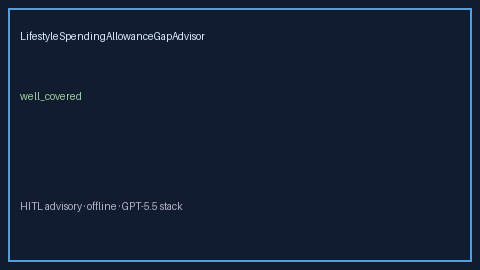

# LifestyleSpendingAllowanceGapAdvisor Guide



Offline HITL advisor for `offered_usd` vs `needed_usd` coverage bands.
Gap vs Rippling/Culture Amp/Total Rewards LSA planners. Distinct from `WellnessStipendGapAdvisor` / `MealStipendGapAdvisor`.

Optional polish via **GPT-5.5 / Claude Sonnet 4.6 / Gemini 3.x / Kimi K2**.

## Usage

```python
from autoapply_agent.services.lifestyle_spending_allowance_gap import (
    LifestyleSpendingAllowanceGapAdvisor,
)

report = LifestyleSpendingAllowanceGapAdvisor().advise(
    offered_usd=50.0,
    needed_usd=100.0,
)
assert report.requires_human_review is True
assert report.auto_enroll is False
print(report.coverage_band)
```

## Safety

Advisory only. No network I/O. Never auto-enrolls. Humans decide.
