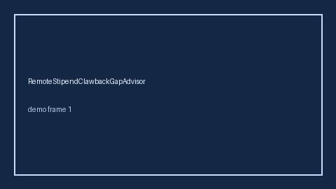

# MentalHealthSessionCapGapAdvisor Guide



Offline helper.
Gap vs Lyra/Spring Health/Modern Health mental-health session-cap planners. Distinct from `MentalHealthEapSessionGapAdvisor` / `WellnessStipendGapAdvisor`.

Stack: **GPT-5.5 / Claude Sonnet 4.6 / Gemini 3.x / Kimi K2**.

## Usage

```python
from autoapply_agent.services.mental_health_session_cap_gap import (
    MentalHealthSessionCapGapAdvisor,
)

report = MentalHealthSessionCapGapAdvisor().advise(
    offered_sessions=6,
    needed_sessions=12,
)
assert report.requires_human_review is True
assert report.auto_approve is False
print(report.coverage_band)
```

## Safety

Advisory only. No network I/O. Never auto-acts. Humans decide.
