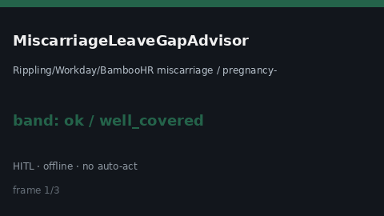

# MiscarriageLeaveGapAdvisor Guide



Offline helper.
Gap vs Rippling/Workday/BambooHR miscarriage / pregnancy-loss leave planners. Distinct from `BereavementLeaveGapAdvisor` / `ParentalLeaveGapAdvisor`.

Stack: **GPT-6 Astra / Claude Opus 5.5 / Gemini 4 Argon / Kimi K3.1 Pro**.

## Usage

```python
from autoapply_agent.services.miscarriage_leave_gap import (
    MiscarriageLeaveGapAdvisor,
)

report = MiscarriageLeaveGapAdvisor().advise(
    offered_days=50.0,
    needed_days=100.0,
)
assert report.requires_human_review is True
assert report.auto_approve is False
print(report.coverage_band)
```

## Safety

Advisory only. No network I/O. Never auto-acts. Humans decide.
