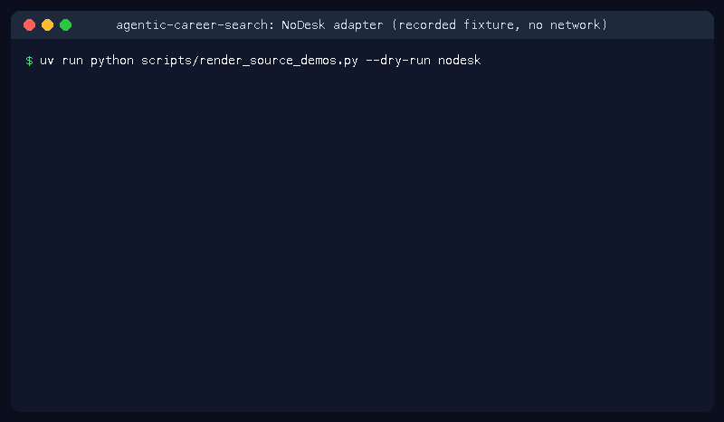

# NoDesk Source Guide



Use this guide when wiring a public NoDesk careers board into
**agentic-career-search**. Discovery is deterministic HTML URL-shape matching;
enrichment with GPT-6 Astra / Claude Opus 5.5 / Gemini 4 Argon / Kimi K3.1 Pro is optional
and runs after candidates are collected.

## Why NoDesk

NoDesk publishes career boards whose public listings commonly link to
detail pages under /jobs/{id}, /job/{id}, /remote/{id}, /positions/{id}, /careers/{id}. Popular remote-job scrapers (JobSpy / similar) index NoDesk listings; this repo lacked a first-party deterministic NoDesk HTML adapter under ADR-077.

## Usage

```bash
curl -X POST localhost:8000/source-configs \
  -H 'content-type: application/json' \
  -d '{
    "name": "nodesk-jobs",
    "source_type": "nodesk",
    "base_url": "https://nodesk.co/jobs"
  }'
```

## URL shapes

| Shape | Example |
|---|---|
| Jobs | `/jobs/48291` |
| Job | `/job/55902` |
| Remote | `/remote/61033` |
| Positions | `/positions/72044` |
| Careers | `/careers/83055` |

Board index pages, apply/login steps, about/index links, and navigation links
are ignored.

## Safety

- Public HTML only — no authenticated APIs or credential storage.
- Apply/login/signin/about/index paths are excluded from discovery.
- Optional LLM enrichment is bounded by the shared safety policy.
