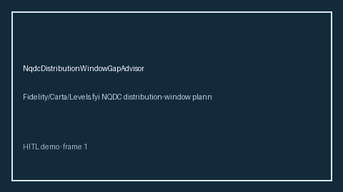

# NqdcDistributionWindowGapAdvisor Guide



Offline HITL advisor. Never auto-acts. Closes closed-UI gaps vs Fidelity/Carta/Levels.fyi NQDC distribution-window planners (distinct from related advisors).

Optional later polish via **GPT-5.5 / Claude Sonnet 4.6 / Gemini 3.x / Kimi K2**.

Distinct from `NqdcDeferralCliffAdvisor` / `IpoLockupReleaseGapAdvisor`.

## Usage

```python
from autoapply_agent.services.nqdc_distribution_window_gap import NqdcDistributionWindowGapAdvisor

report = NqdcDistributionWindowGapAdvisor().advise(
    days_to_distribution=100.0,
    needed_liquidity_days=100.0,
)
assert report.auto_enroll is False
print(report.coverage_band)
```

## Safety

Always `requires_human_review=True`. No HTTP. Humans decide. See `SAFETY.md`.
