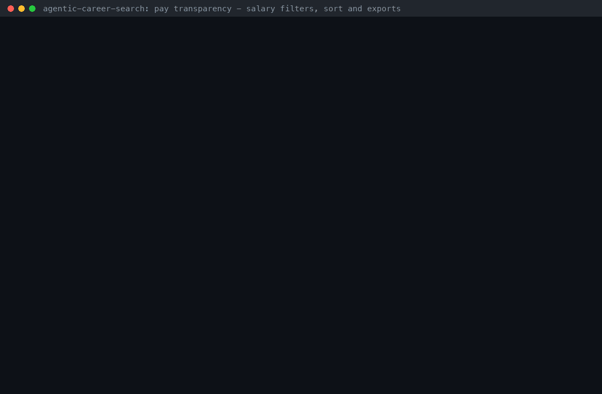

# Pay Transparency Guide



*Recorded from a real session against the seeded demo jobs
([transcript](PAY_TRANSPARENCY_DEMO_TRANSCRIPT.txt)), rendered by
`scripts/generate_demo_gif.py`.*

"What does it pay?" is the first question most job seekers ask. Discovery now captures the
**pay range a posting states** — from structured schema.org `baseSalary` data or from the
description text — as a typed, **annualized** range in one **ISO 4217 currency**. You can
filter on it (`min_salary`, `max_salary`, `salary_currency`, `has_salary`), sort by it
(`sort=salary`), and you get it in every output: `GET /jobs`, CSV / JSON Lines exports, the
Atom feed, `POST /jobs/match` and the read-only MCP tools.

Pay is **informational**. It never changes a job's score or priority, and nothing decides
on your behalf because of it. Unknown pay stays `null`: the extractor never guesses.

## Contents

- [Why it exists](#why-it-exists)
- [Prerequisites](#prerequisites)
- [Quickstart (copy-paste)](#quickstart-copy-paste)
- [What gets captured](#what-gets-captured)
- [How description text is read](#how-description-text-is-read)
- [Filters and sorting](#filters-and-sorting)
- [HTTP API reference](#http-api-reference)
- [Exports, feed and resume match](#exports-feed-and-resume-match)
- [MCP tools](#mcp-tools)
- [Worked example with real output](#worked-example-with-real-output)
- [Upgrading an existing database](#upgrading-an-existing-database)
- [How it fits with the rest of the project](#how-it-fits-with-the-rest-of-the-project)
- [Safety and privacy](#safety-and-privacy)
- [Troubleshooting](#troubleshooting)
- [FAQ](#faq)
- [Limitations and roadmap](#limitations-and-roadmap)

## Why it exists

US pay-transparency laws (Colorado, California, New York, Washington, Illinois and more)
make employers state a pay range in the posting, and the boards this project reads already
publish it in structured form. Popular tools surface it; until this feature, our `Job` had
no compensation fields and `GET /jobs` could not answer the question.

| Project / source | How it exposes pay | What this project does |
|---|---|---|
| [JobSpy](https://github.com/speedyapply/JobSpy) | `min_amount`, `max_amount`, `interval`, `currency`, `salary_source` (`direct_data` / `description`), `enforce_annual_salary` (hour ×2080, day ×260, week ×52, month ×12) | Same shape (`min_amount`, `max_amount`, `interval`, `currency`, `source`) plus annualized columns with the same factors. Unlike JobSpy, the interval is never inferred from the size of the number |
| [Google JobPosting structured data](https://developers.google.com/search/docs/appearance/structured-data/job-posting) | `baseSalary`: `MonetaryAmount` with a `QuantitativeValue` (`minValue` / `maxValue` / `value`, `unitText` HOUR / DAY / WEEK / MONTH / YEAR) | Read by the `jsonld` adapter as `source: structured` |
| [Greenhouse Job Board API](https://developers.greenhouse.io/job-board.html) | `pay_input_ranges` with `?pay_transparency=true` | Not fetched: the `greenhouse` adapter reads the public board HTML, which carries no pay. Posting pages publish JSON-LD; see [Limitations](#limitations-and-roadmap) |
| [Lever Postings API](https://github.com/lever/postings-api) | `salaryRange` `{min, max, currency, interval}` | Not fetched: the `lever` adapter reads listing HTML (roadmap) |
| [Ashby Posting API](https://developers.ashbyhq.com/docs/public-job-posting-api) | `compensation` with `includeCompensation=true` | Not fetched: the `ashby` adapter reads listing HTML (roadmap) |
| Pay-transparency postings | "The base pay range for this role is $120,000 - $150,000" in the description | Read from the description as `source: description` |

`services/salary_band.py` (the *salary band estimator*) is a different tool: it guesses a
band from title keywords and location heuristics for offer conversations. It does not read
what a posting states, so it was not reused; the new extractor never estimates anything.

## Prerequisites

- The API installed as in [QUICKSTART.md](../../QUICKSTART.md) (`uv sync --extra dev --frozen`).
- A database at Alembic revision `e5b8c2a7f913` or later. New databases created by the app
  get the columns automatically; existing ones need one `alembic upgrade head`
  ([below](#upgrading-an-existing-database)).
- Pay for **newly captured** jobs. Jobs captured before the upgrade have no pay until a
  discovery run captures them again; there is no backfill.

## Quickstart (copy-paste)

Offline, with the demo jobs (their descriptions state pay the way real postings do):

```bash
export DATABASE_URL=sqlite+aiosqlite:///./pay-demo.db
uv run python scripts/seed_demo_jobs.py
ENABLE_WORKER=false uv run uvicorn autoapply_agent.main:app --port 8000 &
for _ in $(seq 50); do curl -sf localhost:8000/health/ready >/dev/null && break; sleep 0.2; done

# Best-paid USD jobs first (annualized), with what each posting stated
curl -s 'localhost:8000/jobs?salary_currency=USD&sort=salary' \
  | jq -r '.[] | "\(.salary_min_annual)-\(.salary_max_annual) \(.salary_currency)/yr (per \(.salary_interval))  \(.title)"'

# Jobs whose range reaches 196,000 USD a year (hourly pay counts at 2,080 hours)
curl -s 'localhost:8000/jobs?salary_currency=USD&min_salary=196000' | jq -r '.[].title'

# Jobs that state no pay, a pay-filtered spreadsheet and a pay-filtered feed
curl -s 'localhost:8000/jobs?has_salary=false' | jq -r '.[].title'
curl -s -OJ 'localhost:8000/jobs/export?format=csv&salary_currency=USD&min_salary=150000'
curl -s 'localhost:8000/jobs/feed.atom?salary_currency=USD&min_salary=150000' | head -20
```

For live data, register a `jsonld` source (any posting or careers page that embeds
schema.org `JobPosting` JSON-LD) and start a run; pay is captured as jobs are inserted.

## What gets captured

Each job with pay carries one `Compensation`, stored in full as `raw.compensation` and,
for filtering and sorting, in four nullable, indexed `jobs` columns:

| Field | Example | Meaning |
|---|---|---|
| `raw.compensation.min_amount` / `max_amount` | `85` / `95` | Stated amounts per `interval` (a single figure has `min == max`) |
| `raw.compensation.currency` → column `salary_currency` | `USD` | ISO 4217 code |
| `raw.compensation.interval` → column `salary_interval` | `hour` | `hour`, `day`, `week`, `month` or `year`, as stated |
| `raw.compensation.annual_min` / `annual_max` → columns `salary_min_annual` / `salary_max_annual` | `176800` / `197600` | Amounts × annual factor, rounded to whole currency units |
| `raw.compensation.source` | `description` | `structured` (adapter data) or `description` (posting text) |
| `raw.compensation.snippet` | `$85 - $95 per hour` | Evidence the range was read from (≤ 200 characters) |

**Annualization factors** (full-time, no overtime, no unpaid leave; the same as JobSpy's
`enforce_annual_salary`):

| Interval | Factor | Why |
|---|---|---|
| hour | 2,080 | 40 hours × 52 weeks |
| day | 260 | 5 days × 52 weeks |
| week | 52 | weeks per year |
| month | 12 | months per year |
| year | 1 | already annual |

**Where pay comes from**, in order:

1. **Structured data.** The `jsonld` adapter reads the posting's `baseSalary`
   (`MonetaryAmount`). The currency is `baseSalary.currency`, else the posting's
   `salaryCurrency`. Lists, numeric strings and IRI-style `unitText`
   (`https://schema.org/YEAR`) are accepted; the first usable entry wins.
   `estimatedSalary` is a third-party estimate, not the employer's pay, so it is ignored.
2. **Description text.** When there is no usable structured pay, the posting's
   `description` (HTML or text) goes through the text extractor below.

Every other adapter scrapes listing pages that carry no pay, so their jobs have none (all
columns `NULL`) until they supply it. An adapter only has to set
`JobCandidate.compensation`; the worker stores the columns and `raw.compensation`.

A range is dropped (`null`, never guessed) when the currency is missing or not ISO 4217,
the interval is unknown, only one end is stated (`minValue` alone, "up to $150k"), the
range is inverted (`min > max`) or the annualized maximum exceeds 10^12.

## How description text is read

The text extractor (`services/compensation.py`, `compensation_from_text`) is deterministic
and offline. HTML is reduced to text first (entity-escaped HTML included); block tags such
as `<li>` and `<p>` end a clause, so one bullet never borrows a pay word from another.

**Recognized** (all tested):

| Text | Result |
|---|---|
| `$120,000 - $150,000`, `$120k–$150k`, `$120-150k` | USD 120,000–150,000 per year |
| `USD 120,000 to 150,000`, `120,000 - 150,000 USD`, `between $100,000 and $120,000` | ranges with `to` / `and` and ISO codes before or after |
| `$45/hr`, `$45 to $55 per hour`, `Hourly rate: $25.50 - $30` | hourly (×2,080) |
| `Day rate: £500`, `$900/week`, `$4,000 - $5,000 per month` | daily, weekly, monthly |
| `£50,000–£60,000 p.a.`, `€60.000`, `60 000 € per year`, `CA$90K - CA$110K`, `$90k-$110k CAD` | GBP, EUR (dot or space thousands), CAD |

Dashes may be `-`, `–`, `—`, `−` or `~`; `k`/`K` multiplies by 1,000 and a `k` on one end
of `$120-150k` applies to both.

**When an amount counts as pay.** It needs a currency (a symbol such as `$`, `£`, `€`, `₹`,
a prefix such as `US$`, `CA$`, `A$`, `NZ$`, `S$`, `HK$`, `MX$`, or one of the ISO codes USD,
CAD, AUD, NZD, SGD, HKD, MXN, GBP, EUR, CHF, INR, JPY, SEK, NOK, DKK, PLN) **and** either:

- an explicit interval right after it (`/hr`, `per hour`, `an hour`, `hourly`, `/day`,
  `daily`, `/wk`, `weekly`, `/mo`, `monthly`, `/yr`, `per year`, `per annum`, `annually`,
  `annual`, `yearly`, `p.a.`) or an interval lead-in in the same clause (`Hourly rate:`,
  `Annual base salary:`, `Monthly salary:`); or
- a pay word earlier in the same clause or right after it (salary, pay, compensation, comp,
  wage, rate, base, earn, earnings, income, remuneration, range, band). Without an explicit
  interval, the amount is read as **yearly** only when it is at least 10,000 in USD, CAD,
  AUD, NZD, GBP, EUR or CHF; otherwise it is rejected (a bare `$4,000 - $5,000` could be
  monthly).

**Rejected** (all tested): millions and billions (`$5M Series A`, `$1B revenue`, `$5
million`), amounts next to non-pay words (stipend, allowance, bonus, budget, credit,
equity, stock, funding, raised, revenue, valuation, Series, match, 401(k), reimbursement,
relocation, signing, commission, tips, internet, phone, gym, meals, travel and similar:
`$50 stipend`, `$2,000 signing bonus`, `$100 monthly internet stipend`), numbers without
a currency (`401(k)`, years such as 2026, `Salary 120,000 - 150,000`), one-sided figures
(`up to $150k`, `starting at $20/hr`, `from`, `minimum`, `over`, `$150k+`), mixed
currencies (`US$100k - CA$120k`), inverted ranges, Indian lakh grouping (`₹12,00,000`) and
the ambiguous `¥` and `kr` symbols.

**Several ranges.** Postings often list one range per location ("NYC $150k-$180k, SF
$160k-$200k, Remote $130k-$170k"). The extractor keeps every accepted range in the
**first** accepted range's currency and interval and returns their **widest envelope**
(lowest minimum to highest maximum: USD 130,000–200,000 here), with each piece in the
snippet (`$150k-$180k | $160k-$200k | $130k-$170k`). Ranges in another currency or interval
(`$45/hr (about $93,600 per year)`) are ignored rather than mixed in.

**Bare `$`** is read as USD unless the same range names another dollar currency
(`$90k CAD`); postings that mean Canadian or Australian dollars with a bare `$` are
labelled USD. Structured data, which always names the currency, takes precedence.

## Filters and sorting

All surfaces share one implementation (`services/job_search.py`), so `GET /jobs`, the
export, the feed, `POST /jobs/match` and MCP behave the same.

| Parameter | Type | Semantics |
|---|---|---|
| `salary_currency` | ISO 4217 code, case-insensitive (`usd` = `USD`) | Only jobs paying in this currency (implies pay is known) |
| `min_salary` | integer, 0 – 9223372036854775807 | **Overlap**: the job's range reaches the floor, `salary_max_annual >= min_salary` |
| `max_salary` | integer, 0 – 9223372036854775807 | **Overlap**: the job's range starts at or below the ceiling, `salary_min_annual <= max_salary` |
| `has_salary` | `true` / `false` | Only jobs with / without captured pay |
| `sort=salary` | — | Highest `salary_max_annual` first; ties newest first, then highest id; jobs without pay last |

Bounds are inclusive and annualized, so `min_salary=150000` matches a `$75/hr` posting
(156,000 a year). With both bounds, a job matches when its range overlaps
`[min_salary, max_salary]`.

**Currencies are never mixed or converted.** `min_salary`, `max_salary` and `sort=salary`
**require** `salary_currency`; without it the request is rejected with `422` rather than
silently comparing euros with dollars or assuming USD. `salary_currency` alone, or
`has_salary`, needs nothing else. `min_salary` greater than `max_salary` is a `422` too.

Sorting is stable and keyset-paged like `newest` and `score`: exports stream in batches
that seek past the last row (`ix_jobs_salary_currency_max_annual_created_at_id` backs the
query), and `dedupe=true` orders distinct postings by their representative capture's pay.

## HTTP API reference

`GET /jobs`, `GET /jobs/export` and `GET /jobs/feed.atom` accept the parameters above next
to the existing filters (`q`, `company`, `location`, `remote`, `min_score`,
`source_config_id`, `run_id`, `created_after`, `hours_old`); `sort` exists on `GET /jobs`
and the export. `GET /jobs` and `GET /jobs/{job_id}` return four more fields:

| Field | Type | Notes |
|---|---|---|
| `salary_min_annual` | integer or `null` | Annualized minimum |
| `salary_max_annual` | integer or `null` | Annualized maximum |
| `salary_currency` | string or `null` | ISO 4217 code |
| `salary_interval` | string or `null` | Interval the posting states |

The full range (stated amounts, source, snippet) is in `raw.compensation`.

**Errors** use FastAPI's usual `422` list. Examples (real output):

```json
{"detail":[{"type":"value_error","loc":["query","salary_currency"],"msg":"min_salary needs salary_currency (an ISO 4217 code such as USD): pay is only compared within one currency","input":null}]}
```

| Request | `loc` | `msg` |
|---|---|---|
| `min_salary` / `max_salary` / `sort=salary` without `salary_currency` | `["query","salary_currency"]` | `min_salary needs salary_currency ...` (or `max_salary` / `sort=salary`) |
| `salary_currency=XYZ` | `["query","salary_currency"]` | `Unknown ISO 4217 currency code` |
| `salary_currency=US` | `["query","salary_currency"]` | `String should match pattern '^[A-Za-z]{3}$'` |
| `min_salary=200000&max_salary=100000&...` | `["query","max_salary"]` | `max_salary must be greater than or equal to min_salary` |
| `min_salary=-1`, `max_salary=9223372036854775808` | `["query","min_salary"]` / `["query","max_salary"]` | out-of-range integer |

The export validates before streaming, so an invalid request never starts a download.

## Exports, feed and resume match

- **CSV** (`GET /jobs/export?format=csv`): seven columns are appended after `created_at`, so
  existing column positions do not move: `salary_min`, `salary_max` (stated amounts),
  `salary_interval`, `salary_currency`, `salary_min_annual`, `salary_max_annual`,
  `salary_source`. Cells are empty for jobs without pay and keep the OWASP CSV-injection
  hardening.
- **JSON Lines** (`format=jsonl`): every record has the four `salary_*` fields and
  `raw.compensation`.
- **Atom feed** (`GET /jobs/feed.atom`): each entry summary gains a `Pay:` part, e.g.
  `Pay: USD 85–95 per hour (USD 176,800–197,600 per year)` or `Pay: n/a`. The pay filters
  are part of the feed's identity (its id and title), like the other filters.
- **Resume match** (`POST /jobs/match`): the JSON body accepts `min_salary`, `max_salary`,
  `salary_currency` and `has_salary` with the same rules (errors at `["body", ...]`, the
  resume is never echoed). Ranked jobs carry the `salary_*` fields; `?format=csv` adds the
  export's pay columns.

## MCP tools

The read-only MCP server (`career-search-mcp`) exposes the same filters, so you can ask an
assistant such as Claude Opus 5.5 or GPT-6.2 Sol *"show remote roles paying at least 180k
USD, best paid first"*:

- `search_jobs` accepts `min_salary`, `max_salary`, `salary_currency` (pattern
  `^[A-Za-z]{3}$`), `has_salary` and `sort: "salary"`; `match_resume_to_jobs` accepts the
  four filters. Invalid combinations are tool errors with the HTTP messages.
- Every job record (`search_jobs`, `get_job`, `match_resume_to_jobs`) has a `pay` object or
  `null`:

```json
{"min_amount": 85, "max_amount": 95, "currency": "USD", "interval": "hour",
 "annual_min": 176800, "annual_max": 197600, "source": "description"}
```

- The text summaries add pay: search lines end in `· USD 176,800-197,600/yr` and `get_job`
  prints `Pay: USD 85–95 per hour (USD 176,800–197,600 per year) (from the posting's
  description data; informational)` or `Pay: not stated in the captured posting`.

## Worked example with real output

From the [recorded session](PAY_TRANSPARENCY_DEMO_TRANSCRIPT.txt) on the demo seed (eight
jobs; five state USD pay, one EUR, two none):

```console
$ curl -s "localhost:8731/jobs?salary_currency=USD&sort=salary" | jq -r '.[] | "#\(.id) \(.salary_currency) \(.salary_min_annual)-\(.salary_max_annual)/yr (stated per \(.salary_interval))  \(.title) | \(.company)"'
#3 USD 180000-220000/yr (stated per year)  Staff Platform Engineer (Python, Kubernetes) | Globex
#6 USD 176800-197600/yr (stated per hour)  Machine Learning Engineer | Umbrella Health
#2 USD 165000-195000/yr (stated per year)  Senior Python Engineer | Acme Robotics, Inc.
#1 USD 165000-195000/yr (stated per year)  Senior Python Engineer | Acme Robotics
#4 USD 150000-175000/yr (stated per year)  Backend Engineer, Payments | Initech
$ curl -s "localhost:8731/jobs?salary_currency=USD&min_salary=196000" | jq -r '.[] | "#\(.id) \(.title): \(.raw.compensation.snippet) [\(.raw.compensation.source)]"'
#3 Staff Platform Engineer (Python, Kubernetes): $180k–$220k [description]
#6 Machine Learning Engineer: $85 - $95 per hour [description]
$ curl -s localhost:8731/jobs/6 | jq -c .raw.compensation
{"min_amount":85,"max_amount":95,"currency":"USD","interval":"hour","annual_min":176800,"annual_max":197600,"source":"description","snippet":"$85 - $95 per hour"}
$ curl -s "localhost:8731/jobs?has_salary=false" | jq -r '.[] | "#\(.id) no pay stated: \(.title) | \(.company)"'
#7 no pay stated: Data Engineer | Hooli
#8 no pay stated: =HYPERLINK("https://evil.example","Apply here") | Injected Co
```

Notes: the Initech posting also says "We raised a $40M Series B" and the Acme posting
offers "a $1,000 home office stipend" — neither is read as pay. Hooli's "Competitive
salary" states no figure, so its pay stays unknown. The hourly contract role ranks second
because 95 × 2,080 = 197,600. The two Acme rows are mirrors of one posting; add
`dedupe=true` (or use the feed) to see it once.

## Upgrading an existing database

The columns are added by migration `e5b8c2a7f913` (nullable, so existing rows stay `NULL`;
idempotent, so databases already created by a newer app are fine):

```bash
uv run alembic current            # no revision: stamp first (docs/DEPLOYMENT.md)
uv run alembic upgrade head       # adds salary_* columns and their index
```

The app creates missing *tables* at startup but cannot add columns to an existing `jobs`
table, so an un-migrated database fails on `/jobs` with `no such column:
jobs.salary_min_annual` (and MCP reports a database error). **Older jobs get pay only when
a discovery run captures them again**: re-run your sources. There is no backfill script by
design: the stored rows do not keep the posting text the pay was stated in.
`alembic downgrade d3a9f1c4b7e2` drops the columns and index again; `raw.compensation`
stays in the JSON.

## How it fits with the rest of the project

- **Capture.** Adapters return `JobCandidate(compensation=...)`; the worker stores the
  `salary_*` columns and `raw.compensation` with the job, next to the decision trace. No
  network call is added: pay comes from data the adapter already fetched.
- **Scoring and decisions.** Unchanged. The deterministic score, priority tier, rationale,
  plan steps, LLM enrichment and alert webhook never see pay.
- **Search, dedupe and feed.** The pay filters combine (AND) with every other filter;
  `dedupe=true` keeps working because pay is a property of each capture.
- **Application tracker.** The tracker's job summary does not repeat pay yet; open the job
  (`GET /jobs/{job_id}` or MCP `get_job`) to see the range of a tracked role.
- **Career toolkit.** `SalaryBandEstimator` (title/location heuristics) and the offer and
  benefit advisors are separate, offline helpers; compare their estimates with the stated
  range yourself.

## Safety and privacy

- Pay is **informational**: it is shown, filtered and exported, never used to score,
  rank (except when you ask for `sort=salary`), alert, apply or decide anything for you.
  See [SAFETY.md](../../SAFETY.md).
- Values are the employer's **stated** range (or the structured data's), not a market
  estimate, an offer or advice. Base pay only as stated: equity, bonus, commission and
  benefits are not added, and a posting that quotes total compensation is stored as stated.
- Nothing is guessed: unknown currency, interval or bounds give `null`.
- Extraction runs locally on text the adapter already fetched; no third-party salary
  service is called and no personal data is involved. The snippet is the posting's own text.

## Troubleshooting

| Symptom | Cause and fix |
|---|---|
| `422` `... needs salary_currency` | `min_salary`, `max_salary` and `sort=salary` compare amounts, which only makes sense within one currency: add `salary_currency=USD` (or the currency you want) |
| `422` `Unknown ISO 4217 currency code` | Use a three-letter ISO code such as `USD`, `EUR`, `GBP`, `CAD`, `INR` |
| Every job has `salary_currency: null` | The jobs were captured before the upgrade, or their source publishes no pay (most listing-page adapters). Re-run discovery; use `jsonld` sources for posting pages with `baseSalary` |
| `500` / `no such column: jobs.salary_min_annual` | The database was not migrated: run `alembic upgrade head` ([above](#upgrading-an-existing-database)) |
| A posting states pay but none was captured | The text is ambiguous for the extractor (no currency, no interval and no pay word, a one-sided "up to", lakh grouping, `¥`/`kr`, non-English interval words). It returns `null` instead of guessing |
| A Canadian posting shows USD | It wrote a bare `$`; only `CA$`, `C$` or `CAD` mark Canadian dollars in text |

## FAQ

**Why must I pass a currency to filter by pay?** Because 60,000 EUR and 60,000 JPY are not
comparable, and defaulting to USD would silently hide every other currency. The rule is
the same everywhere: any pay comparison names its currency.

**Why is hourly pay multiplied by 2,080?** It is the standard full-time year (40 hours × 52
weeks), the same factor JobSpy uses. The stated hourly figures are kept too
(`raw.compensation.min_amount` / `max_amount`, CSV `salary_min` / `salary_max`).

**Why does `min_salary` match a range that starts below it?** Overlap semantics: a
`$150k-$200k` role can pay $180k, so it matches `min_salary=180000`. Use `max_salary` to
cap where ranges start.

**What about "up to $150k" or "$150k+"?** One-sided figures are skipped in v1: storing
150,000 as both ends would overstate or understate the range.

**Does it change scores or alerts?** No. Pay is never an input to the scorer, the decision
trace or the alert webhook.

## Limitations and roadmap

- Only the `jsonld` adapter supplies pay today. Next: read Greenhouse `pay_input_ranges`
  (`?pay_transparency=true`), Lever `salaryRange` and Ashby `compensation`
  (`includeCompensation=true`) once those adapters move from listing HTML to the documented
  public JSON APIs.
- One-sided ranges (`up to`, `from`, `+`) and `estimatedSalary` are not captured.
- The application tracker's job summaries (`/applications`, MCP `list_applications`) do
  not show pay yet.
- Text parsing is English-only for interval and pay words; Indian lakh/crore grouping and
  the ambiguous `¥` / `kr` symbols are not parsed.
- No currency conversion and no cost-of-living adjustment (see the separate offer
  advisors for that).
- No backfill: older jobs get pay when discovery captures them again.
