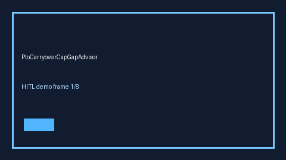

# PtoCarryoverCapGapAdvisor Guide



Offline HITL advisor. Never auto-acts. Closes closed-UI gaps vs Rippling/Gusto/Levels.fyi PTO carryover-cap planners (distinct from related advisors).

Optional later polish via **GPT-5.5 / Claude Sonnet 4.6 / Gemini 3.x / Kimi K2**.

Distinct from `PtoAccrualCliffAdvisor` / `PtoCashOutValueAdvisor`.

## Usage

```python
from autoapply_agent.services.pto_carryover_cap_gap import PtoCarryoverCapGapAdvisor

report = PtoCarryoverCapGapAdvisor().advise(
    carryover_hours=100.0,
    needed_hours=100.0,
)
assert report.auto_enroll is False
print(report.coverage_band)
```

## Safety

Always `requires_human_review=True`. No HTTP. Humans decide. See `SAFETY.md`.
