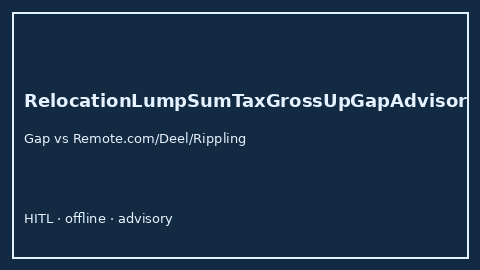

# RelocationLumpSumTaxGrossUpGapAdvisor Guide



Offline HITL helper for `offered_usd` bands.
Gap vs Remote.com/Deel/Rippling relocation lump-sum tax gross-up planners. Distinct from `RemoteWorkStipendTaxGapAdvisor` / `TaxEqualizationGrossUpAdvisor`.

Optional polish via **GPT-5.5 / Claude Sonnet 4.6 / Gemini 3.x / Kimi K2**.

## Usage

```python
from autoapply_agent.services.relocation_lump_sum_tax_gross_up_gap import (
    RelocationLumpSumTaxGrossUpGapAdvisor,
)

report = RelocationLumpSumTaxGrossUpGapAdvisor().advise(
    offered_usd=50.0,
    needed_usd=100.0,
)
assert report.requires_human_review is True
assert report.auto_approve is False
print(report.coverage_band)
```

## Safety

Advisory only. No network I/O. Never auto-acts. Humans decide.
