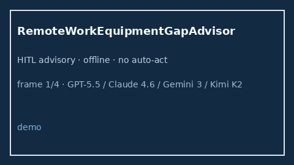

# RemoteWorkEquipmentGapAdvisor Guide



Offline HITL helper for `offered_usd` bands.
Gap vs Rippling/Deel/Remote.com remote-work equipment stipend planners. Distinct from `HomeOfficeStipendGapAdvisor` / `RemoteWorkStipendTaxGapAdvisor`.

Optional polish via **GPT-5.5 / Claude Sonnet 4.6 / Gemini 3.x / Kimi K2**.

## Usage

```python
from autoapply_agent.services.remote_work_equipment_gap import RemoteWorkEquipmentGapAdvisor

report = RemoteWorkEquipmentGapAdvisor().advise(
    offered_usd=50.0,
    needed_usd=100.0,
)
assert report.requires_human_review is True
assert report.auto_approve is False
print(report.coverage_band)
```

## Safety

Advisory only. No network I/O. Never auto-acts. Humans decide.
