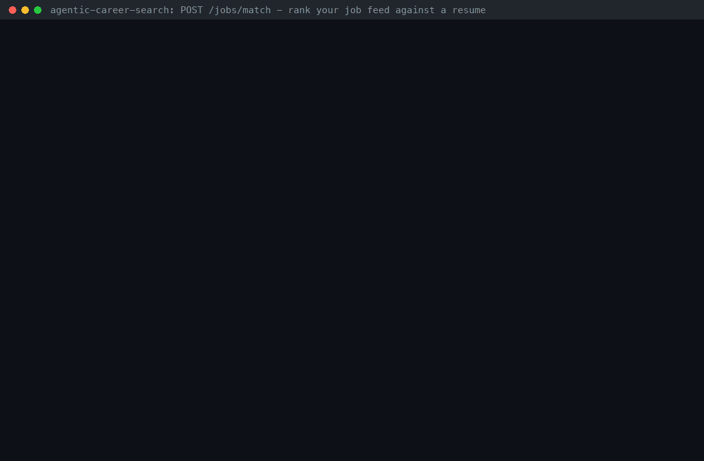

# Resume-to-Job Match Guide

*Rank the jobs your discovery runs captured against your resume — matched and missing
skills, deterministic, offline*



`POST /jobs/match` takes the plain text of your resume plus the same filters as `GET /jobs`
and returns the captured jobs ranked by how much of each posting's skill list your resume
covers, each with `matched_skills`, `missing_skills`, an optional `extra_skills` list and a
one-line `explanation`. AI assistants get the same ranking through the read-only MCP tool
`match_resume_to_jobs`. There is no LLM, no network call and no API key: skills come from a
curated lexicon of 254 technical and business skills with aliases (`k8s` → `kubernetes`,
`Postgres` → `postgresql`, `JS` → `javascript`, `ML` → `machine learning`), and the resume is
used in memory only — never stored, never logged (only its SHA-256 digest is).

| Surface | What it does |
| --- | --- |
| `POST /jobs/match` | JSON body (`resume_text` + `GET /jobs` filters) → ranked jobs; `?format=csv` for a spreadsheet-safe download |
| MCP `match_resume_to_jobs` | The same ranking for Claude Desktop, Claude Code, VS Code, Cursor and other MCP hosts |

## Contents

- [Who it is for](#who-it-is-for)
- [Why this exists](#why-this-exists)
- [Quickstart (offline)](#quickstart-offline)
- [API reference](#api-reference)
- [MCP tool reference](#mcp-tool-reference)
- [How it works](#how-it-works)
- [The skill lexicon](#the-skill-lexicon)
- [Safety, privacy and limits](#safety-privacy-and-limits)
- [Limitations](#limitations)
- [Troubleshooting](#troubleshooting)
- [How this demo was recorded](#how-this-demo-was-recorded)
- [See also](#see-also)

## Who it is for

- **Job seekers** running agentic-career-search against their target boards who want the
  captured feed ordered by fit with *their* background, plus a short list of skills each
  posting asks for that their resume does not show (learn it, or say it if you have it).
- **Assistant users** who would rather ask *"which of this week's remote roles fit my
  resume, and what am I missing?"* in Claude Desktop, Claude Code, VS Code or Cursor.
- **Builders** who need an explainable, reproducible fit signal for triage: the same resume
  and feed always produce the same ranking, and every number can be traced to named skills.

## Why this exists

Resume↔job matching is one of the most requested features of open-source job tools, but
the popular projects either match one job at a time or do not match at all:

- [Resume-Matcher](https://github.com/srbhr/Resume-Matcher) (`srbhr/Resume-Matcher`,
  about 29.3k stars) is built around tailoring a master resume to **one job description you
  paste**: an LLM rewrites the resume, and a deterministic ATS score
  ([`services/ats.py`](https://github.com/srbhr/Resume-Matcher/blob/main/apps/backend/app/services/ats.py))
  rates that resume/job pair. It does not capture postings from career boards or rank a feed.
- [JobSpy](https://github.com/speedyapply/JobSpy) (`speedyapply/JobSpy`, about 4.7k
  stars) scrapes several job boards into a DataFrame, CSV or JSON Lines, and its MCP server
  offers `search_jobs` and `get_job_details` — it never compares postings with a resume.
- agentic-career-search had the building blocks but no product surface:
  `AtsKeywordCoverageScorer` scores one resume against one job text with the 25 most
  frequent JD words (no aliases, so `k8s` never meets `kubernetes`), and
  `SkillsProfileFitScorer` checks an explicit skills list. Nothing ranked the **stored feed**
  against a resume through the API or MCP.

This feature closes that gap on top of the data you already have — captured, deduplicated
and scored jobs — and reuses the ATS scorer's coverage math (`keyword_coverage()`).

| | Resume-Matcher | JobSpy | `AtsKeywordCoverageScorer` | `POST /jobs/match` |
| --- | --- | --- | --- | --- |
| Input | Master resume (PDF/DOCX) + one pasted job description | Search terms | Resume text + one job text | Resume text + `GET /jobs` filters over your captured feed |
| Output | Tailored resume, ATS score | Postings | Coverage, present/missing JD words | Every matching job ranked; matched/missing/extra skills; explanation; JSON or CSV |
| Matching | LLM tailoring + deterministic ATS score | — | Frequent JD words, exact tokens | Curated skill lexicon: aliases, symbol-aware boundaries, implied skills |
| LLM / keys | Yes (cloud or local model) for tailoring | No | No | No |
| Resume storage | Kept in its local database | n/a | Caller's choice | Never stored; digest only |
| Assistants (MCP) | Tailor, verify and render a resume | Search boards | — | `match_resume_to_jobs` |

Facts about the other projects come from their READMEs and docs, checked on 2026-11-12.
They are complementary: Resume-Matcher tailors the resume you send to the jobs this feature
ranks first.

## Quickstart (offline)

Python 3.11+, [uv](https://docs.astral.sh/uv/) and `jq`; no API keys or network access
needed. Seed the demo feed and start the API:

```bash
git clone https://github.com/Francis1998/agentic-career-search.git && cd agentic-career-search
uv sync --extra dev --frozen
export DATABASE_URL=sqlite+aiosqlite:///./match-demo.db
uv run python scripts/seed_demo_jobs.py   # 8 demo jobs; 7 carry a short raw.description
ENABLE_WORKER=false uv run uvicorn autoapply_agent.main:app --port 8000 --log-level warning &
for _ in $(seq 50); do curl -sf localhost:8000/health/ready >/dev/null && break; sleep 0.2; done
```

Build the JSON body from a plain-text resume. `jq --rawfile` reads the file as one string
and escapes newlines and quotes; [`RESUME_JOB_MATCH_SAMPLE_RESUME.txt`](RESUME_JOB_MATCH_SAMPLE_RESUME.txt)
is a synthetic sample resume:

```console
$ BODY=$(jq -n --rawfile resume docs/guides/RESUME_JOB_MATCH_SAMPLE_RESUME.txt '{resume_text: $resume, remote: true, limit: 3}')
$ curl -s localhost:8000/jobs/match -H 'content-type: application/json' -d "$BODY" | jq -r '.jobs[] | "\(.rank). \(.match_score) \(.title) | missing: \(.missing_skills | join(", "))"'
1. 0.9091 Senior Python Engineer | missing: kafka
2. 0.7778 Site Reliability Engineer | missing: incident response, bash
3. 0.6923 Staff Platform Engineer (Python, Kubernetes) | missing: platform engineering, argo cd, observability, system design
$ curl -s localhost:8000/jobs/match -H 'content-type: application/json' -d "$BODY" | jq -r '(.implied_skills | tojson), .jobs[0].explanation'
{"ci/cd":["github actions"],"data visualization":["tableau"],"infrastructure as code":["terraform"]}
Matches 10 of 11 skills in this posting: python, backend development, fastapi, postgresql, aws, docker, kubernetes, ci/cd (via github actions), github actions, go. Missing: kafka.
```

Mix in the deterministic score the discovery run recorded, or download a CSV:

```console
$ jq '.sort = "blend"' <<< "$BODY" | curl -s localhost:8000/jobs/match -H 'content-type: application/json' -d @- | jq -r '.jobs[] | "\(.rank). blend \(.blend_score) = 0.7 x match \(.match_score) + 0.3 x score \(.score)"'
1. blend 0.9124 = 0.7 x match 0.9091 + 0.3 x score 0.92
2. blend 0.7486 = 0.7 x match 0.6923 + 0.3 x score 0.88
3. blend 0.7425 = 0.7 x match 0.7778 + 0.3 x score 0.66
$ jq '.remote = null | .limit = 8' <<< "$BODY" | curl -s -OJ 'localhost:8000/jobs/match?format=csv' -H 'content-type: application/json' -d @-   # saves job-matches-<UTC time>.csv
```

**Your own resume:** save it as plain text (`pdftotext resume.pdf resume.txt` from poppler,
or *Save as → Plain text* in your editor) and replace the sample path. **Your own feed:**
configure sources and start runs as in [QUICKSTART.md](../../QUICKSTART.md); the endpoint
ranks whatever the database holds (see [Limitations](#limitations) for what postings
contain today).

From Python (`httpx` is already a dependency):

```python
from pathlib import Path

import httpx

body = {"resume_text": Path("resume.txt").read_text(encoding="utf-8"), "remote": True}
response = httpx.post("http://localhost:8000/jobs/match", json=body, timeout=30)
for job in response.json()["jobs"]:
    print(job["rank"], job["match_score"], job["title"], "missing:", job["missing_skills"])
```

## API reference

### `POST /jobs/match`

Send `Content-Type: application/json` (any other type is a `415`). The only query
parameter is `format`.

| Query parameter | Values | Meaning |
| --- | --- | --- |
| `format` | `json` (default), `csv` | `csv` returns an attachment with the match columns followed by the `GET /jobs/export` columns |

Body fields (unknown fields are rejected with `422`, so a typo never silently widens a
search):

| Field | Type | Default | Limits | Meaning |
| --- | --- | --- | --- | --- |
| `resume_text` | string | — (required) | 1–50,000 characters, not only whitespace | Plain text of the resume; used in memory only |
| `q` | string | — | ≤ 200 chars | Space-separated terms; each must match title, company or location |
| `company` | string | — | ≤ 256 chars | Case-insensitive company substring |
| `location` | string | — | ≤ 256 chars | Case-insensitive location substring |
| `remote` | boolean | — | | `true`: location mentions remote, anywhere, work from home, wfh, telecommute or distributed; `false`: it does not |
| `min_score` | number | — | 0–1 | Minimum deterministic score (inclusive) |
| `source_config_id` | integer | — | 1–2^63-1 | Only jobs captured from this source config |
| `run_id` | string | — | 1–64 chars | Only jobs captured by this run |
| `created_after` | ISO-8601 date-time | — | | Only jobs captured at or after it (naive means UTC) |
| `hours_old` | integer | — | 1–8760 | Only jobs captured within the last N hours; combines with `created_after` (the later bound wins) |
| `dedupe` | boolean | **`true`** | | Rank each posting once: re-captures of one URL and cross-board mirrors collapse to the first capture (unlike `GET /jobs`, on by default) |
| `sort` | `match` \| `blend` | `match` | | See [Ranking](#4-ranking-and-tie-breaks) |
| `limit` | integer | 20 | 1–500 | Number of top jobs returned |
| `min_match` | number | — | 0–1 | Drop jobs whose match score is lower |
| `include_extra_skills` | boolean | `false` | | Also list, per job, the resume skills the posting does not mention |

The filters are the `GET /jobs` filters with the same semantics — see the
[Job Search, Export & Atom Feed Guide](JOB_SEARCH_EXPORT_GUIDE.md#filter-reference).

### JSON response

| Field | Meaning |
| --- | --- |
| `resume_sha256` | SHA-256 of the UTF-8 resume text, for correlating with the server log line |
| `resume_skills` | Skills recognized in the resume, alphabetical |
| `implied_skills` | Skills the resume demonstrates without naming them → the resume skills that imply them |
| `sort` | `match` or `blend` |
| `total` | Jobs ranked (filters and `min_match` applied) before `limit`; also in the `X-Total-Count` header |
| `jobs` | Ranked jobs, best first |

Each item of `jobs` has every `GET /jobs` field (`id`, `run_id`, `source_config_id`,
`external_id`, `title`, `location`, `company`, `url`, `score`, `plan_steps`, `raw`,
`created_at`) plus:

| Field | Meaning |
| --- | --- |
| `rank` | 1-based position |
| `match_score` | Share of the posting's skills found on the resume (named or implied), 0–1, 4 decimals |
| `blend_score` | `0.7 * match_score + 0.3 * score`, 4 decimals (always returned; used by `sort=blend`) |
| `matched_skills` | Posting skills the resume has, in the order the posting mentions them |
| `missing_skills` | Posting skills the resume lacks, in posting order |
| `extra_skills` | Resume skills the posting does not mention (alphabetical); `null` unless `include_extra_skills` |
| `explanation` | One-line summary; implied matches say which resume skill implied them; with `sort=blend` it ends with the blend arithmetic |

Real response for the sample resume (`remote: true`, `limit: 1`,
`include_extra_skills: true`; `raw.description` shortened and arrays folded onto one line
here):

```json
{
  "resume_sha256": "bb10a7bc97b0af886db70115170f75073ede098fb9f7ebbfbab6ca13d483bd5c",
  "resume_skills": ["amazon s3", "aws", "backend development", "django", "docker", "ec2", "eks", "etl", "event-driven architecture", "fastapi", "github actions", "go", "grafana", "helm", "kubernetes", "linux", "microservices", "postgresql", "prometheus", "python", "redis", "site reliability engineering", "sql", "tableau", "terraform"],
  "implied_skills": {"ci/cd": ["github actions"], "data visualization": ["tableau"], "infrastructure as code": ["terraform"]},
  "sort": "match",
  "total": 3,
  "jobs": [
    {
      "id": 1,
      "run_id": "e5383e90-3306-4888-8081-e75cb59f3e96",
      "source_config_id": 1,
      "external_id": "gh-4101",
      "title": "Senior Python Engineer",
      "location": "Remote - US",
      "company": "Acme Robotics",
      "url": "https://boards.greenhouse.io/acme/jobs/4101",
      "score": 0.92,
      "plan_steps": ["Review fit with the decision trace", "Tailor resume bullets"],
      "raw": {"source": "greenhouse", "agent_decision": {"priority_tier": "high"}, "description": "Build the fleet telemetry backend in Pyt…"},
      "created_at": "2026-11-13T03:25:42.244200",
      "rank": 1,
      "match_score": 0.9091,
      "blend_score": 0.9124,
      "matched_skills": ["python", "backend development", "fastapi", "postgresql", "aws", "docker", "kubernetes", "ci/cd", "github actions", "go"],
      "missing_skills": ["kafka"],
      "extra_skills": ["amazon s3", "django", "ec2", "eks", "etl", "event-driven architecture", "grafana", "helm", "linux", "microservices", "prometheus", "redis", "site reliability engineering", "sql", "tableau", "terraform"],
      "explanation": "Matches 10 of 11 skills in this posting: python, backend development, fastapi, postgresql, aws, docker, kubernetes, ci/cd (via github actions), github actions, go. Missing: kafka."
    }
  ]
}
```

### CSV (`?format=csv`)

`text/csv; charset=utf-8`, served as `attachment; filename="job-matches-<UTC time>.csv"`
with `X-Total-Count`. The header is the match columns followed by exactly the columns of
`GET /jobs/export`:

```text
"rank","match_score","blend_score","matched_skills","missing_skills","extra_skills","explanation","id","title","company","location","remote","score","priority_tier","source","url","source_config_id","run_id","external_id","created_at"
```

Skill lists are joined with `"; "`; `extra_skills` is empty unless `include_extra_skills`.
Rows go through the export's OWASP CSV-injection hardening (`job_csv_row`,
`neutralize_csv_cell`): every cell is quoted, text cells that start with `=`, `+`, `-`, `@`,
tab or carriage return get a leading `'`, and non-http(s) links are dropped. The seeded
hostile row shows it — its title becomes `'=HYPERLINK("https://evil.example","Apply here")`
in the demo above.

### Status codes

| Status | When | Body (real examples) |
| --- | --- | --- |
| `200` | Ranked (possibly zero jobs) | JSON above, or CSV |
| `413` | Body over 1,048,576 bytes — checked from `Content-Length` and again while a chunked body streams in, before any JSON parsing | `{"detail":"Request body exceeds 1048576 bytes; resume_text is limited to 50000 characters."}` |
| `415` | `Content-Type` is not JSON (for example `curl -d` without `-H 'content-type: application/json'`) | `{"detail":"Send the match request as JSON (Content-Type: application/json)."}` |
| `422` | Missing, blank or too long `resume_text`; unknown field; out-of-range filter; malformed JSON; `format` other than `json`/`csv` | `{"detail":[{"type":"resume_blank","loc":["body","resume_text"],"msg":"resume_text must contain text"}]}` |

Body validation errors use FastAPI's usual list shape but **never echo the input** — a
too-long resume comes back as `{"type":"string_too_long","loc":["body","resume_text"],"msg":"String should have at most 50000 characters","ctx":{"max_length":50000}}`,
not as 50,000 characters of your resume. Any resume within the character limit fits the
byte limit, even written entirely in 4-byte characters and sent with JSON `\u` escapes
(a test sends one).

## MCP tool reference

`match_resume_to_jobs` is the seventh tool of the read-only MCP server
`career-search-mcp` (setup for every host: [MCP Server Guide](MCP_SERVER_GUIDE.md)). It
calls the same `rank_jobs()` as the HTTP endpoint, so for the same arguments it returns the
same jobs, scores and skill lists (a test compares them).

| Argument | Type | Default | Notes |
| --- | --- | --- | --- |
| `resume_text` | string, required | — | 1–50,000 characters; the plain text, not a file path |
| `q`, `company`, `location`, `remote`, `min_score`, `source_config_id`, `run_id`, `created_after`, `hours_old` | as `search_jobs` | — | Same filters as `GET /jobs` |
| `dedupe` | boolean | `true` | |
| `sort` | `match` \| `blend` | `match` | |
| `limit` | integer | 10 | 1–50 |
| `min_match` | number | — | 0–1 |
| `include_extra_skills` | boolean | `false` | |

`structuredContent` holds `resume_sha256`, `resume_skills`, `implied_skills`, `sort`,
`dedupe`, `captured_since`, `total`, `limit` and `jobs`; each job has the `search_jobs`
fields (`id`, `title`, `company`, `location`, `remote`, `score`, `priority_tier`, `url`,
`source_config_id`, `run_id`, `captured_at`) plus `rank`, `match_score`, `blend_score`,
`matched_skills`, `missing_skills`, `extra_skills` and `explanation`. The tool works for
modern (2026-07-28) and legacy (`initialize`) clients. Real text content from the demo:

```text
Resume: 25 skills recognized (amazon s3, aws, backend development, django, docker, ec2, eks, etl, event-driven architecture, fastapi, github actions, go, grafana, helm, kubernetes, linux, microservices, postgresql, prometheus, python, redis, site reliability engineering, sql, tableau, terraform).
7 jobs ranked (sort=match, dedupe=on); top 2:
1. #1 match 0.9091 Senior Python Engineer — Acme Robotics · Remote - US
   Matches 10 of 11 skills in this posting: python, backend development, fastapi, postgresql, aws, docker, kubernetes, ci/cd (via github actions), github actions, go. Missing: kafka.
2. #5 match 0.7778 Site Reliability Engineer — Vandelay Industries · Remote (EU)
   Matches 7 of 9 skills in this posting: site reliability engineering, linux, kubernetes, terraform, prometheus, grafana, python. Missing: incident response, bash.
```

Bad arguments come back as `isError: true` tool results that never repeat the resume
(`Invalid arguments: arguments.resume_text must be at most 50000 characters`). With
`--audit-log`, the call is recorded like every other tool call — tool name, keyed hash of
the arguments, result count and duration, never the arguments:

```json
{"arguments_hash": "hmac-sha256:5277151a575459539a2ac625a2b5f07dc0bfd58ded5b6426bbf64fed7c89f3dd", "duration_ms": 3.9, "error_kind": null, "event": "mcp_tool_call", "is_error": false, "result_count": 2, "timestamp": "2026-11-13T05:25:43.080+00:00", "tool": "match_resume_to_jobs"}
```

In an assistant, ask for example *"Here is my resume: … Which remote roles from the last
week fit it best, and what am I missing?"* — the assistant can call the tool with your
resume as `resume_text` plus `remote=true` and `hours_old=168`; no other setup is needed.

## How it works

Everything lives in two services shared by the API and the MCP tool:
`services/skill_extraction.py` (lexicon and extractor) and `services/resume_match.py`
(profile, matching, ranking, CSV).

### 1. Skills from text

One compiled regular expression scans the text once; every alias of a skill folds to its
canonical name.

- **Aliases and spellings.** `k8s`/`Kubernetes`, `Postgres`/`PostgreSQL`, `JS`/`JavaScript`/
  `ES6`, `golang`, `sklearn`, `NodeJS`/`node js`, `CICD`/`ci-cd`. A space or hyphen inside an
  alias accepts any run of spaces, hyphens or underscores, or none: `front-end` =
  `frontend` = `front end`.
- **Symbol-aware boundaries.** `C++`, `C#`, `F#`, `.NET`, `Node.js`, `CI/CD` and `PL/SQL`
  are whole skills; `Java` never matches inside `JavaScript`, `SQL` never inside `NoSQL` or
  `MySQL`, `.NET` never inside `ASP.NET` (which is its own skill). The longest alias wins at
  each position, so `React Native` is one skill and `Objective-C` is not `C`.
- **Versions and plurals.** `Python3.11`, `C++17`, `HTML5` and `LLMs` count.
- **Ambiguous short words are exact.** `Go`, `R`, `C`, `AI`, `ML`, `REST`, `RAG`, `Swift`,
  `Spark`, `Excel`, `Flask`, `Rails`, `Helm`, `S3`, `QA`, `SAP` and a few more match only in
  that capitalization, never touching `-`, `&` or an apostrophe, and not in known non-skill
  contexts: `good`, `Go above and beyond`, `go-to person`, `Go-live` (no Go); `R&D`,
  `R. Smith`, `Mary R Smith`, `Acme(R)` (no R); `Series C`, `C-suite`, `Grade C`,
  `Vitamin C`, `USB-C`, `(C) 2026` (no C); `Excel at …`, `Spark joy`, `the rest of`,
  `RAG status`, `AI-powered`.
- **Implied skills (resume side only).** A resume skill also demonstrates broader ones:
  `postgresql` → `sql`, `eks` → `kubernetes` + `aws`, `github actions` → `ci/cd`,
  `terraform` → `infrastructure as code`, `typescript`/`react` → `javascript`,
  `pytorch` → `deep learning` → `machine learning` → `artificial intelligence` (88 skills
  carry implications; chains are followed). A posting that asks for `sql` is therefore
  matched by a resume that only says `PostgreSQL`, and the explanation says
  `sql (via postgresql)`. Postings never gain requirements they did not state.

### 2. What text of a job is read

The title first, then these `Job.raw` fields when present (strings or lists of strings):
`description`, `summary`, `requirements`, `qualifications`, `responsibilities`, `skills`.
HTML tags are dropped and entities decoded; at most 20,000 characters are scanned.
Company, location and the optional LLM enrichment summary are **not** read: an employer's
name is not a requirement, and model-written text would make the match non-reproducible.

### 3. Scores

- `match_score` = matched posting skills ÷ posting skills (4 decimals) — the coverage math of
  `AtsKeywordCoverageScorer` (`keyword_coverage()`), applied to lexicon skills. It answers
  *"what share of what this posting asks for does my resume show?"*. A posting in which no
  lexicon skill appears scores 0 and says so.
- `blend_score` = `0.7 * match_score + 0.3 * score`, where `score` is the deterministic
  relevance the discovery run stored (run query terms, see
  [ARCHITECTURE.md](../../ARCHITECTURE.md)).

### 4. Ranking and tie-breaks

| `sort` | Order (each key descending) |
| --- | --- |
| `match` | `match_score`, number of matched skills, `score`, capture time, `id` |
| `blend` | `blend_score`, `match_score`, `score`, capture time, `id` |

The job id makes every key unique, so the same request on the same data always returns the
same order. Candidates stream through `iter_jobs` (the export's keyset batches) and only
the best `limit` jobs are kept in memory.

### 5. Filters

The body becomes a `JobSearchFilters` and goes through `services/job_search.iter_jobs`,
the code path of `GET /jobs` and `GET /jobs/export`; a test checks 14 filter combinations
against `GET /jobs` and requires the same jobs and totals. Only `dedupe` differs by
default: a ranking shows each posting once.

## The skill lexicon

254 canonical skills with 434 surface forms, in `services/skill_extraction.py`:

| Group | Skills | Examples |
| --- | --- | --- |
| Programming languages | 34 | python, java, javascript, typescript, go, rust, c, c++, c#, kotlin, swift, r, sql, bash |
| Web and frontend | 26 | react, react native, vue, angular, next.js, node.js, graphql, frontend development, ux design, figma |
| Backend frameworks, APIs, architecture | 20 | django, flask, fastapi, spring, ruby on rails, .net, asp.net, rest api, microservices, distributed systems, system design |
| Data, analytics, machine learning | 61 | machine learning, deep learning, nlp, large language models, pytorch, scikit-learn, pandas, spark, airflow, dbt, snowflake, bigquery, tableau, excel |
| Cloud, infrastructure, operations | 43 | aws, gcp, azure, eks, docker, kubernetes, helm, terraform, ci/cd, github actions, site reliability engineering, prometheus, linux |
| Databases and messaging | 15 | postgresql, mysql, sql server, mongodb, redis, cassandra, rabbitmq |
| Testing and quality | 11 | unit testing, test automation, test-driven development, pytest, playwright |
| Security | 6 | cybersecurity, application security, penetration testing, identity and access management |
| Mobile | 5 | ios, android, swiftui, flutter |
| Delivery practices and tools | 5 | agile, scrum, kanban, jira, confluence |
| Business, product, go-to-market | 28 | product management, project management, stakeholder management, sales, payments, seo, salesforce, financial modeling, gaap |

Some words are deliberately left out because postings use them in other senses: bare
`accessibility` (interview *accessibility accommodations*), `SaaS` (company blurbs),
`Spring` (seasons), `Workday`, `Julia`.

**Extending it:** add one `_skill(...)` line — canonical name, aliases, `exact=` for
ambiguous capitalized words and `implies=` for broader skills — and run
`uv run pytest tests/unit/test_skill_extraction.py`. The module refuses to import if two
skills claim one alias or an implication names an unknown skill, and a test checks that
every alias of every skill is recognized as that skill.

## Safety, privacy and limits

- **Never stored.** The resume is processed in memory for one request: the endpoint only
  reads the database (tests require identical row counts and that a canary string from the
  resume appears in no database file), and the MCP server additionally runs SQLite with
  `PRAGMA query_only = ON`.
- **Never logged.** The API writes one INFO line per match —
  `jobs_match resume_sha256=<digest> resume_chars=… resume_skills=… ranked=… returned=… sort=… format=…` —
  and nothing else; a test captures every log record at DEBUG and searches it for the
  resume. The resume travels in the request body, so access logs (which show the path and
  query string) never contain it. MCP logs and the audit log keep only the tool name and a
  keyed hash of the arguments.
- **Never echoed.** Validation errors omit inputs; tool errors only name the failed rule.
- **Bounded.** `resume_text` ≤ 50,000 characters (about 15 pages); request body ≤ 1 MiB,
  enforced while the body streams in (`413`); `limit` ≤ 500 (MCP: 50); 20,000 characters
  of each posting are scanned.
- **What leaves your machine.** Nothing, from this feature. If you use the MCP tool, your
  assistant host and its model provider already have the resume you pasted into the chat,
  and they receive the ranking.
- **Untrusted postings.** Titles and descriptions come from public career pages: they are
  matched as text, never executed or followed; CSV output is formula-injection safe.
- **Assistive only.** A match score is keyword evidence for triage, not a prediction of
  hiring outcomes; read the posting before acting (see [SAFETY.md](../../SAFETY.md)).

## Limitations

- **Most stored postings have titles only.** Today's adapters capture title, company,
  location and URL, not the posting body, so for those jobs matching uses the title
  (`Staff Platform Engineer (Python, Kubernetes)` → platform engineering, python,
  kubernetes). Postings whose `raw` carries `description`-like fields — the seeded demo jobs,
  rows you import, or future adapters that keep the body — are matched on that text too.
- **Lexicon, not semantics.** A skill the lexicon does not know is invisible, and synonyms
  outside it do not match. English skill names only.
- **Mentions, not requirements.** Every skill named in the posting counts the same,
  including "nice to have" items and teams you would work with ("partner with product
  management"). Years of experience and seniority are not weighed.
- **Plain text in.** No PDF/DOCX parsing; convert first.
- **Top-N, not pages.** There is no `offset`; raise `limit` (≤ 500) or narrow the filters.

## Troubleshooting

| Symptom | Fix |
| --- | --- |
| `415 Send the match request as JSON` | Add `-H 'content-type: application/json'`; plain `curl -d` sends a form. |
| `422 json_invalid` | The body is not valid JSON — build it with `jq -n --rawfile resume resume.txt '{resume_text: $resume}'` instead of pasting the resume into a JSON string by hand. |
| `422 string_too_long` / `413` | Trim the resume below 50,000 characters (drop publication lists, or send the most relevant pages). |
| `422 extra_forbidden` | A field name is misspelled; the error names it (for example `remote_only` → `remote`). |
| `resume_skills` is `[]` and every score is 0 | The text has no lexicon skills — check that you sent extracted text, not a PDF's bytes or a file path. |
| Every `match_score` is 0 or 1 | The feed has titles only; see [Limitations](#limitations). |
| The same job appears twice | You set `dedupe: false`. |
| Fewer jobs than expected | Filters and `min_match` apply before `limit`; `total` / `X-Total-Count` tells you how many matched. |

## How this demo was recorded

Every `$` line in [`RESUME_JOB_MATCH_DEMO_TRANSCRIPT.txt`](RESUME_JOB_MATCH_DEMO_TRANSCRIPT.txt)
was executed verbatim, in order, in one shell at the repository root against a fresh
database (macOS, Python 3.12, 2026-11-12 US Pacific time), and the lines after it are its
unedited output — run id, hash and timestamp included. After starting `uvicorn`, the
recording waited for `GET /health/ready` before the next command. To reproduce:

```bash
rm -f match-demo.db logs/match-audit.jsonl
# ...then run the $ lines of the transcript (needs uv, curl, jq and python3)
```

The GIF is rendered from the transcript by the repository's GIF tool (Pillow; types each
`$` command and reveals its output, one shared palette):

```bash
./scripts/generate_demo_gif.sh --only resume-job-match.gif
```

## See also

- [Job Search, Export & Atom Feed Guide](JOB_SEARCH_EXPORT_GUIDE.md) — the filters and the CSV export
- [MCP Server Guide](MCP_SERVER_GUIDE.md) — connecting Claude Desktop, Claude Code, VS Code or Cursor
- [ATS Keyword Coverage Guide](ATS_KEYWORD_COVERAGE_GUIDE.md) — single resume/job keyword coverage
- [docs/API.md](../API.md) — HTTP API reference
- [SAFETY.md](../../SAFETY.md) — scope boundaries and guardrails
