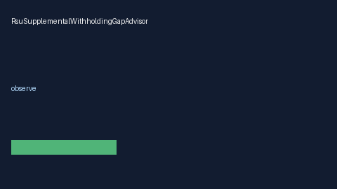

# RsuSupplementalWithholdingGapAdvisor Guide



Offline HITL advisor. Never auto-acts. Closes closed-UI gaps vs Carta/Schwab/Fidelity RSU supplemental-withholding gap planners (distinct from related advisors).

Optional later polish via **GPT-5.5 / Claude Sonnet 4.6 / Gemini 3.x / Kimi K2**.

Distinct from `RsuRefreshCliffAdvisor` / `TaxEqualizationGrossUpAdvisor`.

## Usage

```python
from autoapply_agent.services.rsu_supplemental_withholding_gap import (
    RsuSupplementalWithholdingGapAdvisor,
)

report = RsuSupplementalWithholdingGapAdvisor().advise(
    withheld_rate=100.0,
    marginal_rate=100.0,
)
assert report.auto_enroll is False
print(report.coverage_band)
```

## Safety

Always `requires_human_review=True`. No HTTP. Humans decide. See `SAFETY.md`.
