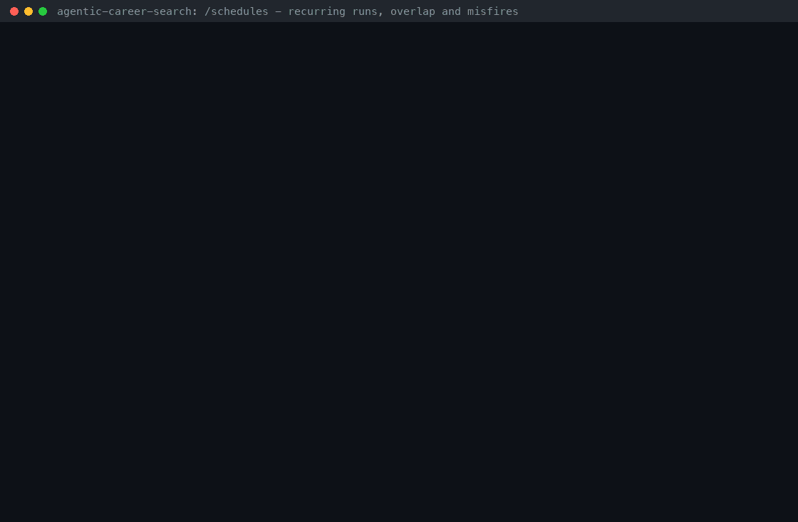

# Run schedules guide

Recurring discovery schedules let the agent re-run your saved sources on its own — every
N minutes or on a cron expression in your time zone — so the job feed stays fresh without
an external cron job and `curl`. Each schedule stores the parameters of `POST /runs`
(query terms, source configs) plus a cadence; an in-process scheduler queues a normal run
whenever one is due, with explicit **overlap**, **misfire**, **pause** and **jitter**
semantics borrowed from workflow orchestrators, and records every decision in an
append-only history.



*Real session against a local SQLite database and an offline JSON-LD board
([transcript](RUN_SCHEDULES_DEMO_TRANSCRIPT.txt)): previewing a cron expression (with the
DST gap skipped), a 422 for a too-frequent schedule, an interval schedule firing on the next
tick, an overlap skip, a buffered fire, pause / resume, and a 31-minute outage coalesced
into one run.*

## Contents

- [Why schedules](#why-schedules)
- [Prerequisites](#prerequisites)
- [Quickstart](#quickstart)
- [How schedules behave](#how-schedules-behave)
- [Cron syntax](#cron-syntax)
- [HTTP API reference](#http-api-reference)
- [MCP tools](#mcp-tools)
- [Configuration](#configuration)
- [Worked example](#worked-example)
- [How schedules interact with the rest of the system](#how-schedules-interact-with-the-rest-of-the-system)
- [Storage and migrations](#storage-and-migrations)
- [Safety and politeness](#safety-and-politeness)
- [Troubleshooting](#troubleshooting)
- [FAQ](#faq)
- [Limitations and roadmap](#limitations-and-roadmap)

## Why schedules

Before this feature, runs were only created by `POST /runs`, so "autonomous" discovery
still depended on the user's own cron job calling the API — with no protection against
two runs overlapping, a burst of catch-up runs after a laptop wakes up, or a cron line
that fires every minute. Orchestrators treat schedules as first-class objects with
explicit semantics; this feature adopts the parts that matter for a job feed:

| Concern | [Temporal Schedules](https://docs.temporal.io/schedule) | [APScheduler 3](https://apscheduler.readthedocs.io/en/3.x/userguide.html) | [Prefect](https://docs.prefect.io/v3/automate/add-schedules) | [Airflow](https://airflow.apache.org/docs/apache-airflow/stable/core-concepts/dag-run.html) | agentic-career-search |
| --- | --- | --- | --- | --- | --- |
| Cadence | Interval (epoch-aligned + phase) or calendar / cron | `interval`, `cron`, `date` triggers | Interval (anchor date), cron, RRule | Cron / timetable | `interval_minutes` (anchored at `start_at`) or 5-field `cron` |
| Time zones & DST | Calendar specs in a named zone | `timezone` on cron triggers | `timezone`; cron fires on schedule times, not elapsed hours | Zone-aware DAGs | IANA `timezone`; nonexistent local times skipped, ambiguous ones fire once |
| Overlap | `Skip` (default), `BufferOne`, `BufferAll`, `CancelOther`, `TerminateOther`, `AllowAll` | `max_instances` (default 1) | Concurrency limits | `max_active_runs` | `skip` (default) or `buffer_one` |
| Missed fires | Catch-up window (default 1 year) | `coalesce`, `misfire_grace_time` | Scheduler creates upcoming runs | `catchup=False` runs only the latest interval | Always coalesced into **one** run (`coalesced_misfire`) |
| Pause | Pause with a note; manual trigger still allowed | `pause_job()` | Inactive schedules | Paused DAGs | `pause` with a note; manual `trigger` still allowed; resume never catches up |
| Run now | Trigger immediately (honours overlap policy) | `modify(next_run_time=now)` | Quick run | Trigger DAG | `POST /schedules/{id}/trigger` (honours overlap policy) |
| Jitter | Random, bounded by the next action | `jitter` seconds | — | — | Deterministic 0–`jitter_seconds` (≤ 600 s) per fire |
| Audit | Recent actions, running workflows | Event listeners | Flow run history | DAG run history | Append-only `GET /schedules/{id}/history` + `run.created` events |
| Double-fire safety | Server-side | Job store locks | Server-side | Scheduler DB locks | Conditional `UPDATE` claim per fire (safe across ticks and processes) |

What we deliberately left out (see [Limitations and roadmap](#limitations-and-roadmap)):
backfill, a configurable catch-up window, `BufferAll` / `AllowAll` / cancel-other
policies, RRule calendars and end dates.

## Prerequisites

- The API running with its scheduler (`ENABLE_SCHEDULER=true`, the default) and, to execute
  the runs it queues, the worker (`ENABLE_WORKER=true`, the default).
- At least one source config (`POST /source-configs`) — or none, in which case a scheduled
  run, like `POST /runs` without `source_config_ids`, processes every enabled source.
- The IANA time zone database. Linux and macOS ship it; on Windows install the `tzdata`
  package (`uv pip install tzdata`).
- Database schema: new installs get the tables from the app's startup `create_all`; for an
  existing database run `alembic upgrade head` (revision `f5c8a2d71b39`, see
  [Storage and migrations](#storage-and-migrations)).

## Quickstart

Fully offline, with the demo board that ships with this guide (three fictional postings
published as schema.org `JobPosting` JSON-LD):

```bash
export DATABASE_URL=sqlite+aiosqlite:///./schedules-demo.db
python -m http.server 8766 --bind 127.0.0.1 --directory docs/guides/demo-board > /dev/null 2>&1 &
SCHEDULER_TICK_SECONDS=2 uv run uvicorn autoapply_agent.main:app --port 8000 --log-level warning &
export CT='content-type: application/json'

# 1. Register the board as a source.
curl -s localhost:8000/source-configs -H "$CT" \
  -d '{"name": "demo-board", "source_type": "jsonld", "base_url": "http://127.0.0.1:8766/"}'

# 2. Dry-run a cron expression: weekdays at 08:30 in Los Angeles.
curl -s 'localhost:8000/schedules/preview?cron=30+8+*+*+1-5&timezone=America/Los_Angeles' \
  | jq -r '.upcoming[].local'

# 3. Save it, and an every-15-minutes schedule that fires on the next tick.
curl -s localhost:8000/schedules -H "$CT" -d '{"name": "weekday mornings", "cron": "30 8 * * 1-5",
  "timezone": "America/Los_Angeles", "query": "python platform", "source_config_ids": [1]}'
curl -s localhost:8000/schedules -H "$CT" \
  -d '{"name": "every 15 min", "interval_minutes": 15, "query": "python", "source_config_ids": [1]}'

# 4. A few seconds later: the run it queued, and the schedule's history.
sleep 3
curl -s localhost:8000/schedules/2 | jq '{last_run_id, last_run_status, next_run_at, upcoming}'
curl -s localhost:8000/schedules/2/history | jq -r '.[] | "\(.kind) \(.reason)"'
```

`SCHEDULER_TICK_SECONDS=2` only makes the demo snappy; the default is 30 seconds.

## How schedules behave

### Cadence

| Kind | Field | Fires at | Time zone role |
| --- | --- | --- | --- |
| `interval` | `interval_minutes` (15 – 43,200) | `start_at + k × interval` (k ≥ 0), in elapsed time | Display only (`upcoming[].local`); DST never changes the spacing |
| `cron` | `cron` (5 fields or a macro) | Every wall-clock time the expression matches, from `start_at` on | Expression is evaluated on the wall clock of `timezone` |

- `kind` is optional: it is inferred from whichever of `interval_minutes` / `cron` you send
  (send exactly one; sending `kind` too must agree with it).
- `start_at` (optional, up to one year ahead) is the interval **anchor** and, for both kinds,
  the earliest fire. It defaults to the next whole second, so a new interval schedule fires
  on the next scheduler tick. A `start_at` in the past only aligns the grid: with
  `start_at: "2026-01-05T09:00:00Z"` and `interval_minutes: 360`, fires land on
  03:00 / 09:00 / 15:00 / 21:00 UTC, starting with the next one after now — past slots are
  never run.
- **Minimum spacing (politeness floor): 15 minutes.** `interval_minutes` below 15 is a 422,
  and so is a cron expression whose consecutive wall-clock times can be less than 15
  minutes apart (`*/10 * * * *`, `0,5 9 * * *`). The check is on wall-clock times within a
  day plus the wrap to the next day, so it is exact or errs on the safe side; a DST change
  can shorten one gap per transition.

### DST rules (cron schedules)

Cron schedules fire on *schedule times*, not elapsed hours (the same rule Prefect
documents):

| Situation | Example (America/Los_Angeles) | Behaviour |
| --- | --- | --- |
| Local time does not exist (spring forward) | `30 2 * * *` on 2027-03-14 (02:00 → 03:00) | **Skipped** that day; next fire 2027-03-15 02:30 PDT |
| Local time happens twice (fall back) | `30 1 * * *` on 2026-11-01 (01:00–01:59 repeats) | Fires **once**, at the first occurrence (01:30 PDT) |
| Hourly across fall back | `0 * * * *` on 2026-11-01 | 01:00 PDT, then 02:00 PST — two real hours apart |
| Daily wall-clock time | `30 8 * * 1-5` | Always 08:30 local: 16:30Z in winter, 15:30Z in summer |

Interval schedules ignore DST entirely: "every 360 minutes" is always six real hours.

### Planned fire time and jitter

`next_run_at` is the planned instant of the next fire (`null` while paused) and
`upcoming` lists the next five. With `jitter_seconds` (0–600) every fire is delayed by a
deterministic offset in `[0, jitter_seconds]` derived from the schedule id and the fire
time, so several schedules on the same cadence do not hit the boards in the same second.
Jitter never accumulates (each offset is applied to the nominal time) and stays below the
15-minute floor, so it never reorders fires.

### Overlap policy

The schedule's *active run* is the last run it queued while that run is `queued`,
`running` or `cancel_requested`. When a fire is due while it is active:

| Policy | First fire while active | Further fires while active | When the active run ends |
| --- | --- | --- | --- |
| `skip` (default) | `skipped_overlap` — no run | `skipped_overlap` | Next fire runs normally |
| `buffer_one` | `buffered` — one fire waits | `skipped_overlap` ("a fire is already buffered") | The next tick starts the buffered fire (`fired`, run `trigger: "buffered"`) |

At most one run per schedule is ever active. Changing the policy to `skip` drops a
buffered fire; so does pausing.

### Missed fires (misfires)

If the scheduler was not running when fires were due (process stopped, laptop asleep),
the first tick after it comes back queues **one** run for all of them and records
`coalesced_misfire` with `details.missed_fires` (counted up to 1,000),
`details.latest_scheduled_for` and `details.late_seconds`. The next fire is then the first
one after *now* — there is never a catch-up storm. A single late fire is just `fired`
(with `late_seconds`).

### Pause, resume and trigger

- `POST /schedules/{id}/pause` (optional `note`) stops automatic fires: `next_run_at`
  becomes `null`, `pause_note` keeps the note, a buffered fire is dropped. Pausing again
  only replaces the note.
- `POST /schedules/{id}/resume` plans the next fire after now. Fires that would have
  happened while paused are **not** run.
- `POST /schedules/{id}/trigger` runs the schedule now — also while paused — and honours
  the overlap policy (`triggered`, `buffered` or `skipped_overlap`; a fire it buffers
  starts when the active run ends, paused or not). It does not move the regular cadence.

### History kinds

| Kind | Queues a run? | Written when |
| --- | --- | --- |
| `fired` | yes | A due fire (or a buffered one) started a run |
| `coalesced_misfire` | yes | Several missed fires were collapsed into one run |
| `triggered` | yes | `POST /schedules/{id}/trigger` started a run |
| `buffered` | later | `buffer_one` kept a fire behind the active run |
| `skipped_overlap` | no | The active run (or a full buffer) blocked a fire or trigger |
| `paused` | no | The schedule was paused (`reason` = note); also on `paused: true` at creation |
| `resumed` | no | The schedule was resumed (`reason` = note) |

Each event has `scheduled_for` (the nominal fire time a fire decision is about; `null` for
manual triggers, pauses and resumes), `run_id`, a human-readable `reason` and
machine-readable `details` (`planned_at`, `late_seconds`,
`missed_fires`, `active_run_id`, `buffered_fire`, …). Runs a schedule queues carry
`run.created` with `{"schedule_id", "schedule_name", "trigger", "scheduled_for"}` in
`GET /runs/{id}/events`.

### Exactly-once claims

Each tick lists the due schedules, then handles every one in its own transaction: it
queues the run, then claims the fire with one conditional `UPDATE … WHERE next_run_at =
<value read> AND last_run_id IS <value read>`. If another tick, process or trigger got
there first, the update matches no row and the whole transaction — the queued run
included — rolls back. Two API processes sharing a database therefore never fire a
schedule twice, and a manual trigger racing a tick returns `409` instead of starting a
second concurrent run.

## Cron syntax

```text
┌─ minute        0-59
│ ┌─ hour        0-23
│ │ ┌─ day of month 1-31
│ │ │ ┌─ month    1-12 or jan-dec
│ │ │ │ ┌─ day of week 0-7 or sun-sat (0 and 7 are Sunday)
* * * * *
```

| Syntax | Meaning | Example |
| --- | --- | --- |
| `*` | every value | `0 * * * *` — hourly |
| `a,b,c` | list | `0 9,13,17 * * *` |
| `a-b` | range | `30 8 * * mon-fri` |
| `*/n`, `a-b/n`, `a/n` | steps (`a/n` = from `a` to the maximum) | `0 */6 * * *`, `15/30 * * * *` |
| names | `jan`–`dec`, `sun`–`sat`, case-insensitive; `fri-sun` wraps to Sunday | `0 10 * * sat,sun` |
| macros | `@hourly`, `@daily` (`@midnight`), `@weekly`, `@monthly`, `@yearly` (`@annually`) | `@daily` |

**Day-of-month vs day-of-week** (crontab(5)): when both fields are restricted — neither
starts with `*` — a day matches if **either** matches: `0 9 1 * mon` fires on the 1st *and*
on every Monday. If one field starts with `*` (including `*/2`), both must match:
`0 9 */2 * 1` fires on odd-numbered days that are Mondays.

Expressions that can never fire (`0 0 30 2 *`), have the wrong number of fields, use
out-of-range values or unknown names are rejected with the field and the reason, e.g.
`invalid cron expression: minute: 61 is outside 0-59`. Seconds, years, `L`, `W`, `#` and
`?` are not supported.

Recipes:

| Goal | Expression | Time zone |
| --- | --- | --- |
| Weekdays at 08:30 Los Angeles time | `30 8 * * 1-5` | `America/Los_Angeles` |
| Twice a day, Berlin | `0 7,19 * * *` | `Europe/Berlin` |
| Every 4 hours on the hour | `0 */4 * * *` | any |
| Monday and Thursday mornings | `0 9 * * mon,thu` | your zone |
| First of the month | `@monthly` (00:00) or `0 9 1 * *` | your zone |

## HTTP API reference

All bodies are JSON. Validation errors are FastAPI's `422` shape —
`{"detail": [{"type", "loc", "msg", "input", "ctx"?}]}` — with the schedule-specific
`type` values listed below; unknown ids are `404 {"detail": "schedule not found"}`.

| Method & path | Purpose | Success |
| --- | --- | --- |
| `POST /schedules` | Create a schedule | `201` + `Location`, detail view |
| `GET /schedules` | List (filters, paging, `X-Total-Count`) | `200`, list |
| `GET /schedules/preview` | Dry-run a cron expression | `200` |
| `GET /schedules/{id}` | One schedule + next five fires | `200`, detail view |
| `PATCH /schedules/{id}` | Change name, run parameters, cadence, policy, jitter | `200`, detail view |
| `DELETE /schedules/{id}` | Delete schedule and history (runs stay) | `204` |
| `POST /schedules/{id}/pause` | Pause (optional `{"note": …}`) | `200`, detail view |
| `POST /schedules/{id}/resume` | Resume (optional `{"note": …}`) | `200`, detail view |
| `POST /schedules/{id}/trigger` | Run now, honouring the overlap policy | `200`, trigger result |
| `GET /schedules/{id}/history` | Append-only history, newest first | `200`, list |

### `POST /schedules`

| Field | Type | Default | Rules |
| --- | --- | --- | --- |
| `name` | string | required | 2–120 characters, one line, unique (`409` if taken) |
| `query` | string \| null | `null` | Same as `POST /runs` (≤ 256 characters) |
| `source_config_ids` | int[] \| null | `null` (= every enabled source) | Same as `POST /runs` (each 1 – 2⁶³−1) |
| `interval_minutes` | int | — | 15 – 43,200; exclusive with `cron` |
| `cron` | string | — | 5 fields or macro, ≤ 120 characters, ≥ 15 minutes between fires; normalised (extra spaces removed) |
| `kind` | `interval` \| `cron` | inferred | Must match the cadence field |
| `timezone` | string | `UTC` | IANA name (`America/Los_Angeles`, `Europe/Berlin`, …) |
| `start_at` | RFC 3339 | next second | 1970-01-01 … now + 366 days; naive values are UTC |
| `overlap_policy` | `skip` \| `buffer_one` | `skip` | |
| `jitter_seconds` | int | `0` | 0 – 600 |
| `paused` | bool | `false` | Create paused (records `paused`) |
| `pause_note` | string \| null | `null` | ≤ 500 characters; needs `paused: true` |

Unknown fields are rejected (`extra_forbidden`). The run parameters reuse the exact field
definitions of `POST /runs`, so the same input gets the same 422 from both endpoints.

**Detail view** (`POST`, `GET /{id}`, `PATCH`, pause, resume): every stored field — `id`,
`name`, `kind`, `interval_minutes`, `cron`, `timezone`, `start_at`, `query`,
`source_config_ids`, `overlap_policy`, `jitter_seconds`, `paused`, `pause_note`,
`next_run_at`, `buffered_fire_at`, `last_fired_at`, `last_run_id`, `created_at`,
`updated_at` — plus `last_run_status` and `upcoming: [{"at": UTC, "local": ISO with
offset}]` (five fires; empty while paused). List items omit the last two.

Schedule-specific 422 `type` values:

| `type` | `loc` | Cause |
| --- | --- | --- |
| `cron_invalid` | `body.cron` / `query.cron` | Malformed, never fires, or fires < 15 minutes apart (`msg` says which) |
| `timezone_invalid` | `body.timezone` / `query.timezone` | Not an IANA time zone |
| `schedule_cadence` | `body` | Both or neither of `interval_minutes` / `cron`, or `kind` disagrees |
| `start_at_range` | `body.start_at` | Before 1970 or more than 366 days ahead |
| `datetime_utc_range` | `body.start_at` / `query.after` | Outside the supported UTC range |
| `pause_note_unpaused` | `body` | `pause_note` without `paused: true` |
| `name_too_short` / `text_control_characters` | `body.name`, `body.note`, `body.pause_note` | Blank after trimming / control characters |
| `null_not_allowed` | `body` | `PATCH` sent `null` for a field that cannot be null |

### `GET /schedules`

Query: `paused` (bool), `kind` (`interval` | `cron`), `q` (case-insensitive name
substring, ≤ 120), `limit` (1–200, default 50), `offset`. Order: soonest `next_run_at`
first, paused schedules last. `X-Total-Count` holds the number of matches.

### `GET /schedules/preview`

Query: `cron` (required), `timezone` (default `UTC`), `count` (1–20, default 5), `after`
(RFC 3339, default now). Same rules as `POST /schedules`; saves nothing.

```json
{"cron": "30 2 * * *", "timezone": "America/Los_Angeles", "min_gap_minutes": 1440,
 "upcoming": [{"at": "2027-03-13T10:30:00Z", "local": "2027-03-13T02:30:00-08:00"},
              {"at": "2027-03-15T09:30:00Z", "local": "2027-03-15T02:30:00-07:00"}]}
```

### `PATCH /schedules/{id}`

Any `POST` field except `paused` / `pause_note` (use pause / resume). Omitted fields are
kept; `query: null` clears the query and `source_config_ids: null` means every enabled
source. Sending `cron` switches the schedule to cron (and clears `interval_minutes`);
sending `interval_minutes` switches it to interval. A change to the cadence (`cron`,
`interval_minutes`, `timezone`, `start_at`, `jitter_seconds`) re-plans `next_run_at` from
now; parameter changes apply to the next run. `409` if the new name is taken.

### `POST /schedules/{id}/trigger`

```json
{"outcome": "skipped_overlap", "run_id": null,
 "reason": "manual trigger skipped: run 9811feae-513c-4aaf-bb95-37d006fecf41 is still queued (overlap_policy=skip)",
 "schedule": {"id": 2, "name": "every 15 min", "last_run_id": "9811feae-513c-4aaf-bb95-37d006fecf41", "...": "..."}}
```

`outcome` is `triggered` (with `run_id`), `buffered` or `skipped_overlap`. `409` when a
concurrent tick or trigger changed the schedule first (retry).

### `GET /schedules/{id}/history`

Query: `kind` (repeatable), `limit` (1–500, default 50), `offset`. Newest first;
`X-Total-Count` holds the number of matches.

Each event: `id`, `schedule_id`, `kind`, `run_id`, `scheduled_for`, `reason`, `details`,
`created_at`. In the [worked example](#worked-example) the coalesced misfire has
`reason` "coalesced 2 missed fires into one run", `details.missed_fires` 2 and
`details.late_seconds` 970, next to `details.planned_at` and
`details.latest_scheduled_for` (the last missed fire).

## MCP tools

The read-only MCP server (`career-search-mcp`, see the
[MCP server guide](MCP_SERVER_GUIDE.md)) exposes two schedule tools; like every other tool
they cannot create, pause, trigger or delete anything.

| Tool | Arguments | Returns |
| --- | --- | --- |
| `list_schedules` | `paused?`, `kind?` (`interval` \| `cron`), `limit` (1–50, default 10), `offset` | `total`, `offset`, `limit`, `next_offset`, `schedules[]` (stored fields) |
| `get_schedule` | `schedule_id`, `history_limit` (1–200, default 20) | `schedule`, `last_run_status`, `upcoming[]` (`at`, `local`), `history_count`, `history_truncated`, `history[]` (newest first) |

Ask an assistant *"which of my discovery schedules is paused, and why?"* or *"did my
weekday-mornings schedule skip anything this week?"*.

## Configuration

| Variable | Default | Meaning |
| --- | --- | --- |
| `ENABLE_SCHEDULER` | `true` | Start the scheduler with the API. Turn it off in extra API replicas if you like; claims are safe either way. |
| `SCHEDULER_TICK_SECONDS` | `30` | Pause between ticks (0 < value ≤ 3600). A fire starts at most this long after its planned time. |
| `ENABLE_WORKER` | `true` | The worker executes the queued runs; with it off, scheduled runs stay `queued` (and count as active for the overlap policy). |

Politeness limits are fixed in code: 15-minute minimum spacing, 600-second maximum
jitter, and per-run limits that already apply to every run (`MAX_JOBS_PER_SOURCE`,
`HTTP_TIMEOUT_SECONDS`).

## Worked example

Excerpts from the [recorded session](RUN_SCHEDULES_DEMO_TRANSCRIPT.txt) behind the GIF
(real output; API on port 8765, the offline demo board on 8766, worker enabled,
`SCHEDULER_TICK_SECONDS=2`, recorded 2026-11-27).

**1. Dry-run expressions.** Weekdays at 08:30 in Los Angeles, then a daily 02:30 around the
2027 spring-forward change — 2027-03-14 02:30 does not exist and is skipped:

```text
$ curl -s 'localhost:8765/schedules/preview?cron=30+8+*+*+1-5&timezone=America/Los_Angeles&count=3' | jq -r '.upcoming[] | "\(.local)  =  \(.at)"'
2026-11-30T08:30:00-08:00  =  2026-11-30T16:30:00Z
2026-12-01T08:30:00-08:00  =  2026-12-01T16:30:00Z
2026-12-02T08:30:00-08:00  =  2026-12-02T16:30:00Z
$ curl -s 'localhost:8765/schedules/preview?cron=30+2+*+*+*&timezone=America/Los_Angeles&after=2027-03-12T12:00:00Z&count=3' | jq -r '.upcoming[].local'
2027-03-13T02:30:00-08:00
2027-03-15T02:30:00-07:00
2027-03-16T02:30:00-07:00
```

**2. The politeness floor.** A cron that would fire every five minutes is a 422:

```text
{"type":"cron_invalid","loc":["body","cron"],"msg":"invalid cron expression: fires 5 minute(s) apart; schedules fire at most every 15 minutes"}
```

**3. Create two schedules.** The cron one waits for Monday 08:30 local time; the interval
one fires on the next tick, and three seconds later its run has completed:

```text
{"id":1,"kind":"cron","next_run_at":"2026-11-30T16:30:00Z","local":"2026-11-30T08:30:00-08:00"}
{"id":2,"kind":"interval","interval_minutes":15,"next_run_at":"2026-11-27T19:40:31Z"}
$ sleep 3  # one scheduler tick later
$ curl -s localhost:8765/schedules/2 | jq -c '{last_run_status, last_fired_at, next_run_at}'
{"last_run_status":"completed","last_fired_at":"2026-11-27T19:40:32.089927Z","next_run_at":"2026-11-27T19:55:31Z"}
```

The run is an ordinary run; its event stream starts with the schedule that queued it:

```text
1 run.created  Run queued by schedule 'every 15 min' (schedule)
2 run.started  Run moved to running state
3 source.started  Processing source config demo-board
4 agent.decision  Decision created for Senior Python Platform Engineer
5 agent.decision  Decision created for Staff Data Engineer (Python)
6 agent.decision  Decision created for Frontend Engineer
7 source.completed  Processed source demo-board
8 run.completed  Run completed successfully
```

**4. Overlap.** Two triggers back to back: the second finds the first run still queued.
After switching to `buffer_one`, three triggers give `triggered`, `buffered`,
`skipped_overlap`, and the buffered fire starts as soon as the run finishes:

```text
triggered: manual trigger queued a run
skipped_overlap: manual trigger skipped: run 9811feae-513c-4aaf-bb95-37d006fecf41 is still queued (overlap_policy=skip)
$ curl -s 'localhost:8765/schedules/2/history?limit=6' | jq -r '.[] | "\(.kind | . + " " * (16 - length)) \(.reason)"'
fired            started the buffered fire after run 7f6d7186-c523-4f84-9106-3e2128f66782 finished
skipped_overlap  manual trigger skipped: run 7f6d7186-c523-4f84-9106-3e2128f66782 is still queued (overlap_policy=buffer_one, a fire is already buffered)
buffered         manual trigger: run 7f6d7186-c523-4f84-9106-3e2128f66782 is still queued; it starts when that run finishes
triggered        manual trigger queued a run
skipped_overlap  manual trigger skipped: run 9811feae-513c-4aaf-bb95-37d006fecf41 is still queued (overlap_policy=skip)
triggered        manual trigger queued a run
```

**5. Pause and resume.** Resuming plans the next fire on the original 15-minute grid:

```text
{"paused":true,"pause_note":"board maintenance until Monday","next_run_at":null}
{"paused":false,"next_run_at":"2026-11-27T19:55:31Z"}
```

**6. A real outage.** The API (and its scheduler) was stopped for 31 minutes, so the fires
due at 19:55:31Z and 20:10:31Z were missed. The first tick after the restart queued **one**
run for both and planned the next fire after now (20:25:31Z):

```text
{"kind":"coalesced_misfire","reason":"coalesced 2 missed fires into one run","missed_fires":2,"late_seconds":970}
#2 every 15 min: every 15 min -> next 2026-11-27T20:25:31Z, last run 3b7e9483
#1 weekday mornings: 30 8 * * 1-5 -> next 2026-11-30T16:30:00Z, last run -
```

Five runs captured the same three postings; the deduplicated feed shows each once:

```text
0.6312 Senior Python Platform Engineer | Acme Robotics | Remote
0.6225 Staff Data Engineer (Python) | Globex | Berlin, DE
0.4732 Frontend Engineer | Initech | Austin, TX
```

## How schedules interact with the rest of the system

- **Runs and the worker.** A fire calls the same `enqueue_run` code as `POST /runs`; the
  worker cannot tell the difference. The run follows the normal `queued → running →
  completed / cancelled / failed` lifecycle, and `POST /runs/{id}/cancel` works on it
  (a cancelled run stops counting as active, so the next fire proceeds).
- **Job feed.** Scheduled runs write jobs like any other run, so `GET /jobs?dedupe=true`,
  `hours_old`, the CSV / JSONL export and the Atom feed (`GET /jobs/feed.atom`) are the
  natural way to consume a schedule's output — subscribe to the feed and new matches
  arrive on the schedule's cadence.
- **LLM enrichment and alerts.** If enrichment (GPT-6.2 Sol, Claude Opus 5.5, Gemini 4
  Neon, Kimi K3.1 Pro …) or the priority-alert webhook is configured, scheduled runs use it
  exactly like manual runs — keep provider budgets in mind when choosing a cadence.
- **Resume match and the application tracker.** Unchanged: they read the jobs your runs —
  scheduled or not — captured.
- **MCP.** `list_runs` / `get_run` show scheduled runs (their `run.created` event names the
  schedule); `list_schedules` / `get_schedule` show the schedules themselves.

## Storage and migrations

Two tables, created by Alembic revision `f5c8a2d71b39` (down revision `e5b8c2a7f913`, the
pay transparency columns) and by the app's startup `create_all`:

- `run_schedules`: one row per schedule (`name` unique; index on `next_run_at` for the due
  query); `buffered_at` holds the `buffer_one` fire, `last_run_id` the run the overlap
  policy checks.
- `run_schedule_events`: the append-only history (index on `schedule_id, id`).

```bash
alembic upgrade head             # creates both tables (idempotent on create_all databases)
alembic downgrade e5b8c2a7f913   # drops them again; runs and jobs are untouched
```

Deleting a schedule deletes its history; the runs it queued, and their jobs, stay.

## Safety and politeness

- Schedules only **discover and score** jobs. A scheduled run is an ordinary discovery
  run: it never applies to a job, never fills in a form, never contacts an employer or a
  recruiter, and never submits anything on your behalf.
- **Rate limits by design:** at most one fire every 15 minutes per schedule, at most one
  active run per schedule (`skip` / `buffer_one`), missed fires coalesced into one run, and
  optional jitter so schedules do not burst together. Every run still honours the
  per-source job cap and HTTP timeout, and adapters identify themselves with
  `HTTP_USER_AGENT`.
- Respect each board's terms of use and `robots.txt`; prefer a daily or weekday cron for
  public boards — postings rarely change every 15 minutes.
- Notes and reasons are stored as plain text and returned as data; nothing in them is
  executed. Logs carry ids and event kinds, not query terms or notes.

## Troubleshooting

| Symptom | Cause and fix |
| --- | --- |
| `next_run_at` passes but nothing happens | `ENABLE_SCHEDULER=false`, or the API is not running (fires are then coalesced when it returns). A fire also waits up to `SCHEDULER_TICK_SECONDS`. |
| Runs stay `queued`, later fires are `skipped_overlap` | The worker is off (`ENABLE_WORKER=false`) or busy; queued runs count as active. Cancel the stuck run or start the worker. |
| `422 cron_invalid … fires 5 minute(s) apart` | The 15-minute floor; use `*/15` or a coarser expression. |
| `422 timezone_invalid` | Use an IANA name (`America/New_York`, not `EST`); on Windows install `tzdata`. |
| A daily 02:30 schedule skipped a day in March | Spring-forward gap: 02:30 did not exist that day. Pick a time outside 02:00–03:00. |
| Paused, resumed, and the missed runs never came | By design: resume never catches up. Use `trigger` to run once now. |
| `409 schedule was changed by another request or tick; retry` | A tick or another trigger fired at the same moment; retry the trigger. |
| `no such table: run_schedules` | An older database: run `alembic upgrade head`. |

## FAQ

**Does a schedule run immediately when I create it?** Interval schedules without
`start_at` fire on the next tick; cron schedules wait for their next matching time. Use
`POST /schedules/{id}/trigger` to run any schedule now.

**Can two schedules share sources?** Yes. Each schedule's overlap policy only looks at its
own runs; add `jitter_seconds` to keep them apart.

**What happens to a run if I delete or pause its schedule?** Nothing — it finishes
normally. Pausing only stops future fires.

**Can I run several API processes?** Yes; each fire is claimed by exactly one of them.
You can also keep `ENABLE_SCHEDULER=true` on one process only.

**Why not use the operating system's cron?** You can, with `POST /runs`; schedules add the
overlap policy, misfire coalescing, pause notes, DST-correct time zones, the 15-minute
floor and an audit history that a crontab line cannot give you.

**Why an in-house cron parser?** It is ~300 lines on the standard library (`zoneinfo`),
fully tested (including DST and the day-of-month / day-of-week rule), and avoids a new
runtime dependency.

## Limitations and roadmap

Deliberately out of scope for this release:

- **Backfill** (Temporal) — run the fires of a past window on purpose.
- **Catch-up window / `misfire_grace_time`** — drop fires that are too late instead of
  coalescing them.
- More overlap policies: `buffer_all`, `allow_all`, `cancel_other`.
- RRule calendars, multiple specs per schedule, exclusions (holidays) and an `end_at`.
- Seconds / years / `L` / `W` / `#` cron extensions.
- Per-schedule notifications (the priority-alert webhook already covers new high-scoring
  jobs).
