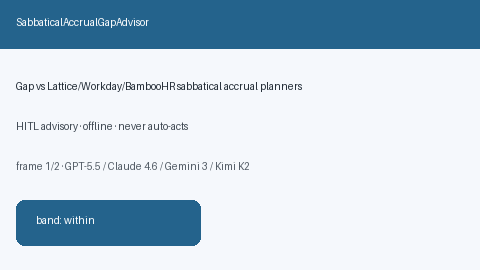

# SabbaticalAccrualGapAdvisor Guide



Offline HITL helper for `offered_months` bands.
Gap vs Lattice/Workday/BambooHR sabbatical accrual planners. Distinct from `SabbaticalEligibilityAdvisor` / `PtoCarryoverCapGapAdvisor`.

Optional polish via **GPT-5.5 / Claude Sonnet 4.6 / Gemini 3.x / Kimi K2**.

## Usage

```python
from autoapply_agent.services.sabbatical_accrual_gap import SabbaticalAccrualGapAdvisor

report = SabbaticalAccrualGapAdvisor().advise(
    offered_months=50.0,
    needed_months=100.0,
)
assert report.requires_human_review is True
assert report.auto_approve is False
print(report.coverage_band)
```

## Safety

Advisory only. No network I/O. Never auto-acts. Humans decide.
