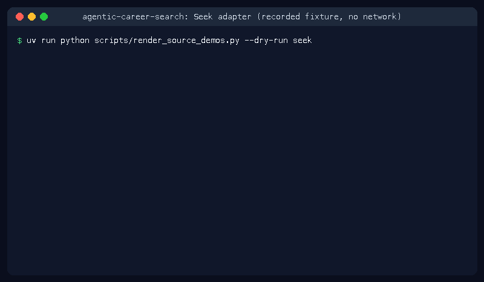

# Seek Source Guide



Use this guide when wiring a public Seek careers board into
**agentic-career-search**. Discovery is deterministic HTML URL-shape matching;
enrichment with GPT-6 Astra / Claude Opus 5.5 / Gemini 4 Argon / Kimi K3.1 Pro is optional
and runs after candidates are collected.

## Why Seek

Seek is the dominant ANZ job board covered by JobSpy-style scrapers but missing from this repository's adapter set; this adapter adds deterministic HTML discovery under ADR-077.

## Usage

```bash
curl -X POST localhost:8000/source-configs \
  -H 'content-type: application/json' \
  -d '{
    "name": "seek-jobs",
    "source_type": "seek",
    "base_url": "https://www.seek.com.au/jobs"
  }'
```

The per-source job cap is the global `MAX_JOBS_PER_SOURCE` setting (default `50`);
source configs have no `max_jobs` field.

## Recognised URL shapes

| Prefix | Example |
|---|---|
| `/job/{id}` | `/job/49102` |
| `/jobs/{id}` | `/jobs/56213` |
| `/listed-job/{id}` | `/listed-job/62324` |
| `/jobsearch/{id}` | `/jobsearch/73435` |
| `/au/job/{id}` | `/au/job/84546` |

## Ignored paths

Board indexes (`/job`, `/jobs`, `/listed-job`, `/jobsearch`, `/au/job`),
apply/login/signin/application/about/index pages, and navigation links are
filtered out automatically.

## See also

- [ADR-192](../adr/ADR-192-seek-source-adapter.md)
- [ADR-077](../adr/ADR-077-deterministic-html-discovery.md) (deterministic discovery policy)
