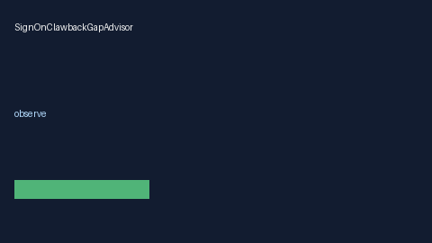

# SignOnClawbackGapAdvisor Guide



Offline HITL advisor. Never auto-acts. Closes closed-UI gaps vs Levels.fyi/Blind/Rippling sign-on clawback planners (distinct from related advisors).

Optional later polish via **GPT-5.5 / Claude Sonnet 4.6 / Gemini 3.x / Kimi K2**.

Distinct from `RetentionBonusCliffAdvisor` / `RelocationRepayment` style cash planners.

## Usage

```python
from autoapply_agent.services.sign_on_clawback_gap import SignOnClawbackGapAdvisor

report = SignOnClawbackGapAdvisor().advise(
    clawback_months=100.0,
    needed_months=100.0,
)
assert report.auto_enroll is False
print(report.coverage_band)
```

## Safety

Always `requires_human_review=True`. No HTTP. Humans decide. See `SAFETY.md`.
