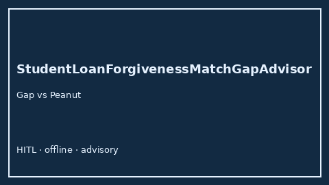

# StudentLoanForgivenessMatchGapAdvisor Guide



Offline HITL helper for `offered_usd` bands.
Gap vs Peanut Butter/Goodly/Gradifi student-loan forgiveness match planners. Distinct from `StudentLoanRepaymentGapAdvisor` / `TuitionReimbursementCapGapAdvisor`.

Optional polish via **GPT-5.5 / Claude Sonnet 4.6 / Gemini 3.x / Kimi K2**.

## Usage

```python
from autoapply_agent.services.student_loan_forgiveness_match_gap import (
    StudentLoanForgivenessMatchGapAdvisor,
)

report = StudentLoanForgivenessMatchGapAdvisor().advise(
    offered_usd=50.0,
    needed_usd=100.0,
)
assert report.requires_human_review is True
assert report.auto_approve is False
print(report.coverage_band)
```

## Safety

Advisory only. No network I/O. Never auto-acts. Humans decide.
