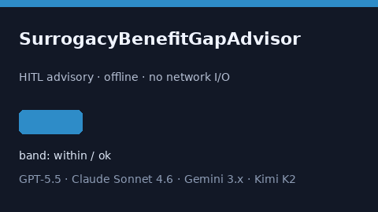

# SurrogacyBenefitGapAdvisor Guide



Offline HITL helper for `offered_days` bands.
Gap vs Carrot/Progyny/Kindbody surrogacy benefit planners. Distinct from `EggFreezingBenefitGapAdvisor` / `FertilityTravelStipendGapAdvisor`.

Optional polish via **GPT-5.5 / Claude Sonnet 4.6 / Gemini 3.x / Kimi K2**.

## Usage

```python
from autoapply_agent.services.surrogacy_benefit_gap import SurrogacyBenefitGapAdvisor

report = SurrogacyBenefitGapAdvisor().advise(
    offered_days=50.0,
    needed_days=100.0,
)
assert report.requires_human_review is True
assert report.auto_approve is False
print(report.coverage_band)
```

## Safety

Advisory only. No network I/O. Never auto-acts. Humans decide.
