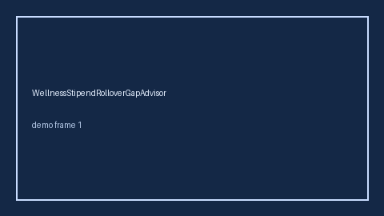

# WellnessStipendRolloverGapAdvisor Guide



Offline helper.
Gap vs Rippling/Lattice/Wellhub wellness stipend year-end rollover planners. Distinct from `WellnessStipendGapAdvisor` / `GymMembershipGapAdvisor`.

Stack: **GPT-5.5 / Claude Sonnet 4.6 / Gemini 3.x / Kimi K2**.

## Usage

```python
from autoapply_agent.services.wellness_stipend_rollover_gap import (
    WellnessStipendRolloverGapAdvisor,
)

report = WellnessStipendRolloverGapAdvisor().advise(
    offered_usd=50.0,
    needed_usd=100.0,
)
assert report.requires_human_review is True
assert report.auto_approve is False
print(report.coverage_band)
```

## Safety

Advisory only. No network I/O. Never auto-acts. Humans decide.
