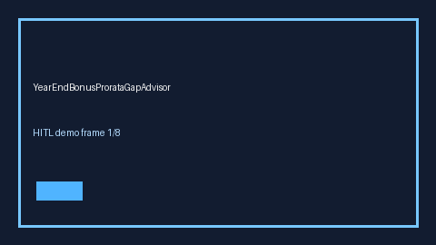

# YearEndBonusProrataGapAdvisor Guide



Offline HITL advisor. Never auto-acts. Closes closed-UI gaps vs Levels.fyi/Blind/Rippling year-end bonus pro-rata planners (distinct from related advisors).

Optional later polish via **GPT-5.5 / Claude Sonnet 4.6 / Gemini 3.x / Kimi K2**.

Distinct from `PerformanceBonusTargetGapAdvisor` / `RetentionBonusCliffAdvisor`.

## Usage

```python
from autoapply_agent.services.year_end_bonus_prorata_gap import YearEndBonusProrataGapAdvisor

report = YearEndBonusProrataGapAdvisor().advise(
    prorata_pct=100.0,
    target_pct=100.0,
)
assert report.auto_enroll is False
print(report.coverage_band)
```

## Safety

Always `requires_human_review=True`. No HTTP. Humans decide. See `SAFETY.md`.
