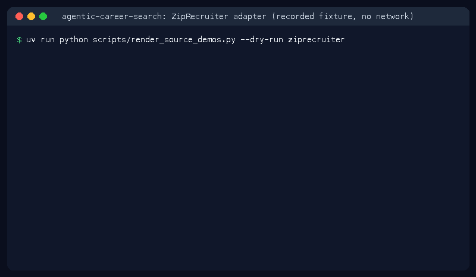

# ZipRecruiter Source Guide



Use this guide when wiring a public ZipRecruiter careers board into
**agentic-career-search**. Discovery is deterministic HTML URL-shape matching;
enrichment with GPT-6 Astra / Claude Opus 5.5 / Gemini 4 Argon / Kimi K3.1 Pro is optional
and runs after candidates are collected.

## Why ZipRecruiter

ZipRecruiter is a major US job board covered by JobSpy-style aggregators but missing here; this adapter adds deterministic HTML discovery under ADR-077.

## Usage

```bash
curl -X POST localhost:8000/source-configs \
  -H 'content-type: application/json' \
  -d '{
    "name": "ziprecruiter-jobs",
    "source_type": "ziprecruiter",
    "base_url": "https://www.ziprecruiter.com/jobs"
  }'
```

## URL shapes

| Shape | Example |
|---|---|
| Jobs | `/jobs/{id}` |
| Job | `/job/{id}` |
| Listings | `/listings/{id}` |
| Openings | `/openings/{id}` |
| Positions | `/positions/{id}` |

Board index pages, apply/login steps, about/index links, and navigation links
are ignored.

## Safety

- Public HTML only — no authenticated APIs or credential storage.
- Apply/login/signin/about/index paths are excluded from discovery.
- Optional LLM enrichment is bounded by the shared safety policy.
